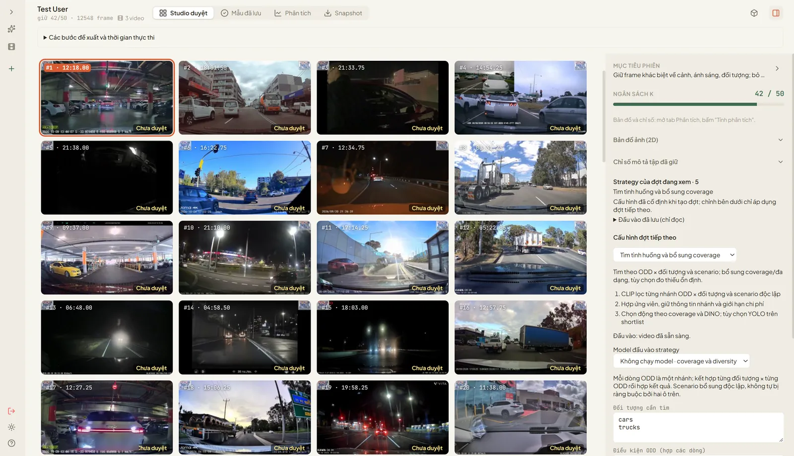
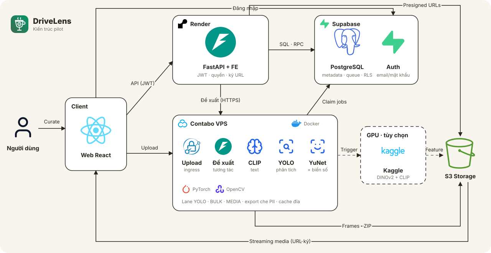

# DriveLens — Video Frame Curation cho ADAS & Robotics

DriveLens (mã đề tài RAV-26, team P-026) giúp kỹ sư Data/ML chọn frame dashcam đáng gán nhãn trong ngân sách:
upload video → tách ảnh/đặc trưng → đề xuất theo strategy → keep/drop → snapshot đóng băng → export đã che PII.
Không claim model accuracy tăng khi chưa có ground truth; confidence/coverage chỉ là evidence để người duyệt quyết định.

- **App:** [c4-app-026.onrender.com](https://c4-app-026.onrender.com) (landing) · [/app](https://c4-app-026.onrender.com/app) (Studio)
- **Repo:** [GitHub](https://github.com)
- **Tài khoản:** tự đăng ký email/mật khẩu (có xác nhận email). Hoặc bấm **Nạp tài khoản demo** trên `/login` (`demo123@aiia.com`, quota/phiên dùng chung, dùng dữ liệu mẫu).



## Tính năng đang live

| Màn hình | Làm gì |
|---|---|
| Kho dữ liệu | **Dữ liệu của tôi / Dữ liệu mẫu** (video + model); upload lớn qua ingress VPS có resume, tiến trình giữ khi chuyển màn |
| Studio phiên | Lưới ảnh 4 fps, viewer ảnh + clip ±3 s, keep/drop/undo, đề xuất tương tác (`random/uniform/diversity/text_diversity`) |
| Strategy nền | `odd_coverage` (CLIP gate + DINO coverage), `perception_instability` (YOLO), model-guided…; hiện bước chạy và thời gian thật |
| Phân tích | YOLO trên ảnh đề xuất với model đã xác minh, metrics theo ngữ cảnh |
| Export | Snapshot → che mặt/biển số (YuNet + plate) → owner xác nhận đúng hash → ZIP private |
| Operations (admin) | Tổng quan, dữ liệu mẫu (tham chiếu chỉ đọc), tác vụ, nhật ký; upload/verify model `.pt` |

Giới hạn còn mở (GPU Kaggle thật, capacity nhiều người, 5 GiB, recall PII) ghi ở [deployment status](docs/setup/DEPLOYMENT_STATUS.md).

## Kiến trúc



Browser React → Render (FE + FastAPI nhẹ, cùng origin) → Supabase (Auth, PostgreSQL metadata/queue/quota/RLS) và S3 private.
Contabo chạy upload ingress, TEXT FastAPI cho đề xuất tương tác và các worker lane YOLO/BULK/MEDIA; Kaggle GPU tùy chọn.
Chi tiết: [architecture](docs/architecture_diagram.md), [CONTRACTS](docs/design/CONTRACTS.md), [docs index](docs/README.md), [PLAN](PLAN.md).

| Thư mục | Nội dung |
|---|---|
| `src/web` | React/Vite FE: landing, login, Studio, Operations |
| `src/rav/api` | FastAPI pilot (`pilot.py`, `routes_v2.py`), auth JWT, upload VPS, proxy interactive |
| `src/rav/store` | Adapter PostgreSQL/S3 và migrations (`store/migrations`) |
| `src/rav/worker` | Supervisor, lanes, dispatcher, handlers (upload/frames/proposal/YOLO/export/PII/GPU) |
| `src/rav/core`, `components`, `pipeline` | Context/Strategy/registry và thuật toán dùng chung |
| `deploy`, `Dockerfile` | Target `combined` (Render) và `worker` (Contabo), env mẫu |

Tên định danh kỹ thuật (`src/rav`, biến `RAV_*`, bảng `rav_pilot_*`, image `rav26`) giữ nguyên để không vỡ deploy/dữ liệu.

## Cài đặt

Python 3.12, Node theo `src/web/package.json`, Docker Linux containers nếu build image.
Windows chạy storage setup trong mỗi terminal trước Python/npm/test để cache/temp nằm trong `data/`/`output/`:

```powershell
. .\scripts\use_project_storage.ps1
python -m venv .venv
.\.venv\Scripts\Activate.ps1
pip install -r requirements.txt
cd src/web; npm ci
```

Env mẫu: `.env.example`, `deploy/*.env.example`; credential đúng role, không copy `.env` vào FE/image/Git.
Agent đọc [AGENTS](AGENTS.md) → PLAN → guide → contract của lát.

## Kiểm tra và chạy

```powershell
. .\scripts\use_project_storage.ps1
python -m pytest tests -q --basetemp=output/pytest-tmp
python -m ruff check src tests
cd src/web; npx tsc --noEmit; npx vitest run
```

Test pilot transaction/RLS cần PostgreSQL test thật ([runbook §6](docs/setup/PILOT_RUNTIME_RUNBOOK.md)), không dùng DB production.
Agent chỉ có repo: [Dev/CI guide](docs/setup/DEV_CI_GUIDE.md) với `python scripts/check_dev.py`.
Chạy API/worker pilot cần env/roles/schema/policy/S3 theo runbook; boot không tự seed/migrate.
Release: [Render](docs/setup/COMBINED_WEB_RELEASE.md), [Contabo](docs/setup/CONTABO_WORKER_RELEASE.md), [operations](docs/setup/OPERATIONS_RUNBOOK.md).

## Team và phạm vi

Team P-026 / IrishCoffee. [Product scope](docs/PRODUCT_STORY.md), [alignment](docs/design/RAV26_ALIGNMENT.md),
[decision log](docs/research-pack/06_project_state/01_confirmed_decisions.md). Training/gán nhãn nằm ngoài hệ thống.
License theo file LICENSE. Ảnh minh họa trên landing/README trích từ video dashcam công khai của
[Dashcam Owners Australia](https://dashcamownersaus.com.au) (giữ watermark), chỉ dùng minh họa phi thương mại.
