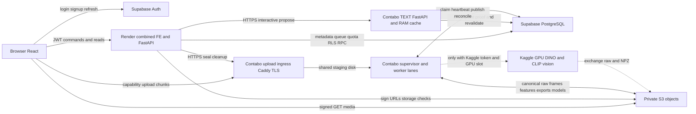
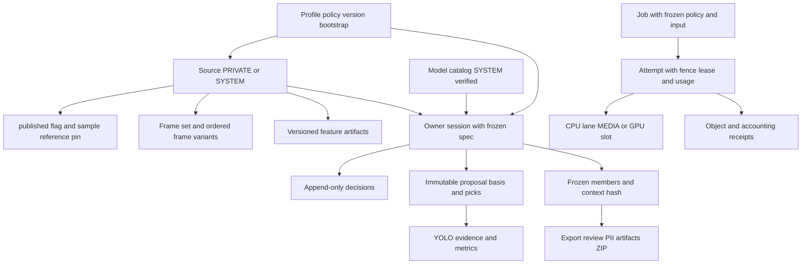
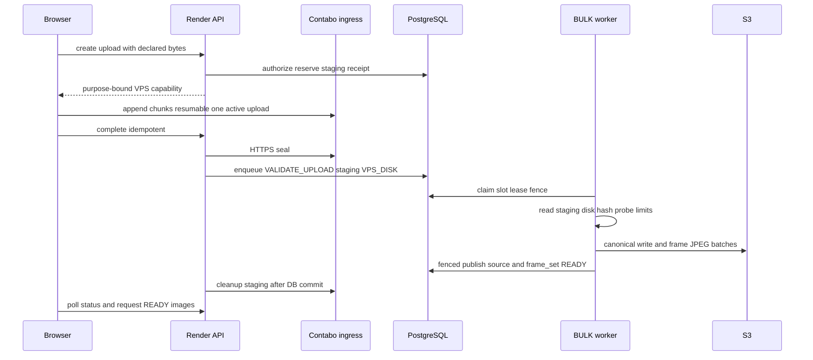
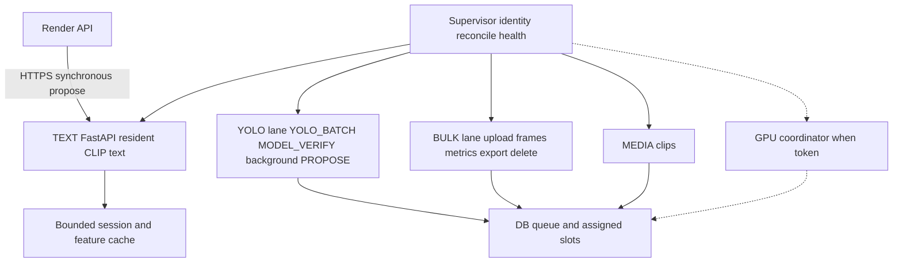

# Architecture — DriveLens (RAV-26) deployment

Cập nhật 2026-10-17 theo live source `fc53ed8` (Render combined + Contabo worker, Supabase migrations 001–027).
Thiết kế cấp 2 cùng [CONTRACTS](design/CONTRACTS.md) và [UI](design/UI_DESIGN.md); tài liệu này mô tả thiết kế đã chốt,
không thêm topology/service/schema mới. [Status](setup/DEPLOYMENT_STATUS.md) giữ digest/policy/evidence vận hành.
§21 CONTRACTS là pilot; core §1–18 vẫn dùng bởi worker. [Kiến trúc local/lịch sử](archived/2026-10-13/docs/architecture_diagram.md)
giữ DTO/API v1 và component diagrams cũ.

## 1. High level: vị trí và trách nhiệm

Sơ đồ trên dùng chung cho landing/README; Mermaid bên dưới là bản chi tiết theo boundary.

Render xác thực/quyền, metadata/commands, ký URL, gọi RPC và phục vụ FE cùng origin; không decode/inference dài trong HTTP,
không đọc filesystem VPS. Contabo nhận upload bytes và PROPOSE tương tác qua HTTPS; job dài pull từ DB queue.
PostgreSQL là authority cho trạng thái/quota/slot/receipt; S3 chứa bytes private; cache worker chỉ là bản tăng tốc dựng lại được.

| Boundary | Live | Hướng tới / gate mở |
|---|---|---|
| Web | Một Docker target combined: React build + FastAPI/Uvicorn nhẹ trên Render | Release CI gate; không chuyển ML vào threadpool |
| Upload | Browser → ingress Contabo → đĩa VPS → canonical S3 (§21.27, #139); trần 5 GiB/60 phút | Benchmark 5 GiB, browser file-picker acceptance |
| CPU/media | TEXT HTTP/RAM; lanes YOLO/BULK/MEDIA durable; supervisor (§21.22/25/26) | Mixed-load/multi-user capacity |
| Host | Contabo 4 vCPU/~8 GiB, container cap 4 CPU/6 GiB | Cost/benchmark video dài |
| GPU | Code lifecycle/quota/feature artifact có; lane chỉ claim khi có `KAGGLE_API_TOKEN` + slot | Kaggle cloud acceptance chưa đạt; dữ liệu mẫu dùng feature import sẵn |
| Export/PII | EXPORT_BUILD/FINALIZE, YuNet + plate, owner confirm hash, ZIP S3 (§21.8); smoke 3 mẫu | Recall PII, capacity |

## 2. Data model và ownership

Source UUID dùng catalog/API, core_source_id/Unit IDs dùng thuật toán; ánh xạ theo §21.2, không đổi ID từ timestamp ước lượng.
Session spec/grid cố định; recipe/strategy đổi theo vòng. Decision append-only + replay; proposal đóng băng config/seed/context/features/basis.
Snapshot giữ members/context hash và provenance; không thay thành thư mục ảnh mutable.

PRIVATE thuộc owner; SYSTEM chỉ đọc. Kho **Dữ liệu của tôi / Dữ liệu mẫu** (§21.35): cờ `published` tách khỏi trạng thái xử lý;
RLS `p_source_read`/`p_model_read` cho chọn mới khi `published = true`, phiên/snapshot đã tạo vẫn đọc được nguồn của nó.
Backend role vẫn kiểm owner/scope khi ghi. Templates shared chỉ đọc; fork tạo phiên riêng trống, không copy decisions/proposals.

Hồ sơ (§21.34): `/me` → `PilotDB.ensure_profile` tạo idempotent profile + storage account theo signup policy tường minh;
thiếu/sai → `503 policy_unconfigured`, không sửa profile cũ hoặc mở lại tài khoản bị khóa. Migration 026 tắt insert của trigger legacy.

## 3. Artifact, exact pixels và cache

| Loại | Durable authority | Consumption |
|---|---|---|
| Raw video | Canonical S3 + metadata/SHA receipt | Clip, ML cần pixel và export đọc exact frame từ raw, disk cache bounded |
| Thumbnail/frame | READY frame_set + frame_idx/variant/SHA S3 | API lookup/URL ký, không decode video và không xếp RENDER_MEDIA ảnh |
| DINO/CLIP vision/pHash | Artifact version/producer/model/spec/source hash | Proposal/metrics đọc features cache-only theo binding, không prepare ngầm |
| Checkpoint YOLO/PII | Verified model SHA/runtime/provenance | Cache disk + resident model LRU một entry/process |
| Results | Proposal/evidence/metric/export DB + object receipts | Reload đọc kết quả, không tự inference lại |

Grid mặc định pyav 4 fps + per_frame; frame_idx/order theo decoder, không bảo đảm đúng bốn frame/giây với fps thấp/VFR.
Chưa có chọn scene/keyframe/blur. Frame S3 là preview; exact pixel inference theo raw anchor để không đổi semantics.
Disk cache khóa theo SHA/version, cap/eviction theo §21.20; cache vector CLIP text theo prompt/model/revision trên đĩa (§21.40).
Cache miss có thể đọc S3, hit dùng local. Không có Redis/FAISS shared cache đã deploy.

Mẫu tham chiếu chỉ đọc (§21.39, migration 027): operator chọn nguồn riêng READY → RPC transactional tạo metadata SYSTEM ẩn
+ alias frame/feature trỏ đúng S3 key cũ + backing reference/pin bất biến. Không S3 COPY/compute/job/charge; backing không xóa được
khi còn tham chiếu, ẩn mẫu không nhả pin. Endpoint copy §21.38 trả `410 sample_copy_retired`; handler cũ chỉ còn để hủy/dọn job dở.

Bronze/silver/gold chỉ mô tả lineage raw → prepared artifacts → curated snapshot/report; không thêm ba kho.

## 4. Upload và readiness

Truyền 100% chỉ là bytes tới ingress. READY còn kiểm hash/probe/limits/canonical/frame storage/publication.
Object intent/receipt + storage reservation bền trước nhận bytes; staging hold chỉ nhả sau cleanup verified.
Browser POST/MULTIPART thẳng S3 (§21.27, part 16 MiB) giữ làm transport cũ. `GET /api/v2/uploads` + upload manager
cấp ứng dụng giữ tiến trình khi chuyển màn, khôi phục `VALIDATING`, nhắc chọn lại file `CREATED` sau reload.

Upload không tự chuẩn bị DINO/CLIP. Nguồn legacy thiếu ảnh → NOT_PREPARED, user PREPARE_FRAMES explicit.
Upload SYSTEM của admin (§21.36): `target_scope='SYSTEM'`, `account_scope='GLOBAL_ONLY'`, nguồn/frame_set/artifact `owner_id=NULL`,
upload/job giữ owner admin; xuất bản qua catalog admin sau readiness. Importer operator giữ dry-run/inventory/lock/COMMITTED.

## 5. Media, proposal và inference

**Media:** auth/source status/frame grid → READY lookup → URL ký → Browser GET S3. Thiếu ảnh không tạo decode job.
Clip ±3 giây: cache READY hoặc RENDER_MEDIA trên MEDIA → S3 receipt → publish → poll URL. Viewer giữ ảnh khi clip tải/lỗi.

**Proposal — hai đường theo catalog `background`:**

| Đường | Recipe/strategy | Luồng |
|---|---|---|
| Tương tác (§21.26) | `random`, `uniform`, `diversity`, `text_diversity` | Browser → Render JWT → Contabo TEXT FastAPI → RAM context → response trực tiếp |
| Nền (§21.32) | `odd_coverage`, `perception_instability`, `context_uncertainty`, `reference_diversity`, `model_guided`, `text_model_guided` | `POST /proposals` → job PROPOSE durable trên lane YOLO → Strategy → publish owner/CAS/lease |

Tương tác: keep/drop/undo ở browser; Đề xuất tiếp gửi full decisions + previous_batch_id. Render lấy proof từ Contabo rồi
checkpoint RPC/CAS trong một DB transaction, chỉ lưu batch service xác nhận. Retry cùng request_id replay checkpoint/response;
compute lỗi sau commit trả checkpoint. Public proposal chỉ mang scores/evidence của batch picks; trace giữ count thay candidate IDs.
Feature thiếu → `feature_not_ready`, không ngầm chạy vision encoder. Revalidate 15 s, TTL/cache bounds §21.26.
Khi direct mode bật, recipe tương tác gọi qua queue bị từ chối `409 interactive_required`; không fallback queue sau lỗi HTTP.
Tối đa một request/user, hai interactive toàn service, bận → 429; không CPU attempt/slot cho PROPOSE tương tác.

Nền: API/catalog chọn Strategy, đóng băng public params/resources; worker dựng Context an toàn, Strategy sở hữu thuật toán nhiều bước.
Frontend checkpoint batch tạm trước enqueue và refresh RAM interactive sau job để lịch sử/số batch khớp DB.
`odd_coverage` (§21.37/40): frozen metadata → Context metadata-only khi không detector (không tải raw) → NPZ cache + IDs verified
→ cache vector CLIP text theo prompt → CLIP contrast gate/branch union → shortlist → DINO coverage → TTA model tùy chọn.
Phase timings bounded qua `progress_detail`; FE hiện bước thật/cache, hủy kiểm trước/giữa I/O. Không thêm service/schema.
Perception Instability (§21.31) dùng model detect đã xác minh, chia dispatcher/slot YOLO, exact-frame inference theo thời gian.

**Text/model:** CLIP text+projection cùng revision/tokenizer/float32/L2 đã parity; giữ CLIP vision space cũ. SigLIP2/PE-Core là research,
không mix không gian embedding hoặc copy threshold. YOLO_BATCH explicit chạy anchors của proposal với checkpoint SHA verified;
cache cùng basis không double-charge. METRICS explicit theo context; confidence là evidence, không chứng minh accuracy.

**Model tham chiếu (§21.33):** admin (`RAV_PILOT_OPERATOR_IDS`) → presigned POST `.pt` vào staging → API HEAD → `MODEL_VERIFY`
(lane YOLO) tải giới hạn + SHA, chạy thử Ultralytics pin, PUT canonical theo SHA → model SYSTEM `INFERENCE_VERIFIED`.
API không unpickle model; user chỉ chọn model đã xuất bản. Model riêng từng người là Hướng tới.

## 6. Worker concurrency, quota và recovery

`RAV_PILOT_CPU_LANES` partition đủ CPU kinds: TEXT `PROPOSE` (HTTP khi `RAV_INTERACTIVE_ENABLED=1`), YOLO `YOLO_BATCH/MODEL_VERIFY`
(+ PROPOSE nền), BULK `VALIDATE_UPLOAD/PREPARE_FRAMES/METRICS/EXPORT_BUILD/EXPORT_FINALIZE/DELETE_SOURCE`. Cấu hình mẫu ở
[compute runtime](setup/COMPUTE_RUNTIME.md). Claim + process identity + frozen policy trong một DB call (§21.25).
Mỗi lane một attempt/slot; preflight kiểm slots/cgroup/thread/RSS budgets; model cache có RSS cap/watchdog; container hard cap 4 CPU/6 GiB.

Claim CAS/SKIP LOCKED/fairness và profile lock; `heavy_active_per_user` áp cho slot CPU/GPU, MEDIA riêng.
CPU/storage accounting tắt theo policy hiện hành; CPU usage chỉ telemetry/recovery. GPU owned-session wall-time quota/holds/receipt giữ;
job policy cũ tất toán theo snapshot cũ. Queue wall-time và process CPU ms khác nhau; ETA cần benchmark.

Heartbeat/lease/fence chặn stale publish; supervisor đối soát PID/start token/boot identity. Lease/cancel/kill chưa chứng minh dừng
→ UNKNOWN/quarantine, không trả slot/hold/pin sớm. Kaggle launch/session UNKNOWN giữ ownership để đối soát.
Process chết restart có backoff; crash loop thoát cho Docker restart; health kiểm identity, không thay DB/S3/cloud smoke.

## 7. Xóa và export

Xóa (§21.29): owner/protected/RESTRICT/CAS → DELETE_PENDING/job + frozen inventory → preflight fence/lease → S3 DELETE/HEAD
**ngoài transaction giữ khóa** → transaction kiểm lại fence/lease/cancel → receipt. Chỉ publish tombstone khi mọi key sạch;
partial/cancel giữ pending để recovery. Chỉ trừ byte từng được tính; không xóa source còn referenced hoặc đang là backing mẫu.

Export (§21.8): snapshot frozen → EXPORT_BUILD đọc exact FRAME → RGB resize ≤ 640 → YuNet + plate → scale box → redact ảnh gốc
→ cache PRIVATE `EXPORT_PREVIEW/PII_REDACTED` (ảnh + evidence manifest, fenced publish, tái dùng đúng input/model/config)
→ report/preview/payload_hash → owner confirm đúng hash (sai → 409) → EXPORT_FINALIZE ZIP private S3 → URL ký.
Không dùng export local để bypass PII hoặc coi chọn dữ liệu là model accuracy report.

## 8. Security và operations

JWT Supabase verified issuer/audience/JWKS; ActorContext server-derived, API không nhận owner/role từ body.
DB API/worker role riêng, DDL operator riêng; migrations immutable/checksum, boot không auto migrate hoặc fallback SQLite.
Presigned URL TTL ngắn + namespace owner; không public bucket/raw key trong DTO, không secret qua runtime-config.
Ingress upload: cert công khai, CORS, capability gắn mục đích, proxy tới listener Contabo có xác minh TLS.

Operations (`#operations`, operator allowlist): Tổng quan / Dữ liệu mẫu / Tác vụ / Nhật ký; `job_counts`, `queue_wait_ms`/`run_ms`,
log từ `rav_pilot_timing_event` theo keyset/cửa sổ, lọc `upload_id`/`job_id`/`request_id` (§21.19/36). Chỉ đọc trace/slot/quota/job,
không quyền private media người khác. Timing UTC + monotonic wall/process CPU; telemetry bounded, lỗi collector không phá nghiệp vụ.

## 9. Code map, deployment và verification

| Logic | Code / docs |
|---|---|
| Auth/v2/web | `src/rav/api/auth.py`, `routes_v2.py`, `pilot.py`, `interactive_proxy.py`, `vps_upload.py`, `web_static.py`; `src/web` |
| Metadata/queue/storage | `src/rav/store/pilot_db.py`, `pilot_runtime.py`, `pilot_uploads.py`, `pilot_vps_*`, `pilot_sample_reference.py`, các `pilot_*`; `store/migrations` |
| Worker | `src/rav/worker/__main__.py`, `supervisor.py`, `lanes.py`, `dispatcher.py`, `interactive.py`, `*_handlers.py`, `pii.py` |
| Shared compute | `core` Context/types/registry/`strategy.py`/`odd_coverage.py`; `service/proposal_jobs.py`; pipeline propose/batch_yolo; components |
| Packaging | `Dockerfile` targets combined/worker, `deploy/compose.worker.yml`, `render.yaml`, pinned requirements |
| Release | [Combined](setup/COMBINED_WEB_RELEASE.md), [Contabo](setup/CONTABO_WORKER_RELEASE.md), [runtime runbook](setup/PILOT_RUNTIME_RUNBOOK.md) |

Docker Linux dùng kernel host, weights/cache trên volume. Image size không là RSS. Candidate source/image/policy/migrations phải khớp
trước rollout; drain + backup + smoke + rollback. Publish/deploy và Git push cần cho phép riêng; docs refresh không thay live.
Kiểm [status](setup/DEPLOYMENT_STATUS.md) và [PLAN](../PLAN.md) trước khi nói ready; test mocked không thay cloud/model thật.

## 10. Tài khoản demo dùng chung

Live 2026-10-18 (§21.41): nút login chỉ điền thông tin demo công khai đã duyệt → Supabase password sign-in như cũ → `/me` bootstrap/signup
policy. Tài khoản thường dùng chung; không quyền operator, không bypass auth.

## 11. Hướng tới: giải pháp, không phải thiết kế đã deploy

A0 measurement → giảm round trip proposal/DB → mixed-load capacity → immutable cache → estimator/release envelope
→ reference/model binding/report → PII quality và label/retrain bên ngoài. Admin tạo phiên mẫu, model riêng từng người, admin policy editor.
SSE/events, placement/DB region, persistent GPU reuse, Redis/FAISS chỉ khi có evidence/design.
[Solutions](backlog/ARCHITECTURE_SOLUTIONS.md), [N1–N6](backlog/POST_BASIC_FLOW_DEVELOPMENT_PLAN.md).

## 12. Compatibility và lịch sử

Local v1 còn cho regression/CLI/evaluator; SQLite/local static/media/threadpool/export không là pilot authority.
Đường PROPOSE queue cũ (#131 publish RPC §21.24) chỉ chạy khi direct mode tắt. Legacy §19–20 cloud-local transport giữ semantics
compatibility, không thay §21. Khi sửa shared signatures đọc CONTRACTS §1–18 và
[component guides archived](archived/2026-10-13/docs/components/README.md). Không lấy lịch sử plan/image/test để cấu hình live.
