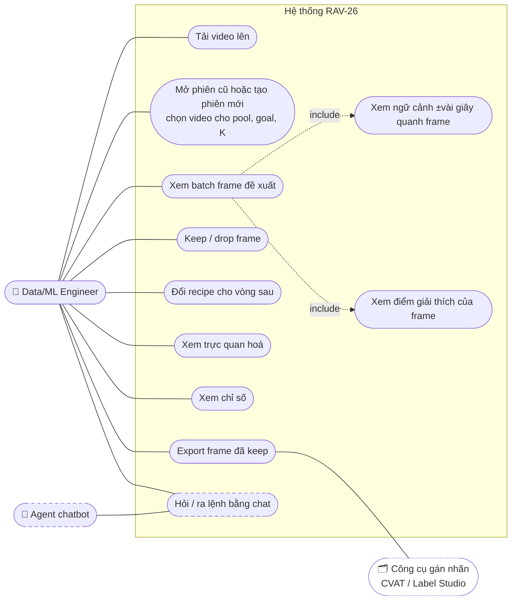
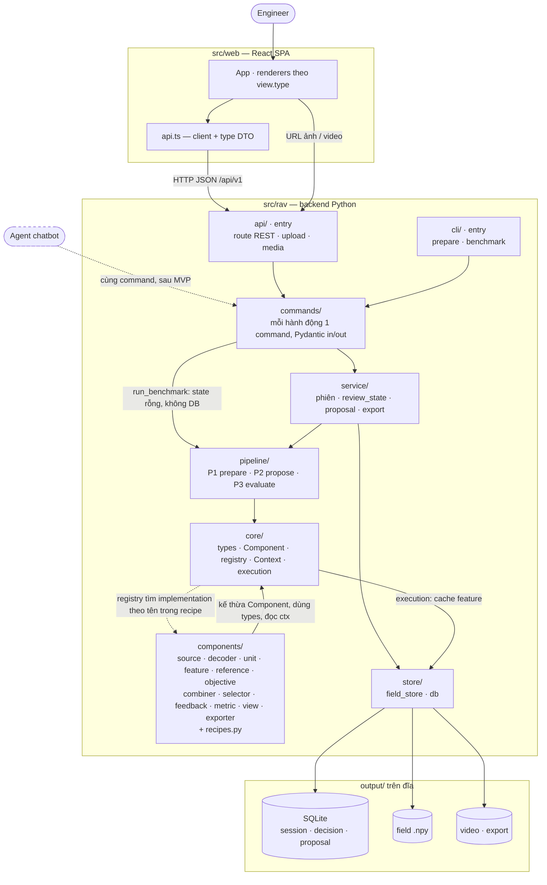
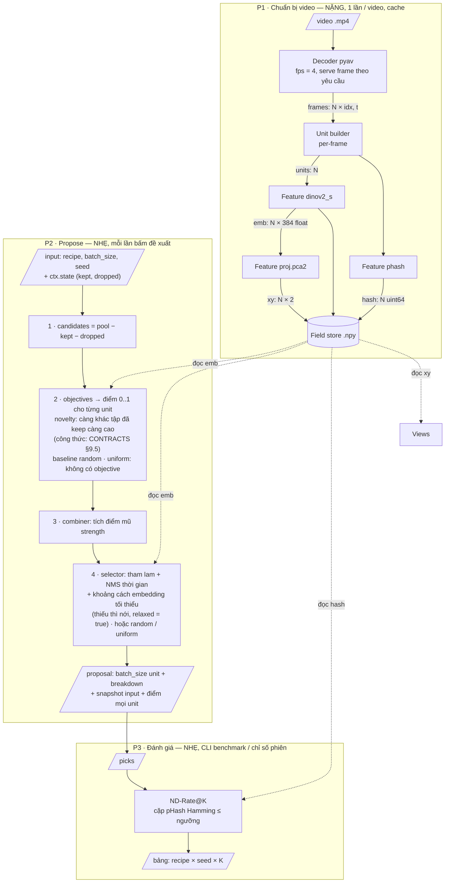
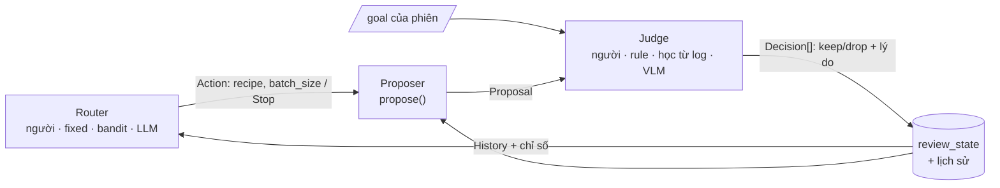
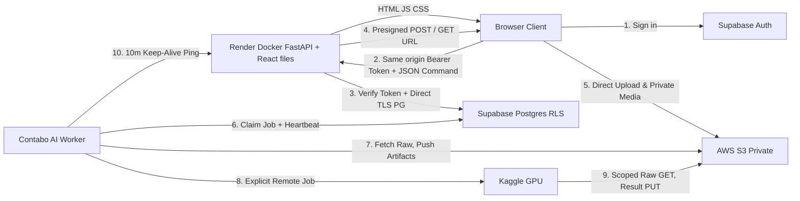
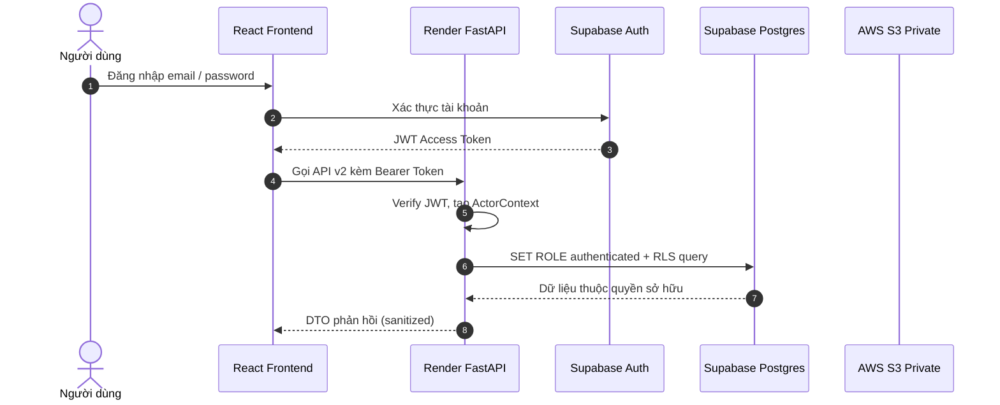
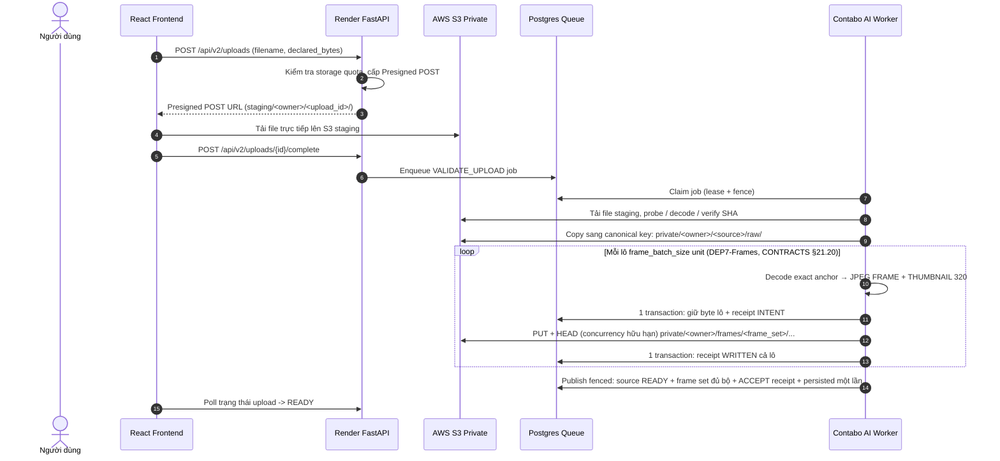
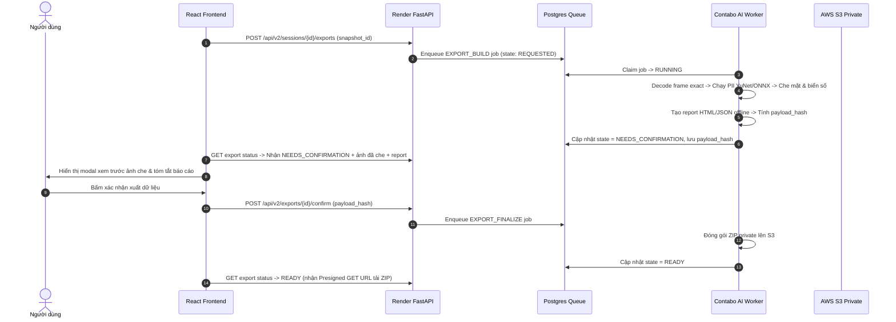

# Architecture — RAV-26 Video Frame Curation

> ⚠️ **MVP là bản 1 người dùng, chạy local.** Trước khi deploy/host cho nhiều người (kể cả Live URL Demo Day), đọc [design/LOCAL_SINGLE_USER_LIMITS.md](../../../design/LOCAL_SINGLE_USER_LIMITS.md).

> File này + [design/CONTRACTS.md](../../../design/CONTRACTS.md) là thiết kế **code phải theo** (thứ bậc nguồn sự thật: [README.md](../../../README.md)).
> Công thức và chữ ký chỉ ghi ở CONTRACTS; file này mô tả tầng, luồng, API. Thay đổi từ 2026-09-29: log quyết định #24 trở đi.
> Phạm vi MVP: **1 người dùng, 1 video, chạy local**. Nét đứt trong sơ đồ = đã chừa chỗ, chưa làm.
> §8 là **gợi ý tối ưu**, không phải cam kết thực hiện.

## 1. Use case



Benchmark so baseline (ND-Rate@K) chạy bằng **CLI**, không cần UI trong MVP.

## 2. Tổng quan hệ thống

Mỗi hộp trong `src/rav/` là **một thư mục** ở §9. Mũi tên liền = **chiều import được phép** (A → B: A được import B).
Mũi tên nét đứt = không import, chỉ tra cứu lúc chạy hoặc chừa chỗ.



**Đọc sơ đồ theo một lần bấm "Đề xuất":** FE gọi `POST /proposals` → `api` gọi command `propose` → `service` đọc state trong DB,
dựng `Context` → `pipeline.propose` chạy objective / combiner / selector mà recipe gọi tên → `core` tìm các component đó trong registry,
tính hoặc đọc cache feature qua `store` → proposal quay ngược lên, `service` lưu lại, `api` trả `ProposalDTO`.

**Luật import** (mỗi lát tự kiểm: không có import nào ngược chiều bảng này):

| Thư mục | Được import | Không được import | Vì sao |
|---|---|---|---|
| `api/` | `commands/` (cả media: command `get_video_file` tra `video_id` → file, #49) | `service/`, `pipeline/`, `components/`, `store/` | UI và agent phải đi qua cùng command (CONTRACTS §11.1) |
| `cli/` | `commands/` | các tầng dưới | như trên |
| `commands/` | `service/`, `pipeline/` (benchmark), `core/` (registry cho `list_recipes`) | `store/` trực tiếp | command chỉ là vỏ Pydantic |
| `service/` | `pipeline/`, `core/`, `store/` | `components/` trực tiếp | chọn frame là việc của pipeline |
| `pipeline/` | `core/` | `components/` trực tiếp, `store/db` | component lấy qua registry theo tên → đổi recipe không sửa pipeline; P2 không đọc DB |
| `core/` | `store/field_store` (execution) | `components/` (chỉ auto-discover lúc khởi động) | lõi không biết implementation cụ thể |
| `components/` | `core/` | component khác, `store/`, `service/` | không gọi chéo, chỉ qua `ctx` (CONTRACTS §1) |
| `store/` | `core/types` | mọi tầng khác | chỉ lưu và đọc |

## 3. Tách Frontend / Backend

| Nguyên tắc | Cách làm trong MVP |
|---|---|
| FE chỉ biết HTTP contract | Không share code Python ↔ TS; nguồn sự thật là Pydantic model → OpenAPI của FastAPI |
| Type TS | Viết tay theo §5.3 (ít DTO); sinh bằng `openapi-typescript` khi API lớn lên |
| Có version | Route dưới `/api/v1` |
| Chạy độc lập | FE dev server proxy `/api`, `/media` sang BE; demo có thể để BE phục vụ luôn FE build |
| **BE giữ state, FE xem và sửa state** | `review_state` (kept/dropped) lưu ở BE; FE đọc bằng `GET .../state`, sửa bằng `PATCH .../state` |
| Input/output thuật toán luôn nhìn thấy | Mỗi proposal trả kèm **đúng input đã dùng** (recipe đầy đủ, kept/dropped lúc tính, batch_size, seed) |
| Media tách khỏi JSON | JSON chứa URL; ảnh/video phục vụ bằng static files (có sẵn hỗ trợ Range để tua) |
| Thiết kế giao diện | Bố cục, màn hình, token, thành phần dùng chung, cách giữ state ở FE: [`design/UI_DESIGN.md`](../../../design/UI_DESIGN.md) (#57) |

## 4. Pipeline thuật toán

### 4.1. Thuật ngữ

| Tên | Nghĩa | Ai tạo / sửa |
|---|---|---|
| **`recipe`** | *Cách* đề xuất: objective nào + trọng số, cách gộp, selector + tham số | Khai báo trong code `src/rav/components/recipes.py` (công thức ghép, CONTRACTS §7); FE chọn và có thể override tham số |
| **`review_state`** | *Kết quả duyệt* của phiên: `kept_ids`, `dropped_ids` (+ lịch sử quyết định) | Người dùng, qua FE → BE |
| **`proposal`** | *Kết quả* một lần đề xuất: `batch_size` frame + điểm, kèm snapshot input | Thuật toán (BE) |
| **`target_k`** (K) | **Ngân sách**: tổng số frame muốn chọn ra trong phiên; lặp các vòng tới khi `kept = K` | Người dùng, khi tạo phiên |
| **`batch_size`** | Số frame đề xuất mỗi vòng cho người duyệt | Người dùng / Router, mỗi vòng |
| **`unit`** | Thứ được đề xuất; MVP = 1 frame (có `t` và ảnh) | Pipeline chuẩn bị video |
| **`field`** | Một kết quả tính cho mọi unit: embedding, pHash, toạ độ 2D | Feature (BE), cache theo `per_sample` (CONTRACTS §3): theo video hoặc theo pool |
| **`pool` / `candidates`** | pool = unit của phiên theo `PoolFilter` (chỉ thêm video, #56); candidates = pool − kept − dropped | Người dùng chọn pool khi tạo phiên |

### 4.2. Ba pipeline và vị trí của chúng



### 4.3. Input / output từng bước

| Bước | Input | Output | Độ nặng (ước lượng thô, **chưa đo**) |
|---|---|---|---|
| P1 Decoder | file video, `fps` | N `Frame` (`idx`, `t`) từ metadata; pixel decode khi feature hỏi, không lưu ảnh | Video 5 phút @4 fps ≈ 1.200 frame; decode tuần tự đi kèm bước feature |
| P1 `dinov2_s` | N ảnh | `emb` N × 384 float32 | **Bước nặng nhất**: N lượt forward ViT; CPU cỡ chục giây–vài phút |
| P1 `phash` | N ảnh | N × uint64 | Nhẹ |
| P1 `proj.pca2` | `emb` của cả pool (`per_sample=False`) | N × 2 | Nhẹ (PCA); tính khi tạo phiên, dùng chung giữa phiên cùng pool |
| P2 candidates | pool, kept, dropped | `candidates` (N_cand id) | Không đáng kể |
| P2 objective `novelty` | `emb[candidates]`, `emb[kept]` | N_cand điểm | N_cand × \|kept\| tích vô hướng → mili-giây với vài nghìn frame |
| P2 combiner | các mảng điểm + strength | N_pool điểm gộp | Không đáng kể |
| P2 selector | điểm gộp, `emb`, `t`, `batch_size` | `batch_size` chỉ số + breakdown | batch_size × N_pool → mili-giây |
| P3 ND-Rate@K | pHash của k pick | 1 số | k² phép so → không đáng kể |

**Kết luận kiến trúc:** chỉ **P1** nặng, và chỉ chạy một lần cho mỗi video → cache theo video, chạy đồng bộ kèm spinner là đủ cho MVP 1 video.
P2, P3 và view đều mili-giây → gọi đồng bộ mỗi lần bấm, không cần hàng đợi hay worker.
Khi nào phải đổi: video dài / nhiều video (P1 vượt timeout) → job nền; pool > ~100k frame → index ANN (FAISS) cho P2 (xem §8).

### 4.4. Chữ ký hàm lõi

```python
def get_score_candidates(recipe: RecipeConfig, ctx: Context) -> tuple[list[Unit], list[Scores], np.ndarray, np.ndarray]
    # candidates, điểm từng objective, combined, mask — chỉ lấy điểm, không chọn
def propose(recipe: RecipeConfig, batch_size: int, seed: int, ctx: Context) -> Proposal
    # = get_score_candidates + selector
```

Hàm này không đọc DB. Kept/dropped lấy từ `ctx.state` — nguồn state duy nhất, không truyền thêm tham số.
Session service đọc `review_state` từ DB rồi dựng `ctx`; CLI benchmark dựng `ctx` với state rỗng.
Cùng input → cùng output (nhờ `seed`). `get_score_candidates` tách riêng để service lấy điểm của một vòng từ snapshot (`return_scores`)
mà không chép lại đoạn nối objective → combiner (CONTRACTS §7).

### 4.5. Ai ra quyết định: người, thuật toán hay AI

Vòng lặp có ba vai trò ([CONTRACTS §12](../../../design/CONTRACTS.md)): **Router** chọn làm gì tiếp, **Proposer** (`propose()`) đề xuất,
**Judge** keep/drop theo `goal` của phiên. MVP: người làm Router + Judge qua UI, và **mọi quyết định được ghi log đầy đủ**.
Vì input/output mỗi vai trò đã tường minh, sau này chỉ cần thêm một file judge/router (rule, học từ log, LLM/VLM)
để chạy mô phỏng hoặc tự động — không cần dựng kiến trúc mới.



| Chế độ | Router | Judge | Trạng thái |
|---|---|---|---|
| Thủ công | người | người | **MVP** (Web UI) |
| Gợi ý | người | algo/ai gợi ý, người xác nhận | ⏳ |
| Mô phỏng — đánh giá recipe không cần người | algo | algo | ⏳ (CLI) |
| Tự động | algo/ai | algo/ai đã kiểm chứng | ⏳ |

## 5. API contract (v1, MVP)

### 5.1. Quy ước

Mục 5 mô tả runtime **local `/api/v1`**; không dùng các URL/media/cache/local storage này như contract deploy. Target deploy ở §11, phiên bản/DTO chi tiết chờ D0 duyệt.

- JSON, `snake_case`, thời gian theo giây, id là string.
- Lỗi: `{"error": {"code": "...", "message": "..."}}` với HTTP 400/404/422/500. Sai kiểu dữ liệu request → 422 `validation_error`;
  lỗi không lường trước → 500 `internal_error` (không lộ chi tiết).
- Route **sinh từ một bảng** `(method, path, command)` trong `api/routes.py` + một handler chung: gom path param, query, body thành
  `Input` của command (CONTRACTS §11.1, #49). Command trả danh sách thì Output là mảng (`RootModel[list[...]]`), API trả nguyên như vậy.
- Ảnh frame (`get_frame`) trả kèm `Cache-Control: immutable` (`video_id` = hash nội dung → ảnh không đổi).
- **`session_id` = uid ngẫu nhiên**, không chứa thông tin dữ liệu. Dữ liệu của phiên do **`pool`** quyết định: bộ lọc trên bảng unit toàn cục
  (MVP: `{"video_ids": ["<1 video>"]}`). Cùng một pool có thể có nhiều phiên (vd để đánh giá nhiều cách duyệt).
- Thuật toán không phụ thuộc số video; 1 video là trường hợp n = 1. Video chỉ dùng để lọc pool, lọc hiển thị, và làm tham số nội bộ
  của component so thời gian ([CONTRACTS §13](../../../design/CONTRACTS.md)).
- Frame và field cache theo **video + cách tách frame** (`spec_hash`, CONTRACTS §3), dùng chung cho mọi phiên; field phụ thuộc cả tập
  (vd PCA) cache theo pool. `review_state` và proposal thuộc riêng từng phiên.
- Command đồng bộ trả kết quả trong request; command queue trả trạng thái rồi tính nền. Local tạo phiên có thể chạy P1 nếu chưa có cache; cloud video phải chuẩn bị explicit theo CONTRACTS §20, không lấy luồng đồng bộ local làm bypass GPU.
- **Upload** là cửa nhận dữ liệu từ ngoài: kiểm tra định dạng bằng cách mở thử file bằng decoder, giới hạn dung lượng (config),
  `video_id` = hash nội dung file (tải lại cùng file không tạo bản trùng). Theo C2/CONTRACTS §20, **upload chỉ lưu, không tự chạy P1/AI**. Người dùng gọi prepare DINO hoặc CLIP riêng; `GET /videos` trả tiến độ từng feature, FE hỏi lại vài giây một lần. Local queue dùng thread/App; cloud embedding có durable job như §19–20. Tạo phiên / thêm vào phiên với video đang chuẩn bị → 409 `video_preparing`.

### 5.2. Endpoint

| Method & path | Làm gì | Request | Response |
|---|---|---|---|
| `POST /api/v1/videos` | **Lưu video** vào kho/S3, không tự chạy feature (§20) — command `upload_video` | multipart: `file` | `VideoDTO` |
| `POST /api/v1/videos/{video_id}/prepare` | Xếp P1 chạy nền cho video chưa chuẩn bị (vd sau khi khởi động lại BE) — command `queue_prepare` | – | `VideoDTO` |
| `POST /api/v1/sessions/{sid}/videos` | Thêm video đã chuẩn bị vào pool của phiên — command `add_videos_to_session` (#56) | `{video_ids}` | `SessionDTO` |
| `GET /api/v1/videos` | Liệt kê video đã có — command `list_videos` | – | `VideoDTO[]` |
| `GET /api/v1/sessions` | Mọi phiên đã có (MVP chạy local, ít phiên → không cần bộ lọc) | – | `SessionDTO[]` |
| `POST /api/v1/sessions` | **Tạo phiên mới** (chạy P1 cho video nào trong pool chưa có cache) | `{pool, goal, target_k, name?}` | `SessionDTO` |
| `GET /api/v1/sessions/{sid}/units?video_id=` | Unit trong pool của phiên; `video_id` chỉ là bộ lọc hiển thị | – | `UnitDTO[]` |
| `GET /api/v1/sessions/{sid}` | **Mở lại phiên** | – | `SessionDTO` |
| `GET /api/v1/recipes` | Recipe có sẵn, kèm **config đầy đủ** + schema tham số | – | `RecipeDTO[]` |
| `GET /api/v1/components/{kind}/{name}` | Mô tả một component (docstring + schema Params) — command `describe_component` | – | `{kind, name, version, doc, params_schema}` |
| `GET /api/v1/sessions/{sid}/state` | **Xem** review_state | – | `ReviewStateDTO` |
| `PATCH /api/v1/sessions/{sid}/state` | **Sửa** review_state: keep / drop / bỏ quyết định | `{changes: [{unit_id, action, proposal_n?, shown_at?, reason?}]}`, `action` ∈ keep, drop, clear | `ReviewStateDTO` |
| `POST /api/v1/sessions/{sid}/proposals` | **Đề xuất** (chạy P2 trên state hiện tại) | `ProposeRequest` | `ProposalDTO` |
| `GET /api/v1/sessions/{sid}/proposals` | Lịch sử đề xuất | – | `ProposalDTO[]` |
| `GET /api/v1/sessions/{sid}/views/{name}` | Dữ liệu cho một biểu đồ — command `get_view` | query: params của view (khoá lặp → list) | `ViewSpec` |
| `GET /api/v1/sessions/{sid}/metrics` | Chỉ số phiên, metric mặc định — command `get_metrics` | query: `on` | `MetricsDTO` |
| `POST /api/v1/sessions/{sid}/metrics` | Chỉ số phiên với metric tự chọn (không ghi gì; POST vì cần body) | `{metrics?, on?}` | `MetricsDTO` |
| `GET /api/v1/sessions/{sid}/proposals/{n}/explain` | Giải thích cấp đợt (lý do theo mục tiêu, bổ sung gì so với tập đã giữ) — command `explain_proposal` (#61) | – | `ProposalExplainDTO` |
| `POST /api/v1/sessions/{sid}/evidence` | Bằng chứng hiển thị của các unit (detector / nhãn / telemetry), chỉ đọc cache — command `get_evidence` (#59) | `{unit_ids}` | `EvidenceDTO[]` |
| `POST /api/v1/sessions/{sid}/export` | Xuất frame đã keep (mỗi lần một bản mới, giữ mọi lần, #54) | – | `ExportDTO` |
| `POST /api/v1/sessions/{sid}/snapshots` | Chốt snapshot bất biến của collection — command `create_snapshot` (CONTRACTS §14.2) | `{note?}` | `SnapshotDTO` + `created` |
| `GET /api/v1/sessions/{sid}/snapshots` | Snapshot của phiên, mới nhất trước — command `list_snapshots` | – | `SnapshotDTO[]` |
| `GET /api/v1/snapshots/{snapshot_id}` | Một snapshot kèm context + mẫu — command `get_snapshot` | – | `SnapshotDetailDTO` |
| `GET /api/v1/exports?session_id=` | Các lần xuất (mọi phiên hoặc một phiên), mới nhất trước — command `list_exports` | – | `ExportDTO[]` |
| `GET /api/v1/exports/{sid}/{export_id}/download` | Tải một lần xuất dạng `.zip` (CSV + ảnh) — command `get_export_file`; zip tạo lần đầu rồi dùng lại (#54) | – | file |
| `GET /api/v1/videos/{video_id}/frames/{idx}?max_side=` | Ảnh JPEG một frame (thumbnail khi có `max_side`), decode theo yêu cầu — command `get_frame` | – | `image/jpeg` |
| `GET /media/videos/{video_id}` | File video (tua ±vài giây, hỗ trợ Range) — command `get_video_file`; URL theo `video_id`, không lộ tên file (#49) | – | file |

### 5.3. DTO

```ts
type VideoDTO   = { id: string; name: string; duration_s: number; n_sessions: number; prepared: boolean;
                    media_url: string;              // "/media/videos/{id}" (#49)
                    thumb_url: string;              // ảnh frame giữa video, cạnh dài 320 px — thẻ ở màn Kho video (#57)
                    width: number; height: number; fps: number; size_bytes: number; added_at: string;   // thông tin file (#59)
                    prepare?: { state: "queued" | "running" | "done" | "error"; stage: string;   // stage = field đang tính
                                done: number; total: number; started_at?: string; error?: string } }   // job P1 nền (#56)
type UnitDTO    = { id: string; video_id: string; t0: number; t1: number; thumb_url: string; frame_url: string }
type EvidenceDTO = { unit_id: string;                        // CONTRACTS §8.0 — null = chưa có nguồn, UI ẩn (#59)
                     detections: { label: string; score: number; box: [number, number, number, number]; source: string }[] | null;
                     tags: Record<string, string> | null;
                     telemetry: { t: number; speed_kmh?: number; brake?: boolean; steer_deg?: number; lat?: number; lon?: number }[] | null }
type PoolFilter = { video_ids?: string[] }       // bỏ trống = mọi video; chừa chỗ: t_range, tags...
type SessionDTO = { id: string;                 // uid ngẫu nhiên
                    pool: PoolFilter; name?: string; created_at: string;
                    target_k: number;             // ngân sách: tổng số frame muốn chọn ra
                    goal: string;                 // "đáng giữ" nghĩa là gì; judge (người/máy) dựa vào đây
                    n_units: number; n_kept: number; n_dropped: number; n_proposals: number }

// ---- recipe: CÁCH đề xuất ----
type ComponentConfig = { type: string; params?: object }   // mọi tham số (kể cả field) trong params (CONTRACTS §7)
type RecipeConfig = {
  name: string; description?: string;                            // mô tả, không vào config_hash (#48)
  reference:  ComponentConfig;                                   // vd session_kept
  objectives: (ComponentConfig & { strength: number })[];        // vd novelty, params {field}
  combiner:   ComponentConfig;
  selector:   ComponentConfig;                                   // vd greedy_nms, params {field, nms_s, min_dist}
}
type RecipeDTO = { name: string; description: string; config: RecipeConfig;
                     params_schema: object;   // JSON schema Params theo hình dạng config: {reference, objectives: [...], combiner, selector} (#48)
                     components: Record<string, string> }   // tên component → docstring (cách tính), hiện cạnh điểm trên UI

// ---- review_state: KẾT QUẢ DUYỆT ----
type ReviewStateDTO = { kept_ids: string[]; dropped_ids: string[];
                        history: DecisionDTO[] }
// log quyết định — schema giữ ổn định từ MVP, là dữ liệu cho đánh giá/huấn luyện judge sau này
type DecisionDTO = { unit_id: string; action: "keep" | "drop" | "clear";
                     actor: string;              // "human:..." | "algo:..." | "ai:..."
                     goal: string; proposal_n?: number;
                     shown_at?: string; decided_at: string;   // → thời gian cân nhắc
                     reason?: string; confidence?: number }

// ---- proposal: KẾT QUẢ ĐỀ XUẤT ----
type ProposeRequest = { recipe: string;                    // tên recipe có sẵn
                        config?: RecipeConfig;             // bản ĐẦY ĐỦ đã chỉnh (lấy từ RecipeDTO.config); config.name phải = recipe (#45)
                        batch_size: number; seed?: number;
                        return_scores?: boolean }            // trả điểm của mọi candidate (tính lại từ snapshot, không lưu)
type PickDTO = { unit_id: string; rank: number; combined: number;
                 breakdown: Record<string, number> }         // điểm từng objective; cách tính = docstring trong RecipeDTO.components
type ProposalDTO = {
  n: number; round: number; created_at: string;   // n: thứ tự proposal (Decision.proposal_n trỏ tới); round: vòng (MVP: round == n)
  input: { recipe: string; config: RecipeConfig; config_hash: string;   // snapshot ĐÚNG input đã dùng
           kept_ids: string[]; dropped_ids: string[]; batch_size: number; seed: number;
           fields_used: string[] };                                          // vd ["emb.dinov2_s@1"]
  picks: PickDTO[];
  relaxed: boolean;                  // selector đã nới bộ lọc mềm để đủ batch_size (CONTRACTS §9.6)
  scores?: { unit_id: string[]; combined: number[]; [objective: string]: number[] }  // dạng cột, trên candidates; get_score_candidates từ snapshot
}

type ExportDTO  = { id: string; session_id: string; session_name?: string; goal: string;   // id = thời điểm xuất (UTC)
                    format: string; n_frames: number; created_at: string;
                    download_url: string }   // "/api/v1/exports/{sid}/{id}/download" (#54)

type SnapshotDTO = { id: string; session_id: string; n: number; created_at: string; created_by: string; note?: string;
                     n_members: number; members_hash: string; context_hash: string; decision_seq: number;
                     is_current: boolean;          // cả hai hash khớp collection + context hiện tại
                     decisions_after: number }     // số quyết định ghi thêm sau khi chốt (thông tin)
type SnapshotDetailDTO = SnapshotDTO & { context: object;
                     members: { ord: number; unit_id: string; source_kind: "video" | "image_set"; source_id: string; provenance: object }[] }

type MetricsDTO = { progress: { target_k: number; kept: number; dropped: number; proposals: number };  // tiến độ ngân sách
                    on: "kept" | number;                    // tập được chấm: tập kept hoặc picks của proposal n
                    results: { type: string; params: object;                  // cùng thứ tự `metrics` gửi lên (#50)
                               values: Record<string, number> }[] }           // dict phẳng #42: <tên>, by_video/<id>, recipe/<tên>, independent

type ViewSpec = { type: string; data: unknown }
//  embedding_map: data = { x: number[]; y: number[]; unit_id: string[]; status: ("pool"|"picked"|"kept"|"dropped")[] }
//  timeline:      data = { video_id: string; t: number[]; unit_id: string[]; series: Record<string, number[]>;
//                          picks: number[]; kept: number[]; dropped: number[] }   // picks/kept/dropped = index vào t
//                 series = field theo tên trong params (ctx.field); điểm objective chồng thêm ở FE từ ProposalDTO.scores
//  duplicate_pairs: data = { hist: number[65];                          // số cặp theo khoảng cách Hamming 0..64 trong tập
//                            pairs: { a: string; b: string; distance: number; a_frame: [string, number]; b_frame: [string, number] }[] }
//                   pairs lấy mẫu theo từng mức khoảng cách để spot-check ngưỡng ND-Rate (#50)
```

FE giữ gì: danh sách unit của video và proposal mới nhất (kèm `scores` nếu cần vẽ) để hiển thị. FE **không** tự tính; mọi tính toán ở BE.

## 6. Luồng chính

```mermaid
sequenceDiagram
    actor U as Engineer
    participant FE
    participant BE
    participant ALG as propose() P2

    U->>FE: mở app
    FE->>BE: GET /sessions
    FE-->>U: danh sách phiên (tên, pool, kept / target_k)
    alt mở lại phiên cũ
        U->>FE: chọn phiên
        FE->>BE: GET /sessions/{sid}
    else tạo phiên mới
        opt video chưa có
            U->>FE: tải video lên
            FE->>BE: POST /videos (multipart)
        end
        U->>FE: "Phiên mới": chọn video cho pool (MVP kiểm thử: 1), nhập goal, target_k
        FE->>BE: GET /videos
        FE->>BE: POST /sessions {pool: {video_ids}, goal, target_k, name?}
        Note over BE: video chưa có cache → P1 (vài phút, 1 lần/video)
    end
    FE->>BE: GET /sessions/{sid}/units · GET /recipes · GET /sessions/{sid}/state

    loop dùng xuyên suốt
        U->>FE: chọn recipe (+ chỉnh tham số), bấm Đề xuất
        FE->>BE: POST /sessions/{sid}/proposals {recipe, config?, batch_size}
        BE->>BE: đọc review_state của phiên, dựng ctx
        BE->>ALG: propose(config, batch_size, seed, ctx)
        ALG-->>BE: proposal
        BE-->>FE: ProposalDTO (picks + breakdown + snapshot input)
        U->>FE: xem frame, tua ngữ cảnh (GET /media)
        U->>FE: keep / drop / bỏ quyết định
        FE->>BE: PATCH /sessions/{sid}/state {changes}
        BE-->>FE: ReviewStateDTO (UI hiện kept / target_k; đủ K thì gợi ý export)
        opt khi cần
            FE->>BE: GET /views/{name} · GET /metrics · POST /export
        end
    end
```

Tắt app mở lại → chọn video → chọn phiên cũ; `review_state` và lịch sử proposal lưu trong SQLite theo `session_id`.

## 7. Thành phần

| Thành phần | Vai trò | MVP |
|---|---|---|
| **Command layer** | Mỗi hành động là một command có Pydantic in/out (CONTRACTS §11); REST route gọi command; agent sau này gọi cùng command | Có |
| **Session service** | Tạo / mở phiên (nhiều phiên mỗi video); đọc/sửa `review_state`; gọi `propose()` và lưu proposal | Có |
| **Pipeline** | candidates = pool − (kept ∪ dropped) → objectives → combiner → selector | Có |
| **Context + execution** | `field()`, `reference()`, `state`, `proposals`, `rng`; execution tính/cache feature theo `per_sample` (hạ tầng trong `core/`) | Có |
| **Decoder / Unit builder** | Video → frame 4 fps → unit per-frame; serve pixel theo yêu cầu (không lưu ảnh) | PyAV |
| **Feature** | `dinov2_s`, `phash`, `proj.pca2`; cache `.npy` theo `FieldKey` | Có |
| **Reference / Objective / Combiner / Selector** | session_kept / novelty / product^strength / greedy + temporal NMS, random, uniform | Có |
| **View** | `embedding_map`, `timeline`, `duplicate_pairs` (lưới đề xuất vẽ thẳng từ `ProposalDTO`, không cần view) | Có |
| **Metric / Exporter** | ND-Rate@K (pHash), keep rate, thời gian duyệt, min-dist, độ phủ thời gian, độ phủ cụm (#59) / CSV + ảnh | Có |
| **Agent** | Client của command layer | Chừa chỗ |

### Trực quan hoá

Phần **tính** (chiếu 2D) là Feature, cache được; phần **dựng dữ liệu** là View; phần **vẽ** là renderer ở FE theo `view.type`.
Thêm kỹ thuật mới = 1 file View (+ Feature nếu cần) ở BE, 1 renderer ở FE.

```python
class View(Component):            # kind = "view", CONTRACTS §5 dòng 14
    def build(self, ctx) -> ViewSpec           # chỉ trả dữ liệu, không trả ảnh; tham số trong self.params (#50)
```

| View | Hiển thị | Hữu ích để | MVP |
|---|---|---|---|
| `embedding_map` | Scatter 2D (PCA), màu theo pool / picked / kept / dropped | Thấy recipe phủ không gian thế nào. **Chỉ để khám phá**: khoảng cách trên plot 2D bị méo, không dùng làm căn cứ chọn hay đánh giá ([thuật ngữ](research-pack/02_problem_understanding/02_terms_and_distinctions.md)) | Có |
| `timeline` | Điểm objective theo t, vị trí pick, kept/dropped | Đề xuất có dồn vào một đoạn video không; click để tua | Có |
| `duplicate_pairs` | Cặp frame pHash coi là trùng | Spot-check ngưỡng ND-Rate | Có |
| `umap2` / `tsne2`, `similarity_heatmap`, `recipe_compare` | – | – | Chừa chỗ |

## 8. Gợi ý tối ưu (không phải cam kết)

| Điểm nặng | Gợi ý |
|---|---|
| Lần đầu mở phiên chậm (decode + embedding) | Chỉ tính một lần nhờ cache; batch inference + `torch.inference_mode()`; giới hạn số thread CPU; fps thấp. Nếu vẫn quá chậm hoặc có nhiều video → khi đó mới thêm job nền + báo tiến độ |
| Novelty so với tập đã keep | Chuẩn hoá embedding một lần (cosine = dot); giữ `max_sim` cho từng frame, cập nhật dần khi keep thêm |
| Greedy selector | Cập nhật khoảng cách tới tập đã chọn tăng dần (farthest-point), không tính lại toàn bộ |
| Chiếu 2D | PCA mặc định; UMAP/t-SNE chậm → tính một lần rồi cache |
| Vẽ nhiều điểm | Gửi dạng cột; FE vẽ bằng canvas thay vì SVG khi > vài nghìn điểm |
| Nhiều thumbnail | Decode theo yêu cầu: cache header dài (frame không đổi) + lazy load; chậm thì thêm cache ảnh trên đĩa |
| RAM thấp | `np.load(mmap_mode="r")`; chỉ nạp field recipe hiện tại cần |

## 9. Cấu trúc code

Mỗi tầng kiến trúc một thư mục trong `src/rav/`; `components/` khớp 1–1 với các kind ở CONTRACTS §5 (và `docs/components/`).
Frontend nằm trong `src/web/`, là project Node riêng.

```
src/
├── rav/                        backend Python (package duy nhất ngoài web)
│   ├── api/                    [entry] HTTP: route gọi command, media, upload
│   ├── cli/                    [entry] prepare · benchmark (python -m src.rav.cli)
│   ├── commands/               command layer (CONTRACTS §11): mỗi hành động 1 command, Pydantic in/out; UI + agent dùng chung
│   ├── service/                video (catalog, upload, P1, ảnh frame), phiên, review_state (log quyết định), proposal, export, views, metrics — gọi pipeline, lưu qua store
│   ├── pipeline/               P1 prepare (source→decoder→unit builder→features) · P2 propose · P3 evaluate (§4)
│   ├── core/                   types.py (§2) · component.py (§3) · registry.py · context.py (§4) · execution.py (cache feature)
│   ├── components/             mỗi kind ở CONTRACTS §5 một thư mục; MVP mỗi kind 1 implementation
│   │   ├── sources/  decoders/  units/
│   │   ├── features/
│   │   ├── references/  objectives/  combiners/  selectors/
│   │   ├── feedback/  metrics/  views/  exporters/
│   │   ├── judges/  routers/   chỉ registry + contract, chưa implement (CONTRACTS §12)
│   │   └── recipes.py          recipe = công thức ghép (CONTRACTS §7)
│   └── store/                  field_store.py (cache field theo FieldKey) · db.py (SQLite)
└── web/                        frontend React + TS: src/api.ts · pages · renderers theo view.type
tests/                          một test cho mỗi ranh giới
docs/components/<kind>/         hướng dẫn viết từng kind, chỉ trích dẫn CONTRACTS
```

Chiều import giữa các thư mục và luật import: sơ đồ §2.

Lệnh chạy: `python -m uvicorn src.rav.api:app`, `python -m src.rav.cli ...`, FE: `cd src/web && npm run dev`.

## 10. Để dành cho sau MVP

Chỉ thêm khi thật sự cần, API hiện tại không phải đổi hình dạng:

- UI chọn nhiều video / điều kiện lọc khác cho pool + bộ lọc hiển thị theo video (contract đã hỗ trợ, CONTRACTS §13).
- Lọc / tìm phiên (`GET /sessions?...`) khi số phiên nhiều.
- Tính toán quá lâu cho một request → job nền + tiến độ (SSE/poll). **P1 đã chuyển sang job nền + poll `GET /videos` (#56)**;
  còn lại: hàng đợi bền (sống qua khởi động lại), nhiều worker / máy riêng khi nhiều người dùng.
- **Quản lý quyền + nhiều người dùng (bắt buộc sau MVP, #55):** Project chứa dataset + phiên, vai trò Owner / Curator / Viewer kiểm ở command layer,
  `Decision.actor` = người dùng thật; sau đó nhiều người cùng một phiên (chia đợt, event log / cập nhật trực tiếp). Gỡ dần LOCAL_SINGLE_USER_LIMITS.
- Agent chatbot, xác nhận hành động của agent, event log cho nhiều client.
- Benchmark trong UI, re-roll, preview A/B, fork phiên.
- Judge gợi ý trên UI: `POST /sessions/{sid}/proposals/{n}/suggest {judge}` → `Decision[]` (không tự áp dụng).
- CLI `simulate`: chạy Router + Judge tự động (vòng lặp ~10 dòng, CONTRACTS §12.4).

### Nguồn ảnh trong core (giai đoạn 1, S3)

`Context.images` tra dataset version qua `ImageSetRef`; `pixels(ImageRef)` đọc raw bằng PIL,
EXIF transpose rồi RGB, có cache nhỏ như frame. Không thêm decoder hay tầng mới cho ảnh.
Execution tách cache bằng `Unit.source_id`; video giữ đường dẫn và hash cũ, dataset version dùng
`image_spec_hash` (CONTRACTS §14.3). Thứ tự pool là `Unit.order_key`. Import/prepare dataset nối vào
hạ tầng này ở S4–S5; S3 chưa thay đổi route, giao diện hoặc pool của phiên.

### Dataset ảnh (S4)

`commands/datasets.py` → `service/dataset.py` → `pipeline/datasets.py` (quét, hash, PIL, YOLO),
`store/db.py` (transaction dataset + version + members). Schema v3 nâng bằng migration/backup.
`App.datasets_dir` từ `RAV_DATASETS_DIR` (mặc định `data/datasets`); `RAV_MAX_IMPORT_IMAGES` mặc định 50.000.
Import đồng bộ, không sao chép raw. S4 trả `prepared=false`; chuẩn bị feature/hàng đợi ở S5, UI ở S7.

| Route `/api/v1` | Command | Input | Output |
|---|---|---|---|
| GET `/datasets/import-folders` | `list_import_folders` | – | `{folder,n_images_hint,detected,classes?}[]`, thư mục cấp 1–2 |
| POST `/datasets/import` | `import_dataset` | `{folder,name? hoặc dataset_id?,annotation_format=auto,description?}` | `{dataset,version,created,report}` |
| GET `/datasets` | `list_datasets` | – | `DatasetDTO[]` |
| GET `/datasets/versions/{version_id}` | `get_dataset_version` | – | `DatasetVersionDTO` + report |
| GET `/datasets/versions/{version_id}/samples` | `list_dataset_samples` | `offset=0,limit=100≤500,label_status?` | `{total,items: SampleDTO[]}` |
| GET `/datasets/versions/{version_id}/images/{key}` | `get_image` | `max_side?` | image/jpeg (đọc raw, EXIF transpose, RGB) |

DatasetDTO = `{id,name,description?,created_at,versions: DatasetVersionDTO[]}` (version mới nhất trước).
DatasetVersionDTO = `{id,dataset_id,n,created_at,folder,annotation_format,classes?,n_images,label_counts,
class_counts,prepared,prepare?,n_sessions_as_reference}`. Label counts gồm cả conflict.
SampleDTO = `{sample_id,key,relpath,width,height,label_status,label_counts?,thumb_url}`.
Lỗi chuẩn theo CONTRACTS §14.4; `get_image` không dùng header immutable vì nguồn raw có thể đổi.

### Dataset prepare/reference và giao diện (S5–S7, #66)

POST `/api/v1/datasets/versions/{version_id}/prepare` → queue_prepare_dataset, trả DatasetVersionDTO.
POST `/api/v1/datasets/versions/{version_id}/verify` → verify_dataset_version, trả `{ok,missing,changed}`.
Dataset prepare dùng cùng App.prepare_queue của video, Context ảnh qua pipeline/datasets; chỉ cache feature, không materialize ảnh.
DatasetVersionDTO.prepared suy từ cache, prepare từ job trong RAM. CreateSessionIn/SessionDTO thêm reference dataset_version_ids;
SessionDTO.latest_snapshot = `{id,n,is_current}` hoặc null. Session pool không đổi; không đưa ảnh reference vào đề xuất.
FE: Kho dữ liệu có hai tab Video/Dataset tham chiếu; màn dataset có import, version, filter, pagination, verify/prepare.
Phiên mới chọn version đã sẵn sàng, thanh phiên có chip tham chiếu. Tab Xuất có snapshot bất biến và xem thành viên;
export hiện có vẫn theo kept, chưa gắn snapshot (S8). Studio ẩn baseline; default recipe theo tên diversity.

Khởi động API khởi tạo DB và chạy migration trước khi đăng ký route/nhận request; không để các request đầu chạy migration song song. CLI tiếp tục khởi tạo DB khi dùng service. Đây là bảo đảm vận hành cho một tiến trình local, không thay schema hay hợp đồng command.

### Export snapshot theo yêu cầu (S8)

GET `/api/v1/snapshots/{snapshot_id}/download` → command `export_snapshot` → service/export_snapshot.py → ZIP tạm.
Command dùng ExportFileOut; route trả FileResponse có cleanup trong finally, không trả đường dẫn máy chủ cho client.
ServiceError có `details` tuỳ chọn để bổ sung error.sources, mọi lỗi cũ vẫn code/message. App cấu hình max_snapshot_zip_bytes.
Khởi động API quét ZIP tạm snapshot đúng namespace sau khi khởi tạo DB. PyAV.read_exact dùng cùng lock/handle nhưng
không chấp nhận frame kế tiếp thay thế frame yêu cầu; read UI hiện có giữ hành vi cũ.

POST `/api/v1/snapshots/{snapshot_id}/verify` → verify_snapshot (chỉ đọc nguồn, không tạo ZIP). Nút FE gọi verify để báo error.sources rồi dùng link download HTTP thông thường; GET kiểm lại nguồn để tránh dùng kết quả verify cũ.

PyAV strict dùng cùng handle/lock và cursor index giải mã thật; tách chế độ read_exact khỏi read UI, reset cursor khi seek/UI đọc. Mẫu tăng dần đọc tiếp, lùi reset từ đầu; không coi round(timestamp*fps) là xác nhận chỉ số frame.

### Tìm frame theo câu với CLIP (S9–S10, #68)

CONTRACTS §15 là hợp đồng. Feature CLIP local và helper text dùng checkpoint pin; objective đọc field qua Context như các feature khác. Service chỉ cho propose khi cache CLIP ảnh có đủ; image embedding được prepare nền (một worker chung). Adapter Kaggle nằm ở pipeline, là nơi tính cho cùng FieldKey; backend local chỉ khi chọn rõ qua env. Transport vẫn command → service → pipeline, không có logic thuật toán trong route/FE.
VideoDTO thêm clip_prepared/clip_prepare; POST /videos/{video_id}/prepare-clip gọi queue_prepare_clip. Không đổi prepared/prepare P1 cũ hoặc ID/spec/cache DINO.
FE cấu hình recipe gồm Đa dạng và Tìm theo câu (CLIP), hidden baselines. Câu tìm/loại trừ lưu trong config từng proposal; goal tự do vẫn cố định. Phiên mới chọn CLIP và điền câu tìm; video cần chuẩn bị CLIP trước. Phiên cũ chọn recipe tại cấu hình, chuẩn bị video qua Kho dữ liệu. Explain thêm semantic_query và chọn field DINO của selector khi mô tả novelty, không lẫn CLIP với DINO.

### Cloud transport và job bền vững (#75)

CONTRACTS §19 mở rộng: HTTP upload → command → service → store/s3 (raw lâu dài, multipart) → pipeline/remote_s3_embed (manifest) → Kaggle process nền tải S3/decode strict/CLIP → S3 result/progress → service kiểm kết quả → FieldStore atomic. Không đưa thuật toán vào route/FE.

store/embedding_jobs dùng local JSON hoặc Supabase REST + RPC lease. Backend giữ secret, Kaggle chỉ có presigned URL cho từng job; không mở inbound port backend. Khởi động API khôi phục job từ store và attach session do job sở hữu. File tạm Kaggle được dọn trước terminal progress; raw S3 được giữ. Session/feedback/catalog nghiệp vụ vẫn local SQLite + raw working copy trên D; việc chuyển toàn DB và cache phục vụ media là lát deploy riêng, không claim hỗ trợ nhiều tenant.

GET `/api/v1/cloud/status` → command `get_cloud_status`: storage_backend/job_backend/s3_ready/jobs_ready/error; không credential. VideoDTO.clip_prepare thêm job_id/result_key (nullable), không signed URL.

### Ngữ nghĩa tham chiếu của luồng cần cải thiện YOLO (#69)

Dataset tham chiếu là dữ liệu train/finetune của checkpoint YOLO tham chiếu; checkpoint này là model hiện có cần cải thiện trên pool mới chưa gán nhãn. Luồng mục tiêu: dataset đã học + checkpoint tương ứng + pool mới → chọn và duyệt mẫu bổ sung → gán nhãn → train/finetune và đánh giá ngoài app. YOLO tham chiếu ở đây không có nghĩa teacher lớn hơn. Nhận định model perform kém do người dùng cung cấp, chưa là số đo trên pool.
Nạp/chọn checkpoint và liên hệ với version dataset train theo M1 bên dưới; inference/cache prediction để xem từng đợt theo M2. V2 (CONTRACTS §18) nối dataset train và consistency prediction vào tiêu chí chọn bằng component/recipe mới. Không lấy performance trên tập train làm bằng chứng tổng quát hoá lên dữ liệu mới.

### Nạp model tham chiếu (M1, #70)

V2 (#72, CONTRACTS §18): service cấp Context pool/reference và binding feature; execution hỗ trợ requested subset. POST proposal-jobs → queue snapshot → cheap candidate stage → requested features → final components → kiểm state/nguồn dưới publication lock → lưu proposal/evidence. Recipe khai báo hai bước bằng config, không nhánh thuật toán trong service. Model ID/SHA từ catalog, cache theo binding/source/IDs. FE phục hồi job và render evidence primitives; proposal cũ tương thích. reference_diversity/model_guided/text_model_guided là component/recipe cụ thể.

M2 (#71, CONTRACTS §17): GET/POST /sessions/{sid}/proposals/{n}/yolo → commands/batch_yolo → service/batch_yolo → pipeline/batch_yolo. Service resolve ordered picks, kiểm SHA model/nguồn, JSON atomic/cache output/yolo_batches; pipeline Ultralytics CPU chỉ đọc anchor pixels_exact và predict từng pick. GET đọc kết quả; POST chạy dưới lock một App. FE overlay đúng đợt/model và chi tiết bằng DetectionBoxes, không sửa session/reference/state/recipe. Inference xem thử độc lập khai báo dataset train; metadata upload không là trạng thái inference toàn cục. Phần inference/evidence Hướng tới ở M1 được nối cho từng đợt ở M2; scoring chưa triển khai.

CONTRACTS §16: multipart POST /models ở transport → upload_reference_model command → service/reference_model → kiểm container, SHA, file quản lý + DB model_checkpoint v4. Các route list/get/verify qua bảng command chung. Không unpickle/chạy model trong upload. Reference phiên gồm model_id + dataset_version_ids do người dùng khai báo, verify checkpoint và dataset prepared trước tạo; snapshot giữ reference này. FE #models nằm trong Kho dữ liệu, Phiên mới chọn model và dataset train, Studio hiện metadata tham chiếu phiên và kết quả inference từng đợt theo M2. Thuật toán dùng model/dataset để chọn mẫu vẫn Hướng tới, không có điểm giả.

### C2 — lưu video trước, GPU chạy explicit (#76)

Pilot GPU (#113): lifecycle session tương tác đối soát theo session ID của attempt qua SDK logs stream (SSE đang chạy / JSON log lưu khi kết thúc); status notebook theo slug không chứng minh session tương tác đã dừng. Slot mới có evidence bootstrap của session smoke riêng; launch không handle hoặc provider lỗi giữ UNKNOWN và khóa slot theo CONTRACTS §21.14.

Theo CONTRACTS §20: upload → command → service → S3 raw/catalog → trả VideoDTO, không enqueue. Nút DINO / CLIP → command queue tương ứng → service/cloud_embedding (payload feature, dedup/lease Supabase) → pipeline/remote_s3_embed → worker Kaggle → result/progress S3 → validate → FieldStore. DINO trả thêm pHash cùng artifact; nguồn Torch Hub/checkpoint đóng băng bằng SHA dưới models/. FE chỉ gọi API, polling hai status độc lập; mở kho/Phiên mới không tự tính. §20 thay mô tả tự prepare video tại §5.3; dataset import giữ §14.5. Cache và API cũ tương thích.

## 11. Kiến trúc deployment pilot — đã khóa tại DEP0 (#84)

> ⚠️ **Mục này mô tả kiến trúc triển khai cho pilot (2–3 người dùng).**
> Mô hình local v1 tại §1–10 vẫn giữ nguyên; deployment pilot tách rời các runtime theo Quyết định #80 và CONTRACTS §21.

### 11.1 Topology và phân bổ hạ tầng
Hệ thống gồm 4 thành phần tách biệt:
1. **Frontend**: React SPA build trong Docker stage Node; file tĩnh do FastAPI phục vụ (#107).
2. **Web API**: cùng FE trong một Render Free Web Service/image (FastAPI v2 nhẹ, authz, metadata, quota check, job enqueue, presigned URLs; không nạp model ML). Một process Uvicorn, hostname `c4-app-026.onrender.com` theo yêu cầu ngày 2026-10-12; tác vụ nặng chỉ ở worker.
3. **AI Worker**: Contabo VPS đã xác minh 4 vCPU / ~8 GiB RAM; tốc độ mạng cần đo, không coi số package là throughput thực. Python pull-worker xử lý decode, inference, PII, ZIP và điều phối Kaggle GPU. Runtime live cũ cap 3 vCPU/4 GiB; không đại diện capacity host.

Theo CONTRACTS §21.3/#110, API và worker tái sử dụng kết nối qua pool Psycopg riêng của mỗi `PilotDB`
(mở lười, tối đa 4 kết nối, checkout timeout 10 giây). Transaction và RLS/claims vẫn tách từng thao tác;
không giữ role/claims qua checkout, không retry ghi tự động hoặc chia pool giữa process/role.
Theo #116, store gom các nhóm ghi tất toán quota/storage và đóng attempt bằng Psycopg pipeline
trong cùng transaction; giữ thứ tự SQL/khóa và sync trước khi dùng kết quả hoặc xử lý lỗi.
Không pipeline toàn transaction/savepoint. Tracing phân biệt `db.enqueue` với `db.execute`,
và đo toàn bộ nhóm qua `db.pipeline` (kể cả sync/exception).
4. **Storage & DB**: Supabase PostgreSQL/Auth + AWS S3 Private.



### 11.2 Phân tách trách nhiệm giữa Web API và AI Worker

| Thành phần | Trách nhiệm | Không đặt vào runtime này |
|---|---|---|
| **Render Web API** | Xác thực token Supabase, dựng `ActorContext`, kiểm quyền sở hữu, transaction DB, tính quota hold, enqueue job, sinh presigned URL, trả metadata cached. | Nạp PyTorch / Ultralytics, giải mã video / thumbnail, tính ma trận / NPZ lớn, đóng gói ZIP, PII, điều phối Kaggle GPU. |
| **Contabo AI Worker** | Pull job từ hàng đợi DB, quản lý lease / fence token, giải mã PyAV strict, chạy YOLO consistency, tính PII che mặt/biển số, tạo báo cáo offline, đóng gói ZIP, điều phối session Kaggle. | Endpoint public cho browser, nhận request bypass quota, sửa quyền user. |

### 11.3 Luồng thực thi và xác thực (`ActorContext`)
Mọi request vào API v2 đều đi qua middleware xác thực:
1. Trích xuất Bearer token từ header `Authorization`.
2. Xác minh chữ ký JWT bằng JWKS của Supabase, kiểm tra `issuer`, `audience`, `expiry`.
3. Kiểm tra profile trong DB: `active = true` (nếu không → 401 `account_disabled`).
4. Khởi tạo `ActorContext(user_id=subject_uuid, request_id=server_uuid)`.
5. Truyền `actor` vào `Command.run(inp, services, actor: ActorContext)`.
6. Transaction mở kết nối PostgreSQL trực tiếp với vai trò `authenticated`:
   `SET LOCAL ROLE authenticated; SELECT set_config('request.jwt.claims', claims_json, true);`



### 11.4 Luồng tải lên video trực tiếp qua S3 (Direct Upload)


### 11.5 Luồng xuất dữ liệu và cổng xác nhận PII (Export & Confirmation Gate)


### 11.6 Luồng khởi tạo phiên riêng từ mẫu (Template Fork)
1. Người dùng mở danh sách phiên mẫu hệ thống (`GET /api/v2/demo-templates`), xem lịch sử mẫu ở chế độ chỉ đọc.
2. Người dùng bấm "Tạo phiên riêng từ mẫu" (`POST /api/v2/demo-templates/{id}/fork` kèm `Idempotency-Key`).
3. Web API lấy cấu hình khởi tạo của mẫu (pool sources, reference model/dataset, goal, target_k), tạo một phiên PRIVATE mới thuộc sở hữu của người dùng.
4. Phiên mới khởi tạo hoàn toàn sạch: `state_version = 1`, `kept_ids = []`, `dropped_ids = []`, `decision_seq = 0`.
5. Toàn bộ số lượng proposals, decisions, snapshots, jobs của phiên mới bằng 0; không có đợt đề xuất nào được tự động enqueue.
6. Frontend điều hướng người dùng tới phiên mới ở trạng thái bắt đầu để người dùng chủ động bấm yêu cầu đợt duyệt đầu tiên.

### Chẩn đoán latency upload (#111)
Browser Console → upload_id → API request_id/DB spans → job_id/attempt_id → worker stage spans → publish.
JSON rav_timing chỉ gồm ID và số đo/mốc UTC, không SQL/params/URL/secret; CONTRACTS §21.4 định nghĩa các chặng.
Log server stdout (Render/Compose rotation), không thêm telemetry endpoint hoặc bảng DB.
Theo #115/CONTRACTS §21.19, bổ sung collector khi RAV_TRACE_ENABLED: rav_timing → bounded queue → bảng telemetry riêng (retention 7 ngày/cap ngày), không đưa SQL/secret/payload vào log. Browser timing → authenticated owner upload endpoint → bảng telemetry (source browser, client-reported). Operator JWT + server UUID allowlist → operations read API → màn #operations (heartbeat/slot/quota/uploads/jobs + timeline); không endpoint điều khiển hoặc quyền private media. Log stdout #111 vẫn giữ; collector lỗi chỉ báo coverage thiếu, không đổi nghiệp vụ/quota. Migrations/operator backup trước release; không auto migrate lúc boot.
### Xóa nguồn và retry (#112, DEP6a)

API CAS + RESTRICT → DELETE_PENDING + receipt/job → worker fenced inventory raw/artifact theo owner → DELETE + HEAD từng key → publication nguyên tử tombstone/artifact/quota/receipt. Lỗi giữ DELETE_PENDING; retry key mới chỉ sau terminal job + usage/cleanup/slot/hold/pin đã đối soát. Export/PII tiếp tục thuộc DEP6.

### Ảnh lưu sẵn và worker tách process (#117, #119, DEP7-Frames)

SYSTEM recovery (#121): dry-run đóng băng inventory receipt chưa cleanup; operator-confirm → `--cleanup-only` → advisory lock + proof writer dừng + guard READY → exact DELETE/HEAD → nhả GLOBAL reservation. Không phụ thuộc source/policy còn được import, không PUT/publish mới; import mới kiểm policy/source và temp budget riêng.

Thumbnail/frame: API lookup `rav_pilot_frame_set` READY → `rav_pilot_frame` theo `frame_idx` → presigned GET; không job, không decode.
Thiếu bộ ảnh → `NOT_PREPARED` (nguồn cũ chuẩn bị bằng job `PREPARE_FRAMES` explicit; SYSTEM qua CLI operator). Clip `context` vẫn `RENDER_MEDIA` từ raw.
ML/export vẫn đọc pixel exact từ raw. Worker: process chính = supervisor; CPU, MEDIA, GPU mỗi loại một process `spawn`, chết thì process chính khởi động lại (1→60 s; >5 lần/10 phút → thoát để Docker khởi động lại); cache theo SHA chung bằng `.part` + đổi tên nguyên tử.
FE giữ suất chỉ trong HTTP call, ưu tiên ảnh/clip đang xem. Chi tiết và chia lát F1–F4: CONTRACTS §21.20.
Shutdown supervisor có thời hạn stop/join/terminate/kill; child không dừng phải báo lỗi, hard-exit tránh atexit join vô hạn và giữ dấu vết process,
không nhả slot/hold hoặc suy dừng từ việc đã gửi tín hiệu. DEP7-Basic-Stability ưu tiên kiểm luồng cơ bản trước tính năng tham chiếu mới.
Theo #121/CONTRACTS §21.21: DELETE_SOURCE kiểm transaction ngắn trước/sau S3 I/O, không giữ khóa chặn heartbeat khi chờ mạng.
CLI SYSTEM frame dùng import receipt/reservation GLOBAL bền trước PUT; publish/settlement nguyên tử, failure giữ inventory cho cleanup/recovery có bằng chứng dừng.

Compute runtime (#127, CONTRACTS §21.22): CPU lanes opt-in là model-owner processes sống lâu, mỗi lane một attempt,
kind/slot allowlist không thay DB queue authority. Text/proposal, YOLO và bulk có slot riêng; MEDIA/GPU vẫn riêng;
PII/export chưa có handler nên vẫn Hướng tới, không claim đã chạy ba AI model đồng thời.
Threads/RSS budget explicit, watcher process RSS + container hard cap; preflight kiểm partition/slot inventory.
Text-only CLIP giữ cùng embedding space, YOLO cache resident theo digest/runtime. SigLIP2/Gemma4 benchmark riêng,
không replace model/threshold hiện có hoặc trộn encoder khác checkpoint. Linux container chia sẻ kernel, không VM mỗi model.
