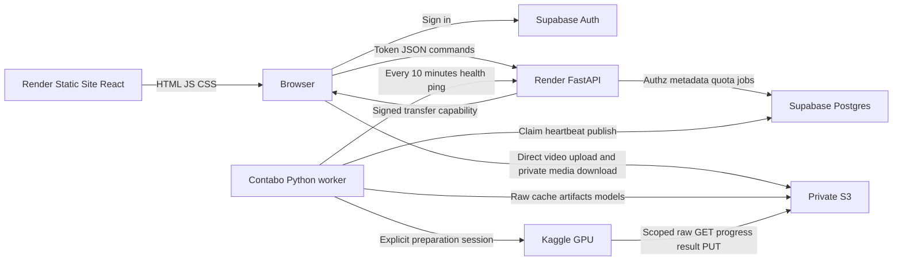

# Spec deployment pilot — RAV-26, 2–3 người dùng

Ngày: **2026-10-09**. Baseline: `duy-mvp/v2` / `8745cf0d4a26f4330ea582bfece0c41ebe377701`.

**Trạng thái: SPEC ĐỂ DUYỆT, CHƯA IMPLEMENT/DEPLOY.** Yêu cầu sản phẩm tại §1 do người dùng chốt; schema, endpoint mới, policy chi tiết và các con số ghi “đề xuất” cần duyệt. PL4 chỉ hoàn thành tài liệu, không hoàn thành bất kỳ lát D0–D8 nào.

**Cập nhật PL6 / #81:** auth Supabase email/password/operator reset, owner xem ảnh đã che + report rồi confirm trước ZIP, và RESTRICT nguồn còn được dùng đã chốt. Phiên/lịch sử mẫu dùng chung chỉ đọc; bản làm việc của mỗi user riêng. Chưa có BDD/nano: bootstrap hạ tầng để đo trước, tìm/provision sau; gate mở pilot vẫn cần dữ liệu/model thật. [Kế hoạch thực thi](../../../../backlog/DEPLOYMENT_EXECUTION_PLAN.md) và ba spec kỹ thuật liên kết trong đó là draft D0 cụ thể để review, chưa permission code/deploy.

**Cập nhật PL7 / #83:** từ mẫu chỉ tạo phiên riêng **trống**, cùng nguồn/cấu hình khởi tạo; không chép lịch sử/kết quả hoặc tự đề xuất. Dùng S3/Supabase/Kaggle hiện có, credential bootstrap trong `.env` repo được operator chỉ định explicit. Target/namespace/prefix/quyền/config được preflight kiểm; hai lựa chọn này đã chốt, các interface kỹ thuật còn draft D0.

Nguồn sự thật theo [docs/README](../../../../README.md). Spec này đề xuất phần deploy mở rộng [CONTRACTS](../../../../design/CONTRACTS.md) và [architecture](../../../../architecture_diagram.md), không thay component contracts, công thức chọn mẫu hoặc kết quả đánh giá. Trước code, D0 phải đưa thiết kế đã duyệt vào CONTRACTS/architecture/UI_DESIGN; những chỗ còn mở không được biến thành mặc định âm thầm.

Spec cụ thể hóa pilot sau [plan multi-user](../../../planning/MULTI_USER_RUNTIME_HOSTING_PLAN.md), [nghiên cứu bandwidth/quota](../../../planning/BANDWIDTH_AND_QUOTA_PLAN.md) và [roadmap platform](../../../planning/CURATION_PLATFORM_ROADMAP.md). Phạm vi upload, thời điểm PII và review trong spec này thay đề xuất cũ tương ứng: **video upload; raw preview có quyền; PII lúc export; review ngoài app trước**.

## 1. Yêu cầu đã chốt và phạm vi

| ID | Yêu cầu pilot bắt buộc |
|---|---|
| R01 | Phục vụ 2–3 người; operator tạo/cấp tài khoản. Không public signup, nút đăng ký hoặc anonymous account |
| R02 | Upload, phiên, quyết định, proposal, snapshot, report và export của mỗi người mặc định private |
| R03 | User tự review; xuất dataset kèm report cho người khác review ngoài app. Mời reviewer trong app **Hướng tới**, chưa thuộc pilot |
| R04 | User chỉ upload video; upload dataset/model của user **Hướng tới** trên bản deploy, không xóa chức năng local. Operator provision reference/model là phương án kỹ thuật ở §10/14 |
| R05 | Seed subset nhỏ BDD100K gồm ảnh và video, thêm dữ liệu local làm demo. System/demo chỉ đọc, user không có quyền xóa; phiên và kết quả phát sinh từ demo vẫn private |
| R06 | Chỉ chủ thể có quyền xóa được yêu cầu xóa; nguồn đang được snapshot/job tham chiếu phải được bảo vệ |
| R07 | YOLO nano và CLIP text chạy khi curation cần; PII chỉ detect mặt/biển số và che **lúc export dataset**. Không OCR/NER, không PII/AI tự chạy lúc upload |
| R08 | Raw preview phải kiểm quyền. PII không thay pixel đầu vào curation/embedding và không sửa raw |
| R09 | Giữ React/Vite + FastAPI; **frontend trên Render Static Site, Web API trên Render Free Web Service**; ping API mỗi 10 phút từ Contabo. Provider web đã chốt theo #80 |
| R10 | Contabo đã xác minh 4 vCPU/~8 GiB RAM (2026-10-13, #127); network throughput cần đo. Python worker nhận job và điều phối Kaggle. Không cần AI API public thứ hai |
| R11 | S3 private lưu bền; browser upload/download trực tiếp theo quyền API cấp. DINO+pHash và CLIP image preparation vẫn explicit theo CONTRACTS §19–20 |
| R12 | CPU/GPU quota riêng; base reset 4 giờ, top-up thủ công DB, không payment. GPU có ngân sách chung theo tài khoản Kaggle thật |
| R13 | Chi phí phát sinh ngoài VPS mục tiêu khoảng ≤2 USD/tháng. Có admission limits/monitoring; không tự xóa raw/demo để giảm bill |

Một pilot account là một chủ sở hữu dữ liệu. Không cần tổ chức/team, chỉnh sửa cùng phiên, chat-agent mới, billing service, Redis, Kubernetes hay training pipeline. Giữ những khả năng thuật toán hiện có nếu input/reference phù hợp; không âm thầm bỏ guided recipe hoặc sửa sampling/threshold để đạt quota.

“Hệ thống/demo chỉ đọc” áp dụng cho **nguồn và catalog nguồn**, không cấm user tạo session/keep/drop/snapshot/export của riêng mình trên nguồn được phép. Không mở catalog private của operator thành demo bằng cách scan toàn bộ thư mục/DB.

## 2. Baseline, nhánh tham khảo và các khoảng cách cần đóng

| Nguồn | Hiện trạng / cách dùng |
|---|---|
| Baseline `8745cf0` | React/Vite + FastAPI/command/service/pipeline đã có. Catalog/session/feedback SQLite và nhiều artifact local; chưa có auth/ownership xuyên suốt |
| CONTRACTS §14 | Ảnh dataset chỉ làm reference; pool curation là video. Snapshot/member bất biến; export dựa raw/hash/frame_idx đóng băng |
| CONTRACTS §15–18 | CLIP cùng checkpoint/revision; YOLO picks/shortlist và original+flip; proposal freeze context. Không đổi score, mask, NMS, ordering, seed hoặc claim uplift |
| CONTRACTS §19–20 | S3 transport, Supabase embedding job/lease và explicit GPU đã có; đây chưa phải migration toàn bộ DB hoặc API/worker deploy |
| `origin/v5_khanh` / `95967ce` | Tham khảo `rav26-work/app/services/pii.py`, `work_queue.py`, auth/variant/evidence. Catalog theo role còn chung; không merge rồi coi đã có tenant isolation |
| `origin/khanh` / `b69454e` và focus/gap mapping | Đối chiếu PII/human review, không dùng header role tự khai làm auth. Hai vai trò trong roadmap vẫn giữ; pilot tự review/export theo R03 |
| [V2_CRITERIA](../evaluation/V2_CRITERIA.md) | Quality ngữ nghĩa chưa đạt. Deploy pass không đồng nghĩa curation chính xác hoặc mAP tăng |

Các ref/SHA trên là ref đã có trên máy, chưa fetch mới. Đề bài đối chiếu từ [research pack](../research-pack/01_origin/01_original_rav26_problem.md), [focus](../research-pack/02_problem_understanding/04_data_curation_focus.md) và [gap mapping](../../../planning/MVP_GAP_MAPPING.md); ảnh rubric gốc chưa đủ để xác minh mọi câu nguyên văn. Pilot self-review không được ghi là đã hoàn tất workflow hai vai trò của roadmap/đề; R03 đưa phần mời reviewer trong app về Hướng tới theo lựa chọn người dùng.

Chỗ cần sửa trước deploy: `api/routes.py`, `api/upload.py`, `api/media.py`; command actor/authorization; service catalog/session/proposal/export; `store/db.py`, `embedding_jobs.py`, `s3.py`, `field_store.py`; `service/__init__.py` đang khởi tạo App/model/worker local; frontend API/auth/cache/navigation; build/runtime dependencies. [LOCAL_SINGLE_USER_LIMITS](../../../../design/LOCAL_SINGLE_USER_LIMITS.md) vẫn là danh sách blocker đang có, không được gỡ chỉ vì đã viết spec.

Blocker build đã đọc: Dockerfile chỉ copy `requirements.txt` nhưng file đó include `requirements-kaggle.txt`, HEALTHCHECK gọi `/health` chưa có route; image Python 3.11 khác môi trường dev 3.12. D7 phải sửa recipe/dependency includes, pin runtime/PyAV/FFmpeg parity và CI cho API/worker/frontend; baseline CI pass không chứng minh build hoặc tenant safety của pilot.

## 3. Topology và ranh giới trách nhiệm

**Phân bổ host (#80, cập nhật #127):** Render chạy phần web (static frontend + Web API nhẹ); Contabo chạy Python worker và điều phối Kaggle. Host đã deploy và xác minh **4 vCPU, khoảng 8 GiB RAM** ngày 2026-10-13; live worker vẫn giới hạn 3 vCPU/4 GiB. Network throughput/disk và capacity tải hỗn hợp cần đo riêng; thông số 200 Mbit/s trước đây chỉ là dự kiến. Không chuyển AI inference vào Render.

Evaluation thuật toán phục vụ phát triển là bộ local riêng theo [spec đã giao Nam](https://github.com/AI20K-Build-Phase-Cohort-4/P-026/blob/a38799bd82c8b763daef99f57f3e8364974e671f/docs/design/LOCAL_ALGORITHM_EVAL_SPEC.md), không deploy cùng worker. Worker vẫn thực hiện scoring/metric cần cho curation và report của app theo contract.

| Runtime | Làm | Không đặt vào runtime đó |
|---|---|---|
| Render Static Site frontend | UI/auth client, form, metadata, job polling, lazy media, review | Secret, quyền DB admin, logic quota quyết định từ browser |
| Render API | Verify auth, authz ở command/service, transaction, admission, job enqueue/status, cấp URL, metadata/explain đã có cache | Torch/Ultralytics model load, decode/thumbnail, vector matrix/NPZ validation, scoring lớn, ZIP/PII, GPU coordination |
| Contabo AI worker | Decode, pixel/integrity checks, cache, YOLO/text/proposal/scoring nặng, export PII/report/ZIP, GPU session reconciliation | Public inference port, endpoint cho browser bypass quota hoặc bộ evaluator phát triển local |
| Supabase Postgres/Auth | Identity; metadata/decision/snapshot; queue/lease/quota ledger | Raw, PNG, ZIP, embedding arrays lớn |
| S3 | Raw immutable, system assets, feature/result/preview/export/report/backup artifacts | Public bucket hoặc public directory phục vụ mọi user |
| Kaggle | DINO+pHash/CLIP image explicit; scoped input/output; cleanup và stop session | AWS/Supabase/Kaggle admin credential, API quyền truy cập catalog |

API và worker cùng repo/package, hai entrypoint/dependency sets/build artifacts. Default pilot cũ một heavy CPU slot và một GPU coordinator slot;
CPU lanes opt-in đã thiết kế tại CONTRACTS §21.22/#127 để tách model owners, kèm thread/RSS/policy-slot budgets.
GPU coordinator đợi remote không chiếm heavy CPU slot, nhưng download/validate result vẫn phải giới hạn CPU/RAM/I/O.
Không coi capacity ba AI model/PII hoặc numeric policy đã đạt chỉ từ tên queue; xem [runtime candidate](../../../../setup/COMPUTE_RUNTIME.md).

Không khởi tạo App local đầy đủ chỉ để chạy API. Tách dependency imports để API start/health/list/job không import Torch hoặc mở raw/feature cache. Model cache chỉ ở worker, warm/load theo nhu cầu và giới hạn RSS; không hứa giữ tất cả model trong RAM. `registry`/schema mô tả component phải dùng metadata hoặc import nhẹ.

## 4. Auth và ma trận quyền

**Đã chốt #81:** Supabase Auth email/password, operator tạo qua dashboard hoặc admin tooling backend. Tắt signup ở provider và mọi transport, không chỉ giấu nút. Operator cấp password qua kênh riêng; không ghi password/token vào DB app/log. Pilot reset password qua operator, không phụ thuộc email invitation/SMTP mới. Đổi password sau login dùng flow provider; Google/SSO/email onboarding **Hướng tới**. Token verification, DB roles/RLS và DTO chi tiết vẫn cần D0 duyệt.

API xác minh token bằng SDK/JWKS theo issuer/audience/expiry/signature, không tin payload decode hoặc `X-User/Role`. Tra `profile.active` khi nhận command, actor lấy từ principal thật; body không được chọn owner/actor/admin. Disable account chặn lệnh/cấp URL mới; URL đã cấp còn giới hạn TTL như §6.

| Hành động | Chủ dữ liệu private | User khác | System/demo | Operator |
|---|---|---|---|---|
| List/read raw/source metadata | Có | Không | Account pilot đọc | Chỉ nguồn được cấp; không mặc nhiên qua quyền admin app |
| Tạo session trên source được phép | Có | Không | Có, session mới thuộc user | Theo account/quyền nguồn |
| Keep/drop, sửa phiên/proposal, tạo snapshot | Chỉ phiên của mình | Không | Không sửa phiên demo gốc; tạo phiên cá nhân | Không sửa phiên private qua role admin |
| Đọc job/result/report/export | Chủ resource | Không | Source chung không làm result cá nhân thành chung | Cần grant cụ thể nếu đọc qua app |
| Upload/rename source | Video của mình | Không | User không | Seed/source system bằng tooling riêng |
| Prepare source system | Không sửa catalog; dùng cache seed | Không | Operator provision explicit trước pilot | Có; tính vào global budget |
| Yêu cầu xóa private raw | Có nếu không protected/đang được dùng | Không | Không | Tooling theo policy, không bulk-delete demo |
| Sửa quota/tạo/disable account | Không | Không | Không áp dụng | Có, audit và quyền DB riêng |

Quyền operator hạ tầng thực tế có thể truy cập storage/DB; đây không phải cam kết mã hóa khiến operator không đọc được raw. Quyền admin trong **app** không tự cấp quyền đọc private. Review invite/grant UI chưa có trong pilot; không tạo role Reviewer toàn cục rồi mở mọi dataset.

Kiểm quyền ở command/service trước resolve/cache/query và trước cấp/publish artifact. Kiểm quan hệ lồng nhau: proposal thuộc session, snapshot thuộc session, frame thuộc source trong pool, model/reference được phép, export thuộc snapshot. Biết một `unit_id`/hash/object key không cấp quyền. Resource không thuộc phạm vi trả 404; thao tác bị cấm trên resource nhìn thấy trả 403; mọi list/count/search phải scope trước pagination.

Raw chỉ tới provider/executor được policy nguồn cho phép. Preparation explicit gửi raw tới Kaggle phải kiểm quyền xử lý ngoài VPS và ghi executor/provenance; dataset public không tự cho phép mọi cách phân phối. Không được phép Kaggle thì chặn preparation với lý do, không silent CPU fallback hoặc tự che trước embedding trái R07. Upload video là input không tin cậy: decoder process non-root, workspace/quarantine riêng, timeout/memory/pixel bounds, không shell theo filename; model chỉ allowlist operator đã pin.

Postgres tables user-facing có RLS/grants; queue/global quota/admin adjustments chỉ backend. API không dùng `service_role` như bằng chứng đã kiểm quyền: key này có thể bypass RLS. Đề xuất ordinary reads/writes dùng user-context RLS, còn atomic job/quota operations dùng RPC/backend path kiểm principal explicit. Worker/admin privilege giới hạn theo nhiệm vụ; function đặc quyền pin search_path, revoke public execute và kiểm owner phía DB.

## 5. Data model và tính bất biến

Đây là **schema đề xuất**, không phải SQL migration chạy được. Giữ metadata hiện có và mapping ID/hash; không nén mọi thứ thành một JSON “job” bỏ mất FK/transaction.

| Nhóm | Trường / ràng buộc cần có |
|---|---|
| `profile` | auth subject, active, display name, policy_id; user không tự đổi admin/quota |
| `source_asset` | id, scope=private/system, owner_id, protected, provenance, raw key/hash/size, metadata, availability; scope/owner không nullable mơ hồ |
| Dataset/version/member | Seed manifest, annotation/classes/provenance/hash; version/member immutable như §14; system versions chỉ operator ghi |
| Model asset | Checkpoint/revision/SHA/license/runtime/task/class map; declaration quan hệ train/reference trung thực |
| Session/proposal/decision | Owner, permitted pool/reference/model IDs, frozen spec; actor thật; ordered evidence, decision seq và optimistic version |
| Snapshot/member | Giữ context/members/hash/provenance và tính bất biến; owner qua session; không cascade xóa hoặc sửa manifest |
| `job` / `job_attempt` | owner, kind, input_hash/spec/state_version, idempotency, queue state, attempt/fencing token, lease/deadline, usage/result refs/error, GPU session ownership |
| Artifact/export/report | owner, source/snapshot/job/attempt, variant/version/SHA/size, state; immutable output receipt, PII evidence và policy/model versions |
| Quota policy/window/hold/usage/adjustment | CPU/GPU amounts, window identity, reserved/consumed/released, dedup receipt; bonus ledger; operator/reason |
| Retirement/delete task/audit | Resource request, dependency check, authorization version, tombstone, physical-delete receipt; giữ metadata audit cần thiết |

Giữ `Unit`, ordered IDs, decoder spec, FieldKey và algorithm hashes theo CONTRACTS. Thêm tenant/ACL namespace **bên ngoài** identity/cache hiện có; adapter phải kiểm parity. Nếu cần resource UUID riêng ở HTTP/DB, lưu mapping tới identity core cũ, không viết lại frame IDs để né xung đột. DB không được coi content hash là owner hoặc quyền truy cập.

Private source/result/cache partition theo owner/resource. Dedup chỉ công bố trong phạm vi user; không trả “file của người B đã có”, ID/metadata hoặc readiness của B. System source chỉ dùng shared cache với input/model/spec bất biến và source đã cấp read. Session/query/decision/proposal/report riêng không dùng shared cache key thiếu owner.

S3 authoritative; Postgres authoritative cho nghiệp vụ. FieldStore/raw/thumbnail local trên VPS là cache có thể xây lại, không phải copy duy nhất. Artifact mới chỉ publish khi SHA/size/ordered IDs/model/spec và quyền/input version còn đúng; incomplete object/cache không được tính prepared.

## 6. Storage, upload và media

Prefix đề xuất: `system/<seed_version>/...`, `private/<owner>/<resource>/raw/...`, `private/<owner>/artifacts/...`, `staging/<owner>/<upload_id>/...`, `jobs/<job_id>/<attempt>/...`, `backups/...`. Key do backend sinh; user không gửi bucket/path/prefix tùy ý. S3 Block Public Access, TLS, encryption at rest theo cấu hình được duyệt; IAM/CORS chỉ origin/method/prefix cần thiết.

### 6.1 Video upload trực tiếp

1. API xác thực, kiểm loại video/kích thước khai báo/pending uploads/storage+cost capacity, reserve bytes rồi tạo upload receipt. Chưa có source READY.
2. Browser upload vào staging key riêng. **Đề xuất pilot:** presigned POST với content-length-range; retry file nếu mất mạng. Resumable multipart **Hướng tới** nếu thử video thật cho thấy cần; không proxy raw qua Render.
3. Complete idempotent: HEAD kiểm kích thước thực, enqueue validation có lease; không tin filename/MIME/checksum do browser tự khai. Chỉ validate cấu trúc/hash/metadata cần thiết, không tự chạy DINO/CLIP/YOLO/PII.
4. Worker tải có giới hạn, tính full SHA, probe/decode trong process có timeout/pixel/frame limits, từ chối file không hợp lệ. Sau kiểm, ghi **chính bytes đã verify** vào canonical key user không có quyền PUT; không copy một staging key có thể đã bị ghi lại mà không pin version.
5. Publish source READY và settle storage atomically theo receipt. Lỗi/crash giữ trạng thái có thể reconcile; không nhận staging thành raw chỉ vì object tồn tại.

Signed upload có thể replay/overwrite staging tới khi hết hạn. Canonical raw luôn ở key khác, never browser-writable; TTL/cleanup staging phải xét khả năng upload lại sau complete. Object quota tính cả staging thực và reservation; upload vượt quota không được publish. Input size cap không tạo hard-cap số request/bytes mạng đối với capability bị replay.

### 6.2 Media và bandwidth

Frame/thumbnail/context preview raw chỉ owner hoặc người có read source system được xem. Cache miss enqueue decode/render trên worker; API trả pending/URL, không decode trên Render. Giữ context ±vài giây hiện có; không âm thầm bỏ context để nhẹ máy. Context clip raw chỉ private preview; không đưa raw clip vào export bundle đã che.

Lazy pagination thumbnail, bounded browser download concurrency, full image khi mở viewer, overlay JSON nhỏ; không base64 PNG trong API hay preload video đầy đủ. Thumbnail nén là preview, không thay ảnh exact dùng scoring/export. Metadata chứa URL phải `private/no-store`; bỏ `public, max-age=31536000` cho media private và xóa frontend state/cache khi logout/đổi account.

Đề xuất signed GET user TTL 5 phút, upload 10 phút; worker/Kaggle TTL theo deadline có giới hạn riêng. Presigned URL là reusable bearer capability: người có URL dùng được đến hạn, download bắt đầu trước hạn có thể tiếp tục. App disable/delete không revoke tức thì mọi URL và không ngăn recipient lưu bản đã tải. Không public cache có signed URL, không log URL/query/token, không coi CORS là authorization.

Theo dõi riêng web egress, S3 download tới browser/Contabo/Kaggle, request counts, footprint và VPS cache hit. Direct download tránh Render egress nhưng không xóa phí S3. Nếu cần hard-cap từng byte/instant revocation, phải duyệt gateway/meter bổ sung; pilot dùng issuance/rate controls và billing reconciliation, không tuyên bố chính xác hơn.

## 7. Worker, queue và vòng đời job

Các kind: validation, media render, prepare DINO+pHash, prepare CLIP image, proposal/YOLO, metrics nặng, export PII/report/ZIP, authorized delete. Small cached metadata/explain/decision writes vẫn ở API; request đọc không tự enqueue inference.

State đề xuất: `QUEUED → RUNNING → SUCCEEDED | FAILED | CANCELLED`; thêm `CANCEL_REQUESTED` và cleanup state riêng. `WAITING_RESOURCE`/reason/deadline thể hiện hết CPU/GPU/budget, không giả thành đang inference. Artifact export có vòng đời riêng ở §9. UI hiển thị phase, done/total, queue reason và số dư/reset, không cần hứa ETA chưa đo.

- Enqueue: principal → ownership/input/state checks → estimate → reserve user quota/storage + pending slot → insert job trong cùng transaction. Idempotency key scope theo owner/action/input; reuse receipt đúng input, khác input cùng key trả conflict.
- Dispatch: claim job/attempt/fencing token và physical resource slot bằng cùng transaction/CAS; lease heartbeat. CPU slot claim khi chạy; GPU reserve global budget trước launch. Không giữ slot cho mọi job queued. DB lease expire chỉ ngăn publish, không chứng minh process cũ đã dừng: supervisor phải xác minh process group cũ không còn chạy trước reclaim CPU slot.
- Work: freeze input/state/policy/checkpoint/ordered IDs; chunk nhỏ, deadline, CPU/RSS/disk caps. Publish chỉ khi lease/fencing/state/input/authz còn đúng; proposal state đổi báo stale theo §18, không ghi đè quyết định mới.
- Finish: validate output rồi publish metadata/cache, settle usage một lần. Theo §19–20, prepared/SUCCEEDED chỉ sau remote raw/temp/config cleanup_done và result checks; provider session stop có thể pending riêng nhưng chưa release GPU slot/chốt final session usage cho tới khi xác minh đã stop. Export/download readiness có điều kiện riêng.
- Cancel: queued release unused holds; running yêu cầu cooperative stop rồi kill process group nếu cần. Đã tiêu CPU/GPU vẫn được ghi; không refund mọi failed attempt thành lượt chạy miễn phí.
- Restart/lease loss: worker cũ không publish. Reconcile owned Kaggle session trước launch retry; không chỉ expire DB lease rồi mở GPU thứ hai. Không claim resume từng vector batch nếu implementation chưa hỗ trợ.
- GPU launch: persist launch intent/job marker trước gọi provider. Timeout/crash sau provider tạo session nhưng trước persist handle là `LAUNCH_UNCERTAIN`; giữ global slot/reservation, tìm session theo ownership marker hoặc xác minh không có session trước retry. Không đối soát được thì block/operator xử lý, không mở thêm session để “thử lại”.
- Retry: user explicit, attempt/receipt mới; cache hợp lệ được tái dùng. Lỗi hệ thống có thể cấp adjustment user theo policy nhưng global provider usage giữ nguyên.

Một CPU heavy slot, một GPU slot/account và một heavy active job/user là **đề xuất pilot**. Hai pending jobs/user; fairness round-robin owner rồi FIFO, media preview nhỏ có budget riêng để không bị một export dài chặn mãi. Preview không được tạo đường chạy compute vô hạn ngoài quota/rate caps.

Giữ một job/lease authority: embedding coordinator hiện có tích hợp với queue dispatch, không để API cũ và worker mới cùng claim/launch `rav_embedding_jobs`. Có thể giữ bảng embedding chuyên biệt nhưng quan hệ với parent job/attempt và active/global uniqueness phải atomic. Migration/recovery phải nhận diện job cũ trước khi bật worker mới.

## 8. Quota và admission policy

### 8.1 Base, bonus và thời điểm reset

CPU credit hiệu chỉnh theo CPU-second/workload profile, gồm original+flip, text, decode/ranking, PII tile/export. GPU credit theo **session wall time**, gồm startup/download/load/cleanup và retry, không chỉ forward. Base reset 4 giờ theo DB time/window; lazy atomic reset khi đọc balance/enqueue, không cộng dồn và không cần cron per-user. Bonus manual ledger riêng, đề xuất giữ đến khi dùng hết; tiêu base trước rồi bonus, hold nhớ nguồn credit.

Hold thuộc window khi reserve. Reset không xóa hold; refund base cũ không cấp vào window mới, refund phần bonus chưa dùng về đúng ledger. Queued job vắt qua window vẫn giữ reservation cũ và phải có queue deadline, không tích trữ vô hạn. Tổng pending/active/global budget chặn burst sát ranh giới reset.

Operator top-up bằng DB transaction/adjustment có operator/reason/idempotency. User không ghi policy/bonus/usage/global budget. Không payment UI. Top-up không tăng CPU/RAM, S3 quota hoặc entitlement Kaggle.

### 8.2 Giá trị đề xuất và gate

| Policy | Đề xuất để duyệt | Cách chốt trước mở pilot |
|---|---|---|
| Accounts | 2–3 active, operator provision | Test A/B/C; không tự signup |
| CPU/GPU slots | 1 heavy CPU + 1 remote GPU/account; 1 heavy active/user, 2 pending/user | Thử công bằng 3 users và crash/cleanup |
| CPU/GPU base amount | **Chưa đặt số credit** | D1 đo profile và quota account; allowance phải đủ một tác vụ pilot hữu ích trong input envelope, tổng phù hợp capacity |
| File | Giữ 500 MiB raw limit hiện có; duration/resolution/fps/decoded pixels cần cấu hình thêm | D1 dùng video thực/VFR; vượt trả lý do, không tự resize/sampling khác contract |
| Candidate/pick/ZIP | Candidate ≤256, picks ≤256, ZIP ≤256 MiB theo guard hiện có; UI pilot thường batch 16 | D1 không mặc định hạ candidate 128/original+flip hay target_k của thuật toán |
| Storage/user/global | Bytes persisted + reserved/staging/model/feature/artifact/backup; số cụ thể chưa đo | Manifest seed + forecast region pricing, D1; full quota chặn admission, không reset giờ |
| Deadlines/lease/TTL | Bound queued/run/stop/cleanup; values config | Đo startup/IO/chunk/stop và signed URL lifetime; deadline ≤reserved budget |
| HTTP/media | Rate + bounded batch/poll backoff, không charge inference cache hit như cache miss | D1 đo Render request/DB/egress; prevent runaway polling |

Không dùng “số lần bấm” làm quota duy nhất. Estimate dưới thực tế: worker kiểm lại trước chunk, reserve thêm atomically trong available budget hoặc dừng rõ, không tự âm balance. Storage reserve gồm output worst-case; ZIP vượt limit fail toàn export, không bỏ mẫu để “thành công”.

### 8.3 Ngân sách Kaggle chung

Operator ghi actual quota/remaining/reset timestamp và các session ngoài app; worker reconcile fresh snapshot trước launch. Nếu provider không có API quota ổn định, snapshot thủ công + usage session có freshness policy; quota không xác minh thì giữ job/chặn launch với lý do. Không hardcode 30 giờ/tuần hoặc hứa GPU sau mỗi lần reset user.

Global weekly/daily budget có headroom cho startup/error/retry/operator work. Chỉ một owned session active, không tạo account khác để vượt quota. Hết GPU vẫn review/cache được theo quyền; preparation không silent fallback CPU, đổi model, giảm frame hay dùng feature giả. Upload chỉ READY raw, không tự tiêu GPU; GET và open page không launch job.

## 9. PII export và báo cáo cùng dataset

### 9.1 Pipeline export

Export luôn bắt đầu từ snapshot immutable; export “kept hiện tại” phải tạo/resolve snapshot rồi đi **cùng gate**. Quyền download legacy raw ZIP/S8 không được để tồn tại trong deploy như đường bypass.

`REQUESTED → PROCESSING → NEEDS_CONFIRMATION → FINALIZING → READY`; lỗi/cancel riêng. Worker verify mọi nguồn → decode exact frame_idx/EXIF theo snapshot → face/plate PII → full-size derivatives + report core → validate → owner xem kết quả đã che/xác nhận payload hash → finalize report/receipt/ZIP private → kiểm payload không đổi, hashes/members/size → READY. **Owner xem và xác nhận trước tải đã chốt #81**; UI/DTO/hash/expiry chi tiết vẫn cần D0/D1, xác nhận không thay quality evaluation.

Payload hash đóng băng snapshot/context, ordered output image hashes, PII config/evidence và report core từ cùng decision_seq; chưa gồm confirmation actor/time hoặc ZIP hash. Owner confirm đúng payload hash. Finalizer chỉ thêm confirmation receipt/report fields rồi kiểm payload vẫn khớp; ZIP SHA lưu ngoài ZIP ở artifact receipt, không tạo checksum tự tham chiếu. Chờ owner không giữ CPU slot; storage reservation/confirmation expiry rõ, finalization có admission/attempt riêng hoặc reserve bounded từ parent. Receipt/input hết hạn hoặc đổi byte phải review lại, không rewrite bundle đã READY.

Không chạy PII khi upload/preparation/preview. Pixel raw giữ nguyên; redacted derivative có hash khác và namespace/version riêng, không chèn vào DINO/CLIP/YOLO scoring cache. Snapshot gốc tiếp tục mô tả raw; export receipt ghi mapping raw unit/hash → output hash + PII model/policy/params/version và confirmation actor/time. Giữ kích thước hình; không lấy thumbnail nén làm output.

Detector tham khảo YuNet face + YOLOv9-t plate ONNX ở `v5_khanh`; checkpoint/runtime/license/threshold/tile strategy chưa pin. Benchmark full image + tiles vì có thể nhân số forward; không giả định một YOLO nano COCO đủ phát hiện mặt/biển số. No detections ≠ chứng nhận không có PII; model error/partial/missing derivative không publish READY hoặc fallback raw.

Cache PII theo source SHA/exact frame/model/policy/params/output variant; confirmation chỉ khớp checksum bundle đã xem. Không sửa export cũ tại chỗ khi đổi policy/model; tạo version/job mới. Cancel/retry không reuse confirmation cho byte khác. Nếu không đạt quality gate, chặn release và ghi issue; cơ chế chỉnh vùng che thủ công chỉ thêm sau khi duyệt, không tự coi đã có trong pilot.

### 9.2 Bundle và report

Bundle đề xuất: `images/` chứa ảnh đã che, `manifest.json`, `manifest.csv`, `report.html`, `report.json`, notices cần thiết. ZIP/report/members cùng snapshot/hash và ordered IDs, không dựng report từ kept hiện tại đã đổi. HTML offline tự chứa style, escape text, không script/remote trackers; JSON phục vụ audit/machine review. PDF/LLM sinh report **Hướng tới** nếu có nhu cầu, không thêm API phí mới trong pilot.

Report bắt buộc: goal/config/reference/model provenance; số mẫu/requested vs returned; keep/drop và metrics có định nghĩa/nguồn; evidence/giới hạn; runtime/algorithm version; PII processing/confirmation và mapping artifact hashes; source availability tại export. Freeze aggregates từ snapshot decision_seq, log/evidence/proposal/version tới mốc đó, không lấy metrics của session hiện tại khi worker chạy. Metric thiếu ghi “chưa có”, không số giả, không claim accuracy/mAP/rare-event uplift từ confidence hoặc deploy pass.

Mọi ảnh nhúng report/contact sheet/nearest-reference/ảnh minh họa cũng phải là derivative qua PII có hash/evidence, hoặc chỉ xuất metadata không ảnh. Không nhúng raw preview/cache thumbnail/base64, kể cả khi `images/` đã che. Report core/PII scope này được freeze trong payload và tính vào estimate/budget; không inference thêm không kiểm soát trong HTML renderer.

Report/payload dùng byte snapshot/export đã freeze, không infer lại để giải thích. Không chứa token, signed URL, host path, AWS/Supabase key, raw clip hoặc private object link. Prediction không phải annotation ground truth; pool video chưa gán nhãn không được xuất prediction như nhãn thật. PII chỉ che vùng mặt/biển số, không tuyên bố đã xử lý chữ/metadata/goal bằng OCR/NER. Review recipient nhận file offline; thu hồi quyền app không thu hồi bản họ đã nhận.

## 10. Seed BDD100K và migration demo

Đề xuất seed manifest riêng: subset ảnh có nhãn làm reference, một vài video làm candidate source/demo; ảnh vẫn không thành candidate pool. Ghi dataset release/split/original IDs, cách chọn/seed, hashes/size/license, annotation conversion và class mapping. Không tải full BDD100K tự động khi boot/deploy.

S11 ≤200 ảnh trong PLAN là smoke hiện có, không tự coi user đã chốt pilot đúng 200 ảnh. Số ảnh/video và tổng bytes chốt từ manifest/cost gate; có subset nhỏ thực trên máy mới chạy seed. BDD JSON chưa là input native của import §14.4: conversion ngoại tuyến có provenance sang YOLO detection hoặc `none`, không giả nhãn/không làm converter âm thầm trong API.

BDD reference không chứng minh YOLO nano đã train trên BDD. Operator provision checkpoint tin cậy và declaration train/fine-tune tương ứng nếu dùng guided recipe; nano COCO baseline chỉ là checkpoint thử nếu chưa có quan hệ đó. Nếu thiếu, UI/command báo recipe thiếu điều kiện, vẫn giữ khả năng YOLO evidence/recipe phù hợp; không fake model–dataset relation. Mở nghĩa reference thành corpus nền khác train là lựa chọn cần duyệt riêng tại D0, không đổi §14.0 ngầm.

Migration chỉ chọn allowlist local assets/session/artifact demo đã kiểm, không chép `.env`, mọi `data/`/`output/` hoặc mọi private session lên image. Source demo protected + system read. **#81 yêu cầu phiên/lịch sử mẫu gốc chỉ đọc** cho mọi tài khoản học cách dùng. **#83 chốt bắt đầu từ mẫu tạo session riêng trống**, cùng nguồn/cấu hình khởi tạo hợp lệ và provenance tới template; không copy proposal/decision/snapshot/job/export/confirmation/history/metric, không auto propose. User thao tác sau đó mới có lịch sử riêng. Không sửa template, mở private catalog của operator hoặc share state giữa A/B. Exact DTO/mappings/pins/receipt vẫn draft D0; không còn policy remap copied-events.

BDD subset/nano hiện chưa có (#81), tìm/provision sau khi bootstrap hạ tầng được. Bootstrap operator-only không phải mở pilot hoàn tất; A03/A11 về BDD/provenance và guided recipe availability vẫn pending. Không claim BDD là tập train khi thiếu chứng cứ.

Các bước D3: freeze/export SQLite backup → inventory/check hashes/FKs/model/ref → mapping owner/system scope explicit → copy raw/assets S3 → import Postgres transaction + schema version → validate counts/ordered IDs/context/member hashes → rebuild/scoped cache hoặc ghi mapping compatible → smoke account A/B → cutover. Idempotent seed/migration receipts; crash không nhân đôi catalog. Không xóa dữ liệu local gốc. Existing raw export không publish cho user; đưa qua pipeline PII mới.

## 11. API/command contract đề xuất

Giữ command layer §11 làm cổng chung; actor context do transport trusted inject, không input user. Đây là endpoint **đề xuất cho deploy**, DTO/signature cụ thể phải chốt D0; không đổi route local đồng bộ thành async mà giữ type cũ.

| Surface | Hành vi deploy |
|---|---|
| Health / me / quota | Health public nhỏ không chạm ML/DB nặng; me/quota authenticated, server time/next_reset/bonus/holds và safe reason |
| Upload create/complete/abort | Receipt + direct transfer capability; complete trả validation job, không raw READY giả; không upload model/dataset route user |
| Video/source/dataset/model catalog | Scope owner/system; pagination; chỉ model/system version allowlist, không local folder browser |
| Video prepare DINO / prepare CLIP | Giữ hai hành động explicit §20, readiness riêng; trả job receipt/status, cache hit không launch |
| Session/state/proposal/evidence | Authz quan hệ + optimistic version; proposal nặng đều queue; đọc cache/explain không inference |
| Media request/status | Resolve source+exact frame/context; cached signed URL hoặc pending job; không cho path/object key tùy ý |
| Snapshot create/list/get/verify | Immutable/hash semantics giữ; owner+reference authz và consistency; verify nguồn job khi nặng |
| Export create/status/confirm/download | POST tạo job theo snapshot; confirm đúng receipt; download chỉ READY derivative/report bundle bằng signed GET |
| Job get/list/cancel/retry | Owner-scoped, phase/attempt/error safe; retry/cancel theo quota/cleanup, không quyền stop session GPU bất kỳ |
| Delete request/status | Principal+resource rights+dependency check; pending/restricted/tombstoned/deleted rõ; không S3 key deletion từ browser |

GET snapshot download/legacy export trong deploy chỉ trả READY link/status hoặc error `export_requires_job`, không tạo CPU/PII job bằng GET và không trả raw ZIP. Chốt compatibility version/DTO ở D0; FE thay đồng bộ cùng lát. Chuẩn lỗi đề xuất: 401 auth, 404 ngoài scope, 403 forbidden nhìn thấy, 409 stale/dependency/conflict, 413 size, 422 invalid input, 429 quota/rate, 503 provider/resource chưa sẵn; có safe code/retry/next_reset, không library trace/host path.

## 12. Xóa, retirement và garbage collection

System/demo/model seed protected: user không rename/write/delete qua API, RPC, signed PUT hoặc raw S3 credentials. Không auto TTL raw vì quota/storage đầy. Private owner có thể yêu cầu xóa resource không protected, nhưng transaction phải lock/check dependency với enqueue/snapshot song song.

Đề xuất hai tầng: kiểm quyền/dependencies trước rồi mới retirement/tombstone metadata chặn read/URL/job mới; physical delete worker check lại, không có active job/lease, live snapshot/reference/session/export cần nguồn hoặc pin. Snapshot/member bất biến giữ nguyên; retirement ở bảng/record ngoài snapshot. **Chưa duyệt retirement không được giả rằng archive UI đã giải phóng source.** Nếu snapshot còn live, trả `resource_in_use` và danh sách dependency trong quyền user; request bị từ chối không làm mất availability/read của nguồn còn hợp lệ.

**#81 đã chốt RESTRICT:** nguồn còn snapshot/phiên/job/reference dùng thì chặn xóa, báo dependency trong quyền user; không có release-pin/retire để vượt restriction trong pilot. Raw đang được live snapshot giữ không xóa để tiết kiệm. Xóa nguồn private không còn được dùng vẫn hỗ trợ bằng receipt/check/worker cleanup; policy mở rộng release pin **Hướng tới**. Không cascade sửa manifest/hash của snapshot. Physical object shared system không bị xóa khi user xóa session/result riêng.

GC chỉ được thu hồi staging upload hết hạn/aborted, attempt temp lỗi, cache tái tạo không có lease/pin, artifact đã owner-authorized retirement theo policy. Đây là quyền service cleanup được định nghĩa, không quyền xóa raw/demo của user. Startup không quét folder tạm của worker khác đang chạy. Orphan canonical objects chưa có DB phải reconcile receipt/age/quarantine; không auto nhận vào catalog và không bulk-delete theo prefix rộng.

## 13. Chi phí, bandwidth và giới hạn free tier

Thông tin kiểm theo tài liệu chính thức ngày 2026-10-09; actual account/region/billing chưa truy cập. R13 hiểu là ngân sách **phát sinh ngoài VPS**, gồm web/DB/storage/request/egress/backup; không giả có domain/LLM/email/paid cron nằm ngoài bill.

| Thành phần | Giới hạn/cost cần tính |
|---|---|
| Render Free Web | 0,1 CPU/512 MB; idle 15 phút, cold start khoảng 1 phút; 750 giờ/workspace/tháng, filesystem ephemeral/restart bất kỳ. Một service giữ awake 31 ngày =744 giờ; service thứ hai dùng cùng quota. Ping best effort, không SLA |
| Render static + API | Workspace Hobby 5 GB outbound/tháng chung; excess public egress 0,15 USD/GB; không payment thì hết quota có thể suspend. Không proxy ảnh/NPZ/video |
| Render build pipeline | Hobby 500 build minutes/tháng; phần bổ sung 5 USD/1.000 phút. Đề xuất pipeline spend limit 0 USD + manual deploy/build filters, tránh mua bổ sung vượt ngân sách |
| Ping | Timer/cron trên Contabo gọi health mỗi 10 phút; 4.464 lần trong 31 ngày, payload nhỏ/timeout. Render Cron Job có phí tối thiểu 1 USD/tháng nên không dùng cho pilot |
| Supabase Free | 500 MB DB, shared compute, egress quota và inactive pause; không dùng làm object storage raw. Không auto nâng Pro vì vượt ngân sách; backup ngoài provider tự vận hành |
| S3 | Giá theo region/storage class/bytes-month, request/multipart và data-out tới browser/VPS/Kaggle; phải xét usage/free offer thực của **account**, không giả mỗi bucket có free allowance riêng |

Frontend **đã chốt Render Static Site**, cùng provider với Web API; URL mặc định không mua domain. Nếu benchmark/forecast không đạt envelope, trình người dùng duyệt thay đổi tài nguyên, limits hoặc provider trước khi sửa target. Cloudflare Pages/Railway/R2 không nằm trong cấu hình pilot đã chốt; không tự migrate để tránh kiểm budget.

Cost forecast trước seed: storage footprint (raw+system models+features+derivatives+exports+backups+staging+versions nếu bật) × giá region, GET/PUT/HEAD/LIST counts × rate, billed egress sau allowance thực × rate. Giữ cache raw/model trên VPS giữa jobs để không tải lại toàn bộ qua S3/Kaggle mỗi vòng; không giữ mọi PNG vĩnh viễn. BDD seed nhỏ phải tính cả video/model/assets, không chỉ số ảnh.

**Đề xuất cảnh báo** 1 USD /1,5 USD /2 USD actual hoặc forecast tháng. Ở ngưỡng forecast 1,5 USD, chặn admission upload/prepare/export tăng cost và yêu cầu operator kiểm bill/headroom; không tự xóa nguồn. Signed GET đã cấp có thể tiếp tục/replay, bytes metering và provider bill có độ trễ, nên không cam kết hard bill cap 2 USD. Muốn trần cứng phải duyệt thêm enforcement/gateway hoặc chấp nhận dừng truy cập; AWS Budget alert không tự đảm bảo giới hạn.

Không đưa con số GB/user/global tùy ý thành chứng minh đủ 2 USD. D1 phải chốt envelope từ forecast + measured requests/bytes + current AWS free usage; vận hành đối soát ngày trong pilot. Billing unknown/stale hoặc tăng vượt forecast: safe admission pause, giữ raw/demo/metadata, báo operator; DB/service outage không fallback local bỏ quyền.

Admission pause không dừng phí storage của raw/demo/backup/versions đã có. Forecast gồm chi phí nền tới cuối kỳ và tháng tiếp theo; nếu chi phí nền vượt 2 USD, operator phải duyệt ngân sách/envelope. Không có cách giữ mọi nguồn vô thời hạn mà bảo đảm bill cap chỉ bằng chặn upload mới.

## 14. Deployment configuration và provision

| Nhóm cấu hình | API | Worker / operator |
|---|---|---|
| Runtime | Deploy mode, API URL/origin allowlist, schema compatible version, auth issuer/JWKS/provider URL | worker ID, queues/slots, lease/chunk/deadline/process/RSS/disk caps |
| Postgres | URL/client role theo authz; privileged RPC secret chỉ server | worker DB credential/RPC, migration credential operator riêng |
| S3 | Bucket/region, signing rights cho permitted transfers, TTL/CORS | raw/result/artifact access; delete privilege theo cleanup path riêng |
| Kaggle | Không credential/orchestration | token/private notebook/session receipt, model assets manifest, quota snapshot/freshness |
| Models/features | Lightweight descriptor metadata | Pin YOLO/CLIP/DINO/PII checkpoints/revisions/SHA/runtime/license, tokenizer/preprocess; no download lúc boot API |
| Policy | policy version, upload/media/rate limits, quota/admission reads | cost profile/headroom, balances/reservations, cache/storage limits; top-up operator DB |
| Secrets | Platform environment/secret config; public FE chỉ provider publishable config | restricted env/secret files ngoài image; never write secret `.env` vào Git/Docker/log/artifact |

Baseline hiện đọc `.env` bằng `dotenv_values`. **#83 chốt credential bootstrap từ `.env` repo**: operator tooling đọc khi chỉ định explicit (draft `--env-file .env`), map/validate config theo target/role rồi inject host environment. Hosted API/worker dùng environment đã validate; không tự chọn env file, AWS credential chain/account khác hoặc dùng admin secret thay scoped roles còn thiếu. Không in credential hoặc chép file vào image/seed/FE. Đổi nguồn config là hạng mục code tương lai, chưa sửa trong PL7. Địa chỉ/đường dẫn runtime theo env, không hardcode máy Windows; Linux volume cache/temporary dirs riêng, có dung lượng và permission rõ.

Build API chỉ dependency nhẹ; worker dependency pin CPU runtime và offline model manifests. Docker/build context exclude `.env`, `data/`, `output/`, caches, private DB và Git; không dùng `COPY . .` để kéo dữ liệu dev lên Render. Static build chỉ public bundle, secret không dùng biến Vite public. TLS giữa browser/cloud/providers; Contabo không mở public AI/DB port, admin SSH giới hạn theo operator.

Provision tương lai: region/package/disk thật → S3/IAM/CORS/private prefixes → Supabase schema/auth/signup-off → migration một lần → seed allowlist → worker readiness/cache/model integrity → Render API light → static frontend → account A/B/C → timer ping → acceptance/cost gate. Migration không tự chạy đồng thời lúc API/worker boot; schema mới hơn app phải refuse/read-only theo compatibility.

Migration chạy qua operator/Contabo release tooling có lock/backup; Render Free không có pre-deploy command, dashboard shell/SSH hoặc one-off jobs. Không xây runbook dựa vào các tính năng paid đó.

## 15. Vận hành, backup và rollback

- Health public trả trạng thái process nhỏ; readiness nội bộ kiểm config/schema/DB/storage access có timeout/cache, không inference. Ping giúp giảm idle, không thay readiness hoặc quota monitor.
- Health ping không query DB không ngăn Supabase Free pause do low database activity trong 7 ngày. Operator theo dõi cảnh báo/pause và có runbook Resume project; không thêm DB traffic giả vào health rồi coi đã bảo đảm provider luôn awake.
- Worker supervisor restart có backoff; durable leases/progress/session receipts cho recovery. Heartbeat stale báo cảnh báo, không dừng nhầm session ngoài quyền job. Theo dõi active/queued/cleanup, RSS/CPU/disk/cache, quota/window, GPU snapshot age, S3/web/DB usage và failed auth/deletes.
- Log/audit có request/job/attempt/principal IDs và safe error; không raw, payload nhạy cảm, token/password/signed URL. Operator top-up/seed/account disable/delete/release-confirmation có actor/reason/time.
- Đề xuất metadata backup hàng ngày và trước migration, encrypted ở S3 prefix operator-only, restore drill trước mở pilot. Free provider không thay backup app. Pin CLI/Postgres và schema/data/roles export phù hợp; restore auth subject UUID/identities/password hashes và FK/ACL hoặc mapping đã kiểm chứng. Auth config/signing keys provision riêng; sang project/issuer khác phải re-login. Không coi default business/schema dump là full account backup, không ghi plaintext password vào backup.
- Raw/system assets không auto expire. Backup/cache/temp retention service phải được duyệt, tính cả bytes/version cost. Đề xuất giữ 7 metadata backups/ngày và 2 pre-migration backups; retention không áp cho raw/demo. Mục tiêu RPO ≤24h, RTO ≤4h là **đề xuất vận hành**, cần restore drill xác minh, không SLA provider.
- Rollback: admission pause → reconcile/stop owned jobs/GPU → backup → dùng app build compatible schema cũ/mới đã kiểm. Migration expand/contract, không down-migrate phá dữ liệu phát sinh; khi incompatible chọn forward fix hoặc restore có thông báo mất dữ liệu/RPO. Không đổi về SQLite để bỏ auth/quota.
- Incident: token/key leak thì disable signing/rotate và audit; DB/S3 outage thì 503/retry/read-only có lý do; hết quota thì stop admission; nguồn đổi/PII lỗi thì block publication/export. Không trả success/cache/raw thay thế để che lỗi.

## 16. Gate benchmark — không suy capacity từ tên model

**D1 trên VPS thật và account/cloud thực, chỉ chạy sau khi được phép implementation/benchmark.** Phiên PL4 không chạy. Ghi package/region/disk, revision, workload/input, cold/warm/cache, measured CPU-second/wall/RSS/peak/temp bytes/network/error/stop cleanup.

Workloads bắt buộc: 2–3 users cùng thao tác; YOLO nano 16 picks và candidate stage 128/256 original+flip; text encoder cùng CLIP revision, thử text-only projection nếu parity đạt; PII full+tiles trên 720p/1080p/ngày/đêm/mặt-biển nhỏ; decode VFR exact và context; ZIP/report ở limit; GPU startup→stop DINO và CLIP riêng; result NPZ validation; restart; actual thumbnail/full/clip/bundle bytes từ browser Việt Nam và region VPS.

API gate: cold/warm import/RSS trong 512 MB, không ML imports hoặc matrix decode; cached metadata p95 mục tiêu đề xuất ≤2 giây khi awake với 3 users, đo cả DB latency. Worker gate: không OOM/swap thrash/disk exhaustion, caps thực thi, job hữu ích trong envelope/quota, foreground review tiếp tục khi heavy job chạy. CPU/RSS numeric caps đặt sau measurement, chừa OS/IO/coordinator headroom trong 8 GB.

Gate algorithm: ordered IDs, masks/scores/NMS/seed/context/FieldKey và pixel/checkpoint parity với baseline; không tự quantize, giảm frame/sample rate/candidate hoặc bỏ flip. Gate PII chất lượng riêng với ground truth và failure modes, human confirmation không thay recall evaluation. Gate cost: forecast/actual usage/account allowance nằm trong ngân sách hoặc operator duyệt thay limits trước pilot.

Nếu không đạt: giảm envelope được người dùng duyệt, queue/caps/cache improvements có parity, hoặc đổi tài nguyên/ngân sách bằng quyết định mới. Không ghi “hỗ trợ 3 users” chỉ vì 3 người login được.

## 17. Acceptance và traceability

| Test/gate | Kết quả phải đạt | Yêu cầu |
|---|---|---|
| A01 Auth | Signup API trực tiếp bị chặn; chưa login/expired/forged token/disabled account không đọc/ghi/cấp URL; operator tạo được 3 accounts | R01 |
| A02 Isolation | A/B/C thử list/search/count/direct ID/nested source/proposal/snapshot/job/cancel/export/cache/media đều không truy cập chéo; logout/đổi account không hiện dữ liệu cũ | R02/R08 |
| A03 System seed | Mọi account đọc source demo/BDD và history mẫu được cấp, không rename/upload-overwrite/delete; từ mẫu tạo session private trống cùng nguồn/config, no inherited history/result/job hoặc auto propose; A/B riêng, replay idempotent, template hash/count nguyên | R05/R06 |
| A04 Upload | MIME giả/file lỗi/oversize/pixel-duration bounds; complete/retry đồng thời/crash; replay staging sau verify không đổi canonical raw; không job AI tự chạy | R04/R07/R11 |
| A05 Feature | DINO/CLIP explicit và status độc lập; nguồn cấm external processing không tới Kaggle; cache hit không launch; malformed NPZ/model/pixel/IDs/hash mismatch không publish; crash giữa GPU launch và receipt, cleanup/stop/retry không chạy trùng | R11/R12 |
| A06 Curation | Algorithm/pixel/replay parity; cache scope; state đổi/job stale bị chặn; restart/cancel/fencing, child process cũ còn sống không bị cấp slot trùng; read metadata không infer | R07/R02 |
| A07 Export PII | Mọi legacy/new export path đi cùng gate; no-detection/error/partial/cancel không fallback raw; exact snapshot decision_seq→redacted pixels/report/members; raw nhúng HTML/reference/base64 bị chặn; confirm/finalize payload và ZIP SHA đúng | R03/R07/R08 |
| A08 Quota | Concurrent enqueue/reset/bonus/settle/retry/cancel; job qua window; không âm/double reserve/refund vào base mới; user còn credit nhưng global GPU hết vẫn chặn | R12 |
| A09 Deletion | A không xóa B/system; raw live snapshot/job bị RESTRICT; snapshot immutable không sửa/cascade; request-delete race với enqueue/URL/GC; cleanup không xóa live temp/source | R06/R13 |
| A10 Cloud | API sleep/restart/redeploy, worker killed, S3/DB/network failure, presigned expiry; state bền và safe error; no implicit local fallback | R09–R11 |
| A11 Restore/cost | Seed/migration idempotent/hash/owner parity; backup restore identities/ACL/lineage; billing forecast/alert/admission pause không xóa raw; actual 3-user resource/egress gate | R05/R10/R13 |

Security boundaries/concurrency/resource/parser changes cần test có ý nghĩa tại slice implementation; code hiện có pytest/ruff/tsc theo guide vẫn phải chạy khi đụng các tầng đó. Live smoke có credentials/permission và báo riêng; mock pass không thay cloud test hoặc quality PII. PL4 chỉ kiểm tài liệu/diff/links, không claim các A01–A11 đã pass.

## 18. Roadmap từng lát và quyết định còn mở

| Lát | Đầu ra | Gate trước lát tiếp |
|---|---|---|
| D0 — duyệt thiết kế | Spec approved; cập nhật CONTRACTS/architecture/UI và decision log: auth/provider roles, endpoint/DTO/actor, schema/ACL/job/quota, export PII, retirement, reference/model semantics | Không signature/contract ngầm; các Hướng tới ghi rõ, không implementation |
| D1 — feasibility | Bench actual VPS/API/GPU/media/PII/cost/seed sizes và parity; chốt credit/envelope/caps/headroom/quality/deadlines | RAM/latency/cost hữu ích đạt hoặc quyết định điều chỉnh đã duyệt |
| D2 — identity/persistence | Supabase auth closed signup, owner/system catalog/RLS, Postgres metadata/migrations, trusted principal command context | A01–A03 và migration/ACL tests; API chưa public live user data nếu thiếu media auth |
| D3 — seed/storage/media | S3 direct staging/canonical validation, system BDD+local allowlist, pixel/media cache/URLs/rights, scoped feature restore | A02–A05/A11 tương ứng; source immutable, không leak/overwrite |
| D4 — queue/worker/quota | Durable CPU/GPU job authority, leases/fencing/admission/bonus/window/global snapshot, recovery/cancel | A05/A06/A08/A10; API tắt không làm mất job hoặc launch trùng |
| D5 — curation runtime | Route heavy workload sang worker, YOLO/text/cache/evidence/metrics giữ contract và UI job states | Baseline parity và 3-user smoke; không claim quality uplift |
| D6 — export/report/delete | PII export gate mọi route, immutable receipt/report/checksums/confirmation, delete RESTRICT nguồn còn dùng; không retirement/release-pin | A07/A09; export raw bypass đóng và nguồn protected nguyên vẹn |
| D7 — build/deploy/runbook | API/worker images nhẹ, env/secrets/IAM, static UI, timer ping, backups/restore/rollback/usage dashboard | A10/A11, build/config/secret checks; operator có runbook và rollback đã thử |
| D8 — closed pilot | Account A/B/C dùng end-to-end, measured billing/CPU/GPU/latency, limit tuning có decision | A01–A11; mở cho 2–3 accounts, không public registration |

D0–D8 là nhóm scope gốc, không thứ tự giao coding agent. Thứ tự thực thi hiện hành là **DEP0–DEP8** trong [execution plan](../../../../backlog/DEPLOYMENT_EXECUTION_PLAN.md) và PLAN: queue/quota DEP3 có trước storage/media DEP4. D1 có thể dùng harness riêng trước migration trong namespace/envelope operator đã duyệt. Mỗi phiên implementation một lát theo PLAN, không tick toàn roadmap bằng một demo flow.

Đã chốt auth Supabase password/operator reset, frontend Render Static, delete RESTRICT không release-pin, owner xem/xác nhận trước ZIP, tạo phiên riêng trống từ mẫu và dùng S3/Supabase/Kaggle hiện có với credential bootstrap `.env` repo (#80–#81/#83). Còn duyệt: direct presigned POST; API/DTO/version transition; schema/RLS/privileged RPC; exact template-start DTO/mappings/pins/receipt; PII confirmation receipt/UI và quality thresholds; report HTML/JSON; checkpoint/BDD relationship; seed inventory/target mapping, caps/credit/headroom/deadlines sau D1; backup/auth recovery/RPO/RTO. Không hỏi lại các lựa chọn đã chốt.

## 19. Nguồn chính thức và giới hạn kiểm chứng

Các facts provider tại §13 đối chiếu [Render Free](https://render.com/docs/free), [compute plans](https://render.com/docs/compute-plans), [static sites](https://render.com/docs/static-sites), [outbound bandwidth](https://render.com/docs/outbound-bandwidth), [cron billing](https://render.com/docs/cronjobs). Health ping trước 15 phút là suy luận từ idle rule, không cam kết uptime.

Build/deploy theo [Render build pipeline](https://render.com/docs/build-pipeline), [pricing](https://render.com/pricing), [deploy commands](https://render.com/docs/deploys). Backup/pause theo [Supabase free project pausing](https://supabase.com/docs/guides/platform/free-project-pausing), [backups](https://supabase.com/docs/guides/platform/backups), [backup/restore](https://supabase.com/docs/guides/platform/migrating-within-supabase/backup-restore), [auth migration](https://supabase.com/docs/guides/troubleshooting/migrating-auth-users-between-projects).

Auth/DB theo [Supabase pricing](https://supabase.com/pricing), [general auth config](https://supabase.com/docs/guides/auth/general-configuration), [admin createUser](https://supabase.com/docs/reference/javascript/auth-admin-createuser), [RLS/bypass](https://supabase.com/docs/guides/database/postgres/row-level-security). Không dùng provider SMTP mặc định làm điều kiện onboarding; administrative credential chỉ server.

Storage/budget theo [S3 pricing](https://aws.amazon.com/s3/pricing/), [presigned capabilities](https://docs.aws.amazon.com/AmazonS3/latest/userguide/using-presigned-url.html), [AWS Budgets và độ trễ](https://docs.aws.amazon.com/cost-management/latest/userguide/budgets-managing-costs.html). Quota GPU theo [Kaggle efficient usage](https://www.kaggle.com/docs/efficient-gpu-usage), actual account state vẫn chưa kiểm. VPS package/port/fair usage theo [Contabo docs](https://docs.contabo.com/docs/servers-hosting/vps/); hardware xác minh theo R10/#127, bandwidth phải đo, không tự nâng package.

Seed/provenance theo [BDD portal](https://bdd-data.berkeley.edu/), [BDD label format](https://github.com/ucbdrive/bdd100k/blob/master/doc/format.md?plain=1), [BDD data/code notices](https://github.com/bdd100k/bdd100k/blob/master/doc/source/license.rst). Trước seed/export phải kiểm đúng release/notice và quyền dùng/phân phối đã có; không suy data license từ license code repo.

Chưa kiểm: actual cloud accounts/bill/quota/package/region, BDD subset hiện có và quyền release cụ thể, license checkpoint đã chọn, runtime memory/latency/PII quality, restore drill. Phiên này chỉ đọc repo/ref/public docs và sửa tài liệu; không code, deploy, launch GPU, download data/model hoặc push.
