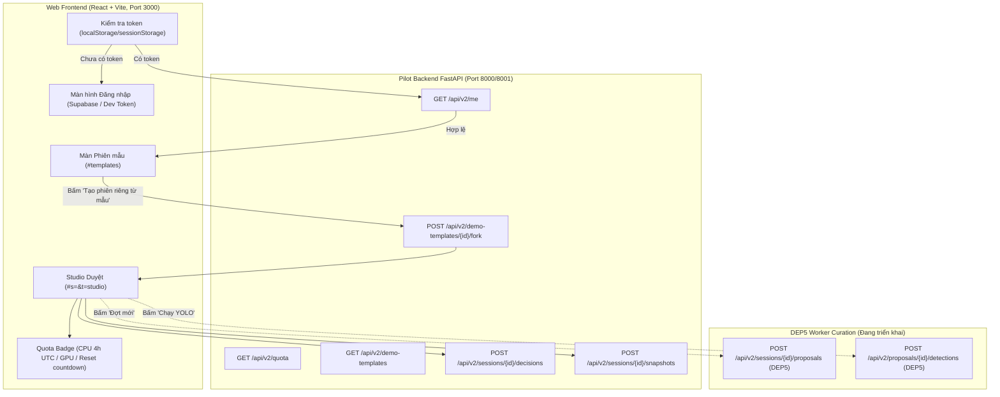

# Hướng Dẫn Sử Dụng & Kiểm Thử Giao Diện Web Pilot v2 (DEP-UI)

> **Phạm vi lát cắt DEP-UI (#93):** Giao diện Web Deploy v2 hoàn thành độc lập, không thay đổi bất kỳ code nào ở backend (`src/rav/*`). 
> Hỗ trợ xác thực JWT Supabase & Dev Access Token, hiển thị Quota Badge, màn Phiên mẫu (Demo Templates), Fork phiên độc lập vào PostgreSQL, và cơ chế Placeholder thân thiện cho các API worker đang làm ở DEP5.

---

## 1. Kiến Trúc & Luồng Hoạt Động



---

## 2. Cách Khởi Động & Kiểm Thử Local

### Bước 1: Khởi động Backend Pilot
Trong một cửa sổ PowerShell:
```powershell
. .\scripts\use_project_storage.ps1
# Chạy uvicorn backend
python -m uvicorn src.rav.api.pilot:app --port 8000
```
*(Hoặc chạy app tích hợp nếu test local v1/v2 song song).*

### Bước 2: Khởi động Vite Frontend
Trong một cửa sổ PowerShell thứ hai:
```powershell
. .\scripts\use_project_storage.ps1
Set-Location src/web
npm run dev
```
Truy cập `http://localhost:3000`.

---

## 3. Các Tính Năng Đã Triển Khai Trong DEP-UI

### 3.1. Xác thực & Đăng nhập (`LoginScreen.tsx`, `api_v2.ts`)
- **Supabase Auth:** Nhập Email & Mật khẩu để gọi API Supabase lấy Access Token JWT.
- **Dev Access Token (Tiện lợi cho dev local):** Khi test local với PostgreSQL thật (`RAV_PILOT_TEST_DATABASE_URL`), bạn có thể dán trực tiếp JWT token do script test sinh ra để vào ngay mà không cần internet.
- **Tự động gia hạn / kiểm tra:** Mỗi khi mở trang hoặc reload, frontend gọi `GET /api/v2/me` để kiểm tra tài khoản còn `active` hay không. Khi token hết hạn hoặc tài khoản bị vô hiệu hóa, app tự động chuyển về `LoginScreen`.

### 3.2. Quota Badge (`QuotaBadge.tsx`)
- Đặt tại góc dưới thanh bên trái (AppSidebar).
- Hiển thị lượng CPU còn lại trong chu kỳ 4h UTC (ví dụ: `180s / 180s`).
- Hiển thị thời gian đếm ngược đến lần reset quota tiếp theo (`reset trong 2g15p`).
- Khi admission bị khóa (`admission.allowed === false`), badge chuyển sang cảnh báo màu vàng kèm lý do của hệ thống.

### 3.3. Màn Phiên Mẫu SYSTEM (`DemoTemplatesScreen.tsx`, `#templates`)
- Liệt kê các phiên mẫu đã được đóng băng trong PostgreSQL (từ inventory allowlist DEP4).
- Hiển thị số lượt quyết định, số frame đã chốt, recipe sử dụng (`diversity`, `text_diversity`), và mô tả mục tiêu.
- Nút **"Tạo phiên riêng từ mẫu"**: Gọi `POST /api/v2/demo-templates/{id}/fork` với header `Idempotency-Key` chuẩn UUIDv4, tạo một phiên làm việc độc lập của riêng người dùng và điều hướng ngay vào Studio duyệt.

### 3.4. Studio Duyệt & Gán Nhãn với PostgreSQL Thật
- Các phím tắt chuẩn (`K`, `D`, `U`, `A`, `X`, `Space`, `Ctrl+Z`, `P`, `M`) hoạt động mượt mà.
- Quyết định gắn nhãn (`keep`/`drop`) được xếp hàng đợi và lưu vào bảng `rav_pilot_decision`.
- Khả năng hoàn tác (Undo) và chốt Snapshot manifest (`SnapshotPanel.tsx`).

### 3.5. Cơ Chế Placeholder Cho DEP5
- **Nút "Đợt mới" (Propose):** Vì endpoint `POST /api/v2/sessions/{id}/proposals` và worker pipeline đề xuất thuộc lát DEP5, khi người dùng bấm Đợt mới trong phiên pilot, hệ thống hiển thị thông báo rõ ràng:
  > *"Tính năng Đề xuất qua Worker Curation đang được kết nối trong lát cắt DEP5 (`POST /api/v2/sessions/{id}/proposals`). Bạn có thể tiếp tục duyệt và ra quyết định trên các frame mẫu có sẵn."*
- **Nút "Chạy YOLO" (Batch YOLO):** Vì endpoint `POST /api/v2/proposals/{id}/detections` thuộc DEP5, khi bấm chạy YOLO, panel hiển thị thông báo tiến độ của DEP5 thay vì báo lỗi kết nối.

---

## 4. Các Lệnh Kiểm Tra Chất Lượng (Quality Gates)

Trước khi nghiệm thu:
```powershell
# 1. Typecheck TypeScript
. .\scripts\use_project_storage.ps1
Set-Location src/web
npx tsc --noEmit

# 2. Production build Vite
npm run build
Set-Location ../..

# 3. Linter Python
python -m ruff check src tests

# 4. Pytest toàn bộ
python -m pytest tests -q --basetemp=output/pytest-tmp
```
