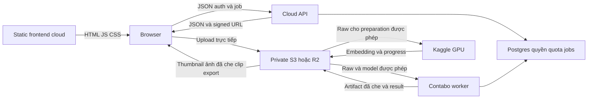

# Plan nháp: bandwidth của cloud web và quota CPU/GPU

> **LƯU TRỮ 2026-10-09.** Bản gốc: `docs/backlog/BANDWIDTH_AND_QUOTA_PLAN.md`. Chỉ tra lịch sử/tham khảo; đọc [index hiện hành](../../README.md), không dùng các lệnh/hiện trạng cũ như contract.

Ngày kiểm nguồn: **2026-10-09**. Bổ sung cho [plan multi-user/runtime/hosting](MULTI_USER_RUNTIME_HOSTING_PLAN.md), baseline `1be5869`. Chỉ tài liệu; chưa đổi code, config, DB hay hạ tầng.

> **Cập nhật PL4 / #79:** [spec pilot](../../design/DEPLOYMENT_PILOT_SPEC.md) là bản cụ thể để duyệt: Render Free API + ping Contabo, frontend static, **S3 giữ nguyên**, 2–3 accounts, CPU/GPU base reset 4 giờ + DB bonus, budget phát sinh ~2 USD/tháng ngoài VPS. R2/Railway và ví dụ 20/100 users dưới đây chỉ là nghiên cứu, không target pilot. PII chỉ tính trong **export**, preview là raw có quyền; không áp đề xuất derivative bắt buộc trước preview của §3 cũ. Credit/caps vẫn phải qua benchmark.

**Người dùng đã chốt:** PII chỉ detect mặt/biển số rồi che, không OCR/NER; web trên cloud, AI tách riêng; tài khoản mới cần quota; không làm payment/top-up online. Người dùng có thể cấp thêm trong DB hoặc dùng cơ chế reset 3–5 giờ. **Đề xuất chưa chốt:** reset 4 giờ, cách cấp credit, provider, quota ban đầu và trần toàn hệ thống.

## 1. Khuyến nghị triển khai để duyệt

- **Frontend:** React/Vite static trên Cloudflare Pages; Render Static Site cũng dùng được nếu nằm trong quota.
- **API nhẹ:** FastAPI trên Render Free cho prototype chấp nhận cold start; Railway Hobby là lựa chọn nếu có ngân sách tối thiểu 5 USD/tháng và muốn API thường trực. Không hứa toàn bộ usage luôn dưới mức này.
- **CPU AI và orchestration:** worker Contabo, một slot nặng trước. Điều phối Kaggle, đọc/validate NPZ, lưu feature cache, decode/ranking/YOLO/CLIP text/PII/ZIP nằm ở worker, không đẩy sang cloud API 512 MB.
- **GPU preparation:** DINO+pHash và CLIP image explicit trên Kaggle theo contract hiện tại; một GPU job active toàn hệ thống trước, ngân sách dùng chung theo tài khoản Kaggle thật. Giữ cache để hạn chế launch lại.
- **File:** private S3 hiện có, browser upload/download trực tiếp theo quyền API cấp. R2 là ứng viên cần so sánh nếu egress S3 chiếm phần lớn chi phí; chưa tự migrate hoặc coi adapter tương thích hoàn toàn.
- **Quota:** hai ngân sách CPU/GPU riêng cho user; base allowance reset đề xuất 4 giờ, manual bonus riêng trong DB. Global GPU budget và storage/bandwidth limits áp dụng độc lập; không payment service, không cần cron reset từng user.

## 2. Provider hỗ trợ bandwidth thế nào?

Phải phân biệt **GB/tháng** (lưu lượng/chi phí), **Mbit/s** (tốc độ đường truyền) và **CPU/RAM** (khả năng app xử lý request). Credit miễn phí không phải băng thông hay compute vô hạn. Bảng là giá/quota được công bố tại ngày kiểm, không phải SLA đo trên app.

| Nơi host | Lưu lượng/giá đã xác minh | Ý nghĩa với RAV-26 |
|---|---|---|
| Render Static/Web, workspace Hobby | 5 GB outbound/tháng dùng chung workspace; public egress vượt mức 0,15 USD/GB. Inbound không tính. Không có payment method thì có thể dừng dịch vụ đến tháng sau khi vượt quota. [Bandwidth](https://render.com/docs/outbound-bandwidth) | Proxy ảnh qua API làm tốn quota cloud web; traffic frontend/API cùng workspace phải cộng chung |
| Render Free Web | 0,1 CPU/512 MB; ngủ sau 15 phút idle, cold start khoảng một phút; 750 instance-hours/workspace/tháng. [Compute](https://render.com/docs/compute-plans), [Free](https://render.com/docs/free) | Chỉ JSON/auth/jobs; không inference, decode ảnh hoặc nhận upload lớn để xử lý đồng bộ |
| Railway | Free: 1 USD credit/tháng, tối đa 0,5 GB RAM/1 vCPU. Hobby: tối thiểu 5 USD/tháng, gồm 5 USD usage; egress 0,05 USD/GB; CPU/RAM cũng trừ usage. [Plans](https://docs.railway.com/pricing/plans) | Free không bảo đảm API chạy cả tháng. Hobby không phải phí 5 USD cộng thêm một lần toàn bộ usage; phần vượt included usage mới làm bill tăng |
| Cloudflare Pages | Công bố unlimited bandwidth/requests cho Pages; Free giới hạn 500 builds/tháng, 20.000 files/site, 25 MiB/file; Functions có quota riêng. [Pages](https://www.cloudflare.com/products/pages/), [Limits](https://developers.cloudflare.com/pages/platform/limits/) | Phù hợp HTML/JS/CSS của React. Không dùng deploy assets của Pages làm kho upload private hoặc proxy video/ảnh để lợi dụng bandwidth frontend |
| Cloudflare R2 Standard | Egress trực tiếp không tính phí; free tier 10 GB-month storage, 1 triệu Class A và 10 triệu Class B/tháng. Ngoài free storage/operations có phí. [Pricing](https://developers.cloudflare.com/r2/pricing/) | Đáng khảo sát cho nhiều lượt tải thumbnail/ảnh/video. API proxy trên Render/Railway vẫn tính egress của host đó dù nguồn là R2 |
| Contabo | Tài liệu mới công bố traffic không có default cap, có fair usage và quyền throttle; tốc độ port tùy sản phẩm. [Traffic policy](https://help.contabo.com/en/support/solutions/articles/103000271195-are-there-any-bandwidth-or-traffic-limits-at-contabo-), [Product docs](https://docs.contabo.com/docs/servers-hosting/vps/) | Dùng giả định người dùng cung cấp 200 Mbit/s để tính; không coi đó là throughput bảo đảm đến Việt Nam hoặc cho mỗi user |

Trong nguồn Render/Railway đã đọc, chưa có cam kết **Mbit/s riêng cho từng service** để dùng làm SLA ảnh của app. Railway công bố request upload body phải hoàn tất trong 5 phút; đây cũng là lý do không đưa upload video lớn qua API web. Các giới hạn edge request/connection không chứng minh FastAPI trên free compute xử lý được tương ứng. [Railway network limits](https://docs.railway.com/networking/public-networking/specs-and-limits)

Thông số Contabo hiện trên website có cấu hình 4 vCPU/8 GB/200 Mbit/s và Storage VPS 3 vCPU/8 GB với port khác. Cấu hình 3 vCPU/8 GB/200 Mbit/s của người dùng có thể là gói cũ/khác; **không tự nâng giả định thành 4 vCPU**. Chốt chính xác package/region ở Control Panel trước T1. Trang policy hiện hành quan trọng hơn bài blog traffic cũ khi hai nguồn khác nhau.

## 3. Đường truyền ảnh để tránh cloud API gánh toàn bộ bandwidth

Frontend nằm trên Render/Pages **không có nghĩa ảnh trong trang phải đi qua host frontend**. Browser nhận URL sau authorization rồi tải artifact private từ storage. API không nhận full embedding matrix/NPZ hay truyền base64 ảnh trong JSON; worker đọc feature tại nơi tính toán, chỉ trả score/evidence cần cho UI.

Ví dụ một ảnh đã che: worker đọc raw → tạo immutable derivative → PUT storage → ghi artifact/checksum/PII state → API kiểm user được xem variant đó → browser GET signed URL. Ảnh đang xử lý/lỗi có placeholder, không fallback raw. Thumbnail có version riêng; ảnh lớn chỉ tải khi mở viewer. Overlay box/class/score trả dưới dạng JSON nhỏ trên cùng ảnh, không gửi lại một PNG mới cho mỗi thay đổi overlay.

Quyền truy cập vẫn áp dụng trên artifact/video/dataset/project. Bucket private, key tenant-scoped, TTL ngắn, CORS đúng origin, không public bucket hay public cache chung. Signed URL có thể được dùng lại/chia sẻ tới khi hết hạn; không coi đó là link một lần hoặc công cụ revoke tức thì. R2 có S3 presigned URL dùng trực tiếp từ browser. [R2 access](https://developers.cloudflare.com/r2/api/s3/presigned-urls/)

Với direct signed download, quota “bytes user đã tải” không thể bị chặn chính xác chỉ bằng một lần cấp URL vì URL có thể được replay. Pilot nên hard-limit compute/storage/upload/URL issuance, theo dõi usage storage thực và trần chi phí toàn hệ thống. Nếu bắt buộc hard-cap từng byte download thì cần gateway có meter; gateway đó tăng CPU/egress/độ phức tạp, chưa đưa vào scope mặc định.

Tối ưu ban đầu: lazy-load/pagination thumbnail, cache theo artifact version và user scope, tải ảnh lớn khi cần, không preload mọi video; giới hạn download đồng thời của UI; polling job có backoff và dừng khi terminal; cache raw trên VPS giữa các vòng. Các ảnh xuất phải đúng variant/checksum của snapshot, không dùng bản thumbnail nén làm training/export.

## 4. Phép tính bandwidth để chọn quota

**Ví dụ minh họa, chưa đo app:** 100.000 lượt tải ảnh × 200 KB decimal ≈ **20 GB**. Nếu chuyển tiếp toàn bộ qua Render thì phần ảnh riêng đã vượt 5 GB included; qua Railway ghi nhận khoảng 1 USD egress usage, ngoài RAM/CPU. Đây không phải bill tổng hoặc kích thước ảnh thực tế của RAV-26.

Với 16 thumbnail/vòng, trung bình 100 KB, 50 vòng/user/ngày, 20 users hoạt động: `16 × 0,1 MB × 50 × 20 × 30 ≈ 48 GB/tháng`. Chưa gồm full image, context clip, retry, export và frontend bundles. Nếu ảnh PNG trung bình lớn hơn dự kiến, số này tăng tương ứng; phải đo bytes thực, không lấy số lượt frame làm đại diện bandwidth.

Mô hình dự báo cần lưu riêng:

- Web egress = bundle/frontend + JSON/evidence/progress/auth, nếu không proxy ảnh.
- Storage egress = ảnh/clip/export tới user + raw/model tải về Contabo/Kaggle + result worker tải lại.
- VPS network = raw cache miss tải vào + artifact upload + endpoint nào còn stream qua VPS; 200 Mbit/s ≈ 25 MB/s lý thuyết, shared toàn máy.
- Storage footprint = raw + model người dùng + derivative + embedding/artifact + upload dở; request cost theo GET/PUT/HEAD/multipart, không chỉ GB.

Chọn R2 chỉ sau phép thử private multipart, range video, signed GET/PUT, CORS, lifecycle, Kaggle access và adapter hiện có. “Egress miễn phí” không chứng minh RTT/throughput tốt; đo từ region Contabo, Kaggle và browser Việt Nam. S3 là baseline để tránh migration vội; R2 có thể trở thành lựa chọn mới nếu cost/latency và compatibility tốt hơn.

## 5. Quota tối giản, không cần payment

### 5.1 Tách loại tài nguyên

| Quota | Đơn vị/cách tính đề xuất | Có reset 3–5 giờ không? |
|---|---|---|
| CPU curation | Credit theo chi phí workload, hiệu chỉnh bằng worker CPU time/profile: YOLO original/flip, PII full+tiles, text encode, decode/ranking/ZIP | Base allowance có; số credit ban đầu chốt bằng T1 |
| GPU preparation | Dự toán và reconcile theo thời gian **session Kaggle**, kể cả overhead/attempt; có hard deadline | Allowance user có thể reset, nhưng global account quota vẫn theo Kaggle |
| Storage | Bytes của raw/model/derivative/artifact và phần upload đang reserve | **Không**; dữ liệu còn thì vẫn chiếm quota, reset giờ không tự giải phóng storage |
| Upload/input | Size file/ZIP unpacked, số frame/pixel/duration, số upload dở, schema và model được phép | Giới hạn mỗi request + persistent/global budget |
| Concurrency/queue | Active/pending jobs theo user và global CPU/GPU slots | Giới hạn tức thời, không tích lũy |
| Download/HTTP | Rate và cấp URL theo batch; global bandwidth/cost monitoring | Có rate window, nhưng signed URL byte accounting chỉ là best effort như §3 |

Không dùng “10 lần bấm AI” làm quota duy nhất: một job 16 picks, 128 candidates original+flip và 1080p PII nhiều tile có giá rất khác nhau. Cache hit không nạp/chạy model thì không trừ phần compute tương đương cache miss; rate/network caps vẫn áp dụng.

### 5.2 Chu kỳ reset: đề xuất 4 giờ, kiểm tra khi có request

Một policy cấu hình chung `reset_interval_hours=4` (có thể đổi 3 hoặc 5), anchor/window theo user và **thời gian DB/server**, không theo clock browser. Khi đọc balance hoặc tạo job, transaction xác định window hiện tại; nếu sang window mới thì cấp lại allowance cơ bản tới mức B. **Không cộng dồn B mỗi chu kỳ** cho tài khoản không dùng.

Không cần scheduler/cron chạy mỗi 4 giờ trên Render/Railway; API ngủ vẫn không làm mất/reset sai quota vì state ở Postgres. UI chỉ hiển thị balance và `next_reset_at` đã tính từ server. Lần request đầu sau khi hết window thực hiện reset một lần bằng atomic update/lock.

Job/hold đang chạy thuộc window khi reserve. Reset không xóa hold và không credit-refund job cũ vào allowance của window mới. Fixed windows có thể cho phép dùng hai allowance gần ranh giới; global budget, một active job/user và rate/cooldown ngăn burst quá tải. Nếu pilot cho thấy boundary burst đáng kể mới cân nhắc token bucket, chưa cần thêm ngay.

### 5.3 Top-up thủ công trong database

Đề xuất base allowance và **manual bonus** riêng. Người vận hành thêm adjustment trong DB với user/resource/amount/reason; không sửa đè balance computed hoặc reservation đang active. Bonus có thể giữ tới khi dùng hết, base credit reset không xóa bonus. Trường/record này không cho user tự ghi qua API/RLS.

Không cần payment gateway, invoice, purchase UI hoặc hệ thống tiền tệ. UI chỉ có số credit còn lại, thời điểm reset và lý do bị chặn. Có thể hỗ trợ operator bằng một SQL transaction/function có audit/idempotency sau khi schema đã duyệt; vẫn là thao tác thủ công trong DB, chưa viết SQL chạy thật trong plan.

Manual top-up **không tăng GPU Kaggle thực tế**, CPU máy hoặc storage provider free tier. Global caps vẫn thắng user bonus. Nếu chỉ muốn thao tác DB cấp credit và tắt reset, policy có thể giữ allowance một lần; cùng cơ chế reserve/settle, không cần một hệ thống thứ hai.

### 5.4 Reserve trước, settle sau

1. API kiểm auth/ownership/input limits, estimate chi phí theo input/model/resolution/tiles và policy version. Một job không được thay input thành lớn hơn sau khi estimate.
2. Transaction reserve user CPU/GPU credit, storage cần thiết và pending-job slot rồi ghi job/idempotency. Hai request song song không thể cùng dùng một số credit; duplicate request dùng receipt/job cũ.
3. Global CPU/GPU slot được claim khi worker dispatch, không khóa cả máy cho mọi job đang queued. Global GPU budget phải được reserve **trước launch**, xét quota tài khoản và các session/attempt còn sống.
4. Worker có chunk/deadline/resource caps; chạm trần estimate phải dừng/yêu cầu thêm allowance theo contract, không tự tính vượt quota rồi trừ âm. Input validation/cancel trước compute hoàn phần reserve chưa dùng.
5. Kết thúc ghi usage theo attempt, settle/release đúng một lần. Retry có cost riêng; reconcile sau crash/lease loss, không refund toàn bộ một session GPU đã chạy rồi tạo retry miễn phí vô hạn.
6. Nếu policy hoàn credit user do lỗi hệ thống thì ghi adjustment riêng; phần GPU provider đã tiêu vẫn phải trừ global budget. Không dùng trạng thái FAILED làm bằng chứng rằng provider không tiêu tài nguyên.

Job phải có chỗ ghi input/policy version, reserved/consumed/released và receipt/attempt ID; balance/policy/adjustment ở Postgres có quyền rõ. Không cần billing microservice, Redis hoặc per-user cron. Đây là yêu cầu hành vi để thiết kế schema, chưa chốt signature mới trong plan dẫn xuất.

## 6. Global Kaggle budget: reset user không đủ

Kaggle ghi quota GPU theo tuần, thường 30 giờ hoặc cao hơn tùy demand/resources, và có công cụ theo dõi trong notebook/profile/session management. Con số tài khoản thật tại lúc dispatch mới là đầu vào; không hardcode 30 giờ thành entitlement chắc chắn. [GPU usage docs](https://www.kaggle.com/docs/efficient-gpu-usage)

Ví dụ **giả sử** có 30 giờ/tuần: cấp 2 phút GPU/user mỗi 4 giờ, cho 100 user dùng hết, sẽ cần `100 × 2 × 6 × 7 = 8.400 phút = 140 giờ/tuần`. App reset đúng vẫn thiếu GPU hơn bốn lần. Quota user chỉ là trần cá nhân; còn trần tuần toàn hệ thống và fairness giữa người dùng.

Đề xuất:

- Một coordinator trên Contabo quản lý notebook/session/lease, global budget và một GPU slot; API cloud chỉ enqueue. Giữ credentials backend theo §19–20; không tạo account thay thế để vượt quota.
- Từ weekly quota thật, chừa headroom cho startup/model load/download/cleanup/error/retry và các session operator chạy ngoài app. Dự toán dùng thời gian session, không chỉ kernel forward time hoặc GPU utilization.
- Có global allowance theo ngày/cửa sổ để một user không đốt hết tuần đầu. Phần trăm headroom và phân bổ cụ thể sau benchmark; không hứa mọi user chắc chắn có GPU sau mỗi 4 giờ.
- Trước launch kiểm session cũ còn sống và quota snapshot mới. Nếu có API quota ổn định thì đối soát; nếu không, operator nhập quota/time snapshot trong DB và worker cập nhật usage session, có trạng thái quota chưa xác minh. Không đoán quota tài khoản từ số job app hoàn tất.
- Hết global budget hoặc provider chưa có GPU: vẫn đọc dữ liệu/cached feature và review được theo quyền; job GPU bị chặn hoặc chờ có deadline/reason rõ. Không tự fallback CPU khi §20 hiện cấm.
- Tái sử dụng feature hợp lệ để hạn chế notebook startup; giảm frame prepare/sampling chỉ sau khi duyệt contract và cache spec. Không tự giảm dữ liệu/đổi DINO/CLIP để làm quota “đủ”.

## 7. Giá trị quota pilot để chốt sau benchmark

Có thể chốt cấu trúc ngay, chưa nên đoán throughput/credit theo tên model. Đề xuất ban đầu: 1 CPU job active/user, tối đa 2 pending/user, 1 CPU heavy slot toàn VPS, 1 GPU job active toàn hệ thống; upload max-size giữ giới hạn đang có cho tới khi duyệt giá trị mới; CPU/GPU base allowance và storage/user/global được cấu hình DB.

T1 đo ít nhất: GPU startup→stop cho DINO và CLIP riêng; 16/64/128 candidates và original/flip; 720p/1080p/VFR; PII full+tiles, cache hit/miss; CPU-second/RSS, raw/result bytes, thumbnail/full/clip bytes, cloud API p95 và storage RTT. Từ đó đặt cost profile và lấy headroom trước khi cấp quota cho nhiều user mới. Registration limit/invite pilot cần nằm trong global budget, không chỉ thêm balance lớn cho mỗi tài khoản mới.

Nếu worker chỉ có 2 CPU dùng khoảng 4 giờ, trần lý thuyết là 28.800 CPU-second/window, trước overhead/headroom. Lấy tổng allowance user làm kế hoạch capacity phải nhỏ hơn ngân sách xử lý kỳ vọng, hoặc chấp nhận backlog có deadline; không suy CPU-second thành thời gian job bằng cách bỏ qua I/O/decoder.

## 8. Acceptance thêm vào T2–T6

- Hai request đồng thời trừ cùng balance, retry cùng idempotency, bonus và reset đồng thời: không trừ âm/cấp gấp đôi.
- API restart/ngủ; user chỉnh clock/browser timezone; user đăng nhập máy khác; nhiều request đầu window: `next_reset_at` và balance vẫn đúng từ DB.
- Job vắt qua reset window, cancel trước/sau compute, lease loss, hard crash, retry, operator top-up: reservation/settlement/reconciliation đúng một lần; global usage đã tiêu không tự hoàn.
- GPU quota user còn nhưng global hết, quota account chưa rõ, provider hết resource, session cũ chưa stop: trả trạng thái rõ, không launch không kiểm soát, không silent CPU fallback.
- Storage vẫn đầy sau 4 giờ; upload khai size nhỏ nhưng thực tế lớn; ZIP unpack vượt; multipart bỏ dở: complete không publish sai, có cleanup, storage reservation không biến mất vì quota reset.
- Browser gọi URL/private artifact của user khác bị chặn ở bước cấp; download trực tiếp không đi qua cloud API; signed URL expiry/replay được ghi đúng giới hạn, không tuyên bố hard-cap bytes chỉ bằng URL.
- Đo riêng egress web/storage/VPS và dùng billing/usage thật để đối soát mô hình. Không đưa raw/keys/signed URL vào log hoặc dashboard public.

## 9. Lựa chọn còn cần duyệt

| Lựa chọn | Đề xuất |
|---|---|
| Frontend | Pages để tách frontend bundle traffic khỏi 5 GB Render; Render Static nếu ưu tiên cùng provider và đủ quota |
| Cloud API | Render Free cho prototype chấp nhận cold start; Railway Hobby nếu chấp nhận phí/usage để chạy ổn định hơn; giữ FastAPI |
| Storage | Giữ S3 làm baseline, so R2 khi forecast nhiều GB ảnh/clip/raw download; chưa migrate |
| Quota refill | Base reset 4 giờ lazy/atomic, bonus top-up DB riêng, không cộng dồn base |
| Credit ban đầu | Tính theo T1 và số người pilot; có global Kaggle budget, không đặt entitlement GPU chỉ theo user count |
| Job failed/refund | Chốt error classification và policy user refund; global provider usage luôn giữ số đã tiêu |

Chưa kiểm: số dư GPU/billing của tài khoản thật, throughput từ VPS/browser, cold-start FastAPI sau tách dependency, JPEG/PNG kích thước thực và adapter R2. Phiên này chỉ kiểm nguồn public/tài liệu/repo; không chạy benchmark, launch notebook, chỉnh DB hoặc cấu hình provider.
