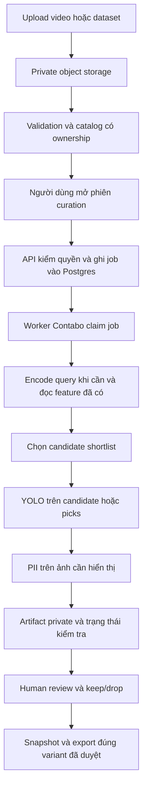
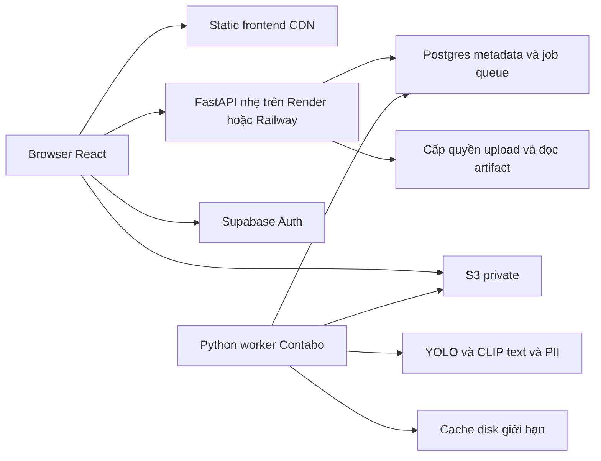

# Plan nháp: nhiều người dùng, AI trong curation và hosting tiết kiệm

> **LƯU TRỮ 2026-10-09.** Bản gốc: `docs/backlog/MULTI_USER_RUNTIME_HOSTING_PLAN.md`. Chỉ tra lịch sử/tham khảo; đọc [index hiện hành](../../README.md), không dùng các lệnh/hiện trạng cũ như contract.

Ngày: **2026-10-09**. Baseline: `duy-mvp/v2`, commit `73e2850`.

> **Cập nhật PL4 / #79:** [DEPLOYMENT_PILOT_SPEC](../../design/DEPLOYMENT_PILOT_SPEC.md) cụ thể hóa pilot mới để duyệt: 2–3 account operator cấp, user chỉ upload video, system BDD ảnh/video + local demo chỉ đọc, raw preview có quyền và **PII lúc export**, report review ngoài app. Render Free API + ping Contabo 10 phút, S3 và quota reset 4 giờ là hướng đã chốt. Các đề xuất PII-before-preview/context, user dataset/model upload hoặc review sharing ngay trong tài liệu cũ dưới đây **không còn là yêu cầu pilot**; phần rộng hơn giữ trong roadmap, không coi đã triển khai. Giá trị credit/caps và thiết kế chi tiết xem spec mới.

Cập nhật PL3 cùng ngày: người dùng chốt PII chỉ dò mặt/biển số rồi che, không OCR/NER; ưu tiên web/API nhẹ trên cloud và AI tách riêng; cần quota cho tài khoản mới, top-up thủ công trong DB hoặc reset sau 3–5 giờ. Chi tiết nghiên cứu bandwidth và quota: [BANDWIDTH_AND_QUOTA_PLAN](BANDWIDTH_AND_QUOTA_PLAN.md). Provider, quota cấp ban đầu và chu kỳ chính xác chưa chốt.

**Trạng thái: ĐỀ XUẤT, CHƯA DUYỆT. Chỉ lập kế hoạch; chưa thay code, contract, cấu hình triển khai hoặc hạ tầng.** Tài liệu này bổ sung phần execution/hosting cho [roadmap platform](CURATION_PLATFORM_ROADMAP.md), không thay nguồn sự thật ở [docs/README](../../README.md). Các lựa chọn dưới đây phải được duyệt rồi mới cập nhật CONTRACTS/architecture và triển khai từng lát.

Yêu cầu phiên này: nhiều tài khoản có thể upload video/dataset; dữ liệu của người A mặc định không được người B xem; YOLO nano, text encoder và PII chạy **trong curation**, không tự chạy lúc upload. VPS dự kiến do người dùng cung cấp: **3 vCPU, RAM 8 GB, mạng 200 Mbit/s**. Người dùng yêu cầu đọc repo, đề RAV-26 và các nhánh liên quan, **không code**.

## 1. Phương án đề xuất để duyệt

1. **Giữ React/Vite hiện có**, build thành file tĩnh trên Render Static Site hoặc Cloudflare Pages. React chạy trong trình duyệt; hosting frontend tĩnh không cần một server Node chạy thường trực.
2. **Giữ FastAPI và command/service hiện có**, tách API khỏi inference, decode, scoring lớn và ZIP export. Theo cập nhật của người dùng, ưu tiên API nhẹ trên Render/Railway, worker trên Contabo. API cùng Contabo là phương án dự phòng tiết kiệm nếu không chấp nhận giới hạn/cost của cloud web.
3. **Worker Python trên Contabo** thực thi curation và PII theo yêu cầu, điều phối preparation GPU Kaggle hiện có, có queue bền vững, quota và cache. Bắt đầu với **một slot CPU nặng cho toàn VPS**, **một slot GPU Kaggle toàn hệ thống** và ngân sách GPU chung theo quota tài khoản thật. Nhiều người có thể đăng nhập/làm việc, nhưng inference nặng sẽ xếp hàng.
4. **Supabase Auth + Postgres** cho identity, ownership, nghiệp vụ và queue; **S3 private hiện có** cho raw và artifact. SQLite và folder scan không còn là catalog dùng chung của bản deploy. Cache trên VPS có thể mất và xây lại từ storage.
5. Upload trực tiếp vào object storage theo quyền do API cấp; backend hoàn tất upload rồi enqueue validation. API không chuyển tiếp toàn bộ video/dataset và không đưa raw vào RAM.
6. PII là bước tạo **bản hiển thị/phân phối riêng** khi curation cần ảnh. Giữ nguyên raw; phiên bản xử lý, checksum và xác nhận của người kiểm tra phải đi cùng artifact. Không tự đánh dấu dữ liệu an toàn vì detector không tìm thấy gì.

Đây là cách giữ công viết lại nhỏ và tách compute web khỏi AI. Chưa có bằng chứng VPS đủ nhanh cho tải mong muốn; benchmark ở lát T1 là gate bắt buộc trước khi chốt cấu hình. Ảnh/video đi trực tiếp giữa browser/worker và storage private; API cloud chỉ nhận metadata, job và cấp quyền tải. Chuyển ngôn ngữ backend không tạo thêm CPU cho inference.

## 2. Đối chiếu đề bài và nhánh

### 2.1 Nguồn yêu cầu và giới hạn chứng cứ

- [Đề gốc lưu trong research pack](../2026-10-13/docs/research-pack/01_origin/01_original_rav26_problem.md) và [snapshot scope gốc](../2026-10-13/docs/research-pack/01_origin/02_original_prd_scope_snapshot.md) nói về tuyển chọn dữ liệu ADAS/robotics, diversity, uncertainty, coverage, human review và đánh giá cùng ngân sách.
- [PRD Gate 1 v2.1](../gate-1/RAV26_PRD_v2_1_MVP_3_weeks.md) là bản MVP đã thu hẹp, ghi nhiều tài khoản/role là non-goal. Không dùng non-goal lịch sử này để loại yêu cầu mở rộng của phiên hiện tại.
- [Focus §6](../2026-10-13/docs/research-pack/02_problem_understanding/04_data_curation_focus.md) và [gap mapping G2/G3, L10, Q3/Q4](MVP_GAP_MAPPING.md) ghi yêu cầu PII và ít nhất hai vai trò; gap mapping ghi người dùng đã xác nhận ngày 2026-10-07. Cơ chế và quyền cụ thể vẫn chưa được chốt tại baseline.
- PRD ở `origin/khanh:docs/gate1/PRD.md` ghi nguồn là hai ảnh đề RAV-26 do người dùng cung cấp trước đây. Bản chép đề trong nhánh hiện tại chưa đầy đủ câu PII/role; **không có đủ ảnh đề gốc trong các nguồn đã đọc để kiểm tra nguyên văn mọi tiêu chí**. Plan phân biệt yêu cầu ghi trong repo với lựa chọn thiết kế đề xuất, không tự coi mọi flow của một nhánh là bắt buộc của đề.
- [CONTRACTS §14–20](../../design/CONTRACTS.md) và [architecture](../../architecture_diagram.md) vẫn là thiết kế đang có hiệu lực. Dataset ảnh hiện là **reference train/fine-tune do người dùng khai báo**, pool curation là video. Mở dataset ảnh thành candidate pool cần lát thiết kế riêng.
- [Kết quả V2](../2026-10-13/docs/evaluation/V2_CRITERIA.md) ghi chất lượng ngữ nghĩa chưa đạt. Đổi hosting hoặc chạy model nhanh hơn không tự giải quyết chất lượng tuyển chọn, cũng không chứng minh mAP tăng.

### 2.2 Những nhánh đã rà

Đọc bằng `git show`/`git grep` trên các ref đang có ở máy; không checkout, merge hay fetch. SHA dưới đây giúp tái kiểm tra cùng phiên bản; không khẳng định là trạng thái mới nhất của GitHub sau lần fetch gần nhất.

| Nhánh / mốc | Kết quả liên quan | Cách dùng trong plan |
|---|---|---|
| `duy-mvp/v2` / `73e2850` | React/Vite, FastAPI, curation hai bước, YOLO theo picks/candidate, text CLIP; raw S3 và job embedding Supabase; catalog/session/feedback còn SQLite | Baseline triển khai; giữ thuật toán và provenance, thay identity/persistence/execution |
| `origin/main` / `7e1d0d3`, `origin/develop` / `24f600e` | Docs đề bài/PRD và phần template; chưa có cơ chế PII/tenant dùng được cho baseline này | Đối chiếu nguồn yêu cầu; không chuyển sang kiến trúc template chỉ để deploy |
| `origin/duy` / `ef38fd8`, `duy-test/lightly-based` / `20619d7` | Nghiên cứu thị trường/local-first và prototype cũ | Tham khảo pain point; không dùng nghiên cứu thay kiểm chứng bảo mật |
| `origin/duy-mvp/init` / `97cf0a8`, `origin/thien` / `d4efeb8` | MVP/UI cũ; thư viện chủ đề ADAS và trải nghiệm review | Chọn ý tưởng UX khi cần; các ngưỡng kịch bản mock không phải số liệu thật |
| `origin/khanh` / `b69454e` | Curator/Reviewer, PII gate theo trạng thái nhập; identity từ header tự khai; chưa tự che mặt/biển số | Tham khảo yêu cầu; không tái sử dụng header role làm xác thực |
| `origin/v1_khanh` / `1f87409`, `v2_khanh` / `77cabed`, `v3_khanh` / `46e4f53`, `v4_khanh` / `1ae0d0e` | Các phiên bản tiếp theo có PII thật, workflow, upload và tiến độ; `v4` xử lý ổn định tác vụ/review | Xem lịch sử và chọn bản mới hơn để khảo sát port; không ghép cả chuỗi nhánh |
| `origin/v5_khanh` / `95967ce` | `rav26-work/`: auth cookie/CSRF, role, worker riêng, queue SQLite/lease, PII ONNX, variant/checksum, history và export gate | Nguồn hữu ích nhất để port ý tưởng worker/PII/evidence. Phải chuyển sang ownership/Postgres của kiến trúc hiện tại |
| `origin/nam-init/mvp-v2` / `4df96fd` | Có khung downstream experiment nhưng [audit nhánh](../2026-10-13/docs/backlog/branch_review_2026-10-03.md) chỉ ra một số pipeline/số mAP giả | Chỉ tham khảo cấu trúc sau khi đọc code từng phần; không dùng report đó làm bằng chứng |

**Lưu ý về `v5_khanh`:** có đăng nhập và quyền theo role không đồng nghĩa đã cô lập dữ liệu từng người. Ví dụ `rav26-work/app/api.py::datasets` gọi `list_datasets()` cho curator; `repository.py::list_datasets` lấy catalog chung, không lọc tenant. Không merge nhánh này rồi tuyên bố đã có multi-user private.

Nguồn nhánh để đọc lại ở đúng commit: [PRD `khanh`](https://github.com/AI20K-Build-Phase-Cohort-4/P-026/blob/b69454eeb32ca2949c37c2cc3d0632b81b21e599/docs/gate1/PRD.md), [PII automation `v5_khanh`](https://github.com/AI20K-Build-Phase-Cohort-4/P-026/blob/95967ce4d2e6d8af23bab96ebcb4ebe2f40991e1/rav26-work/docs/PII_AUTOMATION.md), [PII runtime](https://github.com/AI20K-Build-Phase-Cohort-4/P-026/blob/95967ce4d2e6d8af23bab96ebcb4ebe2f40991e1/rav26-work/app/services/pii.py), [worker queue](https://github.com/AI20K-Build-Phase-Cohort-4/P-026/blob/95967ce4d2e6d8af23bab96ebcb4ebe2f40991e1/rav26-work/app/services/work_queue.py), [workflow](https://github.com/AI20K-Build-Phase-Cohort-4/P-026/blob/95967ce4d2e6d8af23bab96ebcb4ebe2f40991e1/rav26-work/docs/WORKFLOW_V2.md).

## 3. Ba phần AI thực tế là gì?

| Phần nghiệp vụ | Bằng chứng trong repo | Đề xuất chạy trong curation |
|---|---|---|
| YOLO perception | Baseline [pipeline](../../../src/rav/pipeline/batch_yolo.py) nạp checkpoint YOLO detection người dùng đã chọn, CPU, `imgsz=640`; recipe consistency chạy ảnh gốc và ảnh lật | Chạy trên candidate shortlist/picks, không toàn bộ video lúc upload. Nano là cấu hình tiết kiệm cần chốt checkpoint; không tự bỏ hỗ trợ model tham chiếu đã có trong §16–18 |
| Text encoder | [CLIP B/32](../../../src/rav/components/features/clip_b32.py), checkpoint/revision pin, vector projection 512 chiều chuẩn hóa; `_load` hiện nạp cả CLIP image/text | Encode khi người dùng chốt/đổi query, cache theo tenant/query/model version. Thử chỉ nạp `CLIPTextModelWithProjection` cùng checkpoint để giảm RAM; phải kiểm parity với image embedding hiện có |
| PII | `v5_khanh:rav26-work/app/services/pii.py`, `docs/PII_AUTOMATION.md`, `scripts/setup_pii_models.py` | Tham khảo YuNet ONNX dò **mặt** và YOLOv9-t ONNX dò **biển số**; xử lý ảnh cần xem/xuất trong curation, cache variant bất biến |

**Phạm vi PII đã được người dùng làm rõ: detect mặt và biển số rồi che; không cần OCR/NER.** Hai detector ở nhánh liên quan là phương án tham khảo phù hợp để benchmark. Chọn checkpoint/runtime, quality gate và quyền xem raw vẫn phải thiết kế. Không mở thêm OCR đọc tên hoặc nhận dạng danh tính.

Ba **phần** nghiệp vụ có thể là **ít nhất bốn model runtime**: YOLO perception, CLIP text, YuNet face, YOLO plate. Chưa tính DINO/CLIP image encoder cho feature preparation. Không ước tính RAM bằng số lượng “3 model” chung chung.

Hai checkpoint PII tìm được ở nhánh tham khảo:

- `face_detection_yunet_2023mar.onnx`, SHA256 `8f2383e4dd3cfbb4553ea8718107fc0423210dc964f9f4280604804ed2552fa4`.
- `yolo-v9-t-640-license-plates-end2end.onnx`, SHA256 `c3c1026ca7d0585dd88084d68182dd897113712fa734ae1557ca70174440c076`.

Đây là checksum ghi trong nhánh, **chưa tải hoặc chạy lại trong phiên lập plan**. Nguồn publisher: [OpenCV Zoo YuNet](https://github.com/opencv/opencv_zoo/tree/main/models/face_detection_yunet), [Open Image Models](https://github.com/ankandrew/open-image-models). Detector plate không đọc nội dung biển số. Chất lượng PII trên dữ liệu thực tế của dự án chưa được đánh giá đầy đủ; report 8 ảnh trong nhánh không chứng minh không bỏ sót.

## 4. Luồng AI trong curation

Sơ đồ là luồng nghiệp vụ; không bắt buộc cả ba phần chạy lại trong mọi vòng hay chạy theo đúng một thứ tự kỹ thuật duy nhất. Worker nên decode một lần và dùng ảnh đó cho các bước được phép. Tính điểm trên raw hay redacted là quyết định ở §5.

### 4.1 Upload và preparation

- Upload chỉ lưu và validation kỹ thuật: loại file, dung lượng, checksum, decode/probe có giới hạn, schema nhãn. **Không tự chạy YOLO/text/PII trên toàn bộ dữ liệu.**
- DINO+pHash và CLIP **image** feature preparation hiện là job explicit trên Kaggle, khác CLIP **text** encode trong curation. Giữ sự phân biệt này khi viết contract mới; không gọi cả hai là “text encoder”.
- Không dùng encoder văn bản khác với image embedding hiện có; đổi embedding space phải tạo version/cache mới và đánh giá lại recipe.
- Dataset reference có thể cần feature riêng phục vụ novelty/reference_diversity. Chuyển chỗ chạy preparation phải ghi rõ executor, chi phí, provenance và tương thích cache.

### 4.2 Khi curation cần ảnh

1. API xác thực và kiểm quyền toàn bộ session, video/dataset/model/reference, rồi ghi job với input version cố định.
2. Worker đọc raw được cấp quyền, dùng cache trên VPS nếu hợp lệ, decode đúng `frame_index` kể cả VFR. Có thể decode theo thứ tự thời gian để giảm seek rồi khôi phục đúng thứ tự unit IDs.
3. Encode text một lần cho query/version; ranking feature lớn, diversity và YOLO chạy ở worker. Kết quả cache cùng scope, checksum, model/config/runtime version.
4. PII tạo derivative cho ảnh sắp hiển thị, thumbnail/contact sheet và ngữ cảnh cần phục vụ. Trong lúc xử lý UI hiện placeholder/progress; lỗi không tự trả ảnh gốc qua endpoint ảnh thông thường.
5. Detector tạo trạng thái xử lý và bằng chứng. Xác nhận của người kiểm tra là trạng thái riêng, gắn đúng artifact checksum/processing ID. Không detection vẫn có thể chứa PII.
6. Export dùng snapshot và variant đã được cho phép; thay raw/model/policy hoặc thu hồi quyền/xác nhận thì phải kiểm lại điều kiện phân phối. Lịch sử cũ vẫn truy vết được.

Cache kết quả sau lần curation đầu tiên là hợp lý; không đồng nghĩa phải inference lại mỗi lần mở ảnh. Chia job theo từng item/chunk và chỉ publish kết quả còn phù hợp với phiên. Người dùng đổi goal/pool/model hoặc keep/drop trong lúc job chạy phải làm kết quả cũ bị từ chối hoặc đánh dấu stale theo contract.

## 5. Những xung đột phải giải quyết trong thiết kế trước code

| Vấn đề | Vì sao không thể bỏ qua | Đề xuất để duyệt |
|---|---|---|
| PII chỉ chạy trong curation nhưng thumbnail/video xem trước có thể xuất hiện từ trang kho | Cho raw ra browser trước curation có thể bỏ qua policy PII | Trang kho mặc định dùng metadata/placeholder. Preview có thể khởi tạo job PII on-demand cùng cơ chế curation; chưa có bản xử lý thì chặn endpoint thường. Nếu muốn xem raw, cần quyền riêng có audit trong đúng tenant |
| Video ngữ cảnh ±vài giây | Che một anchor không che được mọi frame trong video phát | Không dùng signed URL raw làm video preview mặc định. Thiết kế redacted context clip hoặc quyền xem raw rõ ràng; đo latency/cost của clip. Không âm thầm bỏ yêu cầu ngữ cảnh để giảm tải |
| Chấm raw hay bản che | Blur có thể đổi embedding, prediction và chất lượng tuyển chọn | Đề xuất inference nội bộ trên raw trong worker tin cậy, hiển thị/export derivative. Ghi rõ hai variant và provenance; đánh giá lại nếu training/labeling dùng bản che |
| Kaggle nhận raw trước PII | Notebook private vẫn là dữ liệu chuyển tới provider khác | Với dữ liệu được phép đưa tới Kaggle: consent/policy phải cho phép raw, không suy quyền từ trạng thái public dataset. Với dữ liệu chỉ được xử lý trên VPS: thay executor preparation sau khi duyệt §20, benchmark CPU hoặc compute riêng được phép. Không lén thêm PII preprocessing lúc upload |
| Phạm vi PII | Người dùng đã chốt mặt/biển số, không OCR/NER | Thử detector face/plate ở nhánh tham khảo; chốt checkpoint/quality/raw-access, không thêm scope đọc tên |
| Hai vai trò nhưng dữ liệu riêng từng người | Role Reviewer toàn hệ thống không được tự đọc mọi dataset | Curator/Reviewer chỉ có quyền trong project được cấp. Người B chỉ review dữ liệu A sau grant/invitation rõ ràng; không tự chia sẻ toàn bộ kho khi đổi role |
| Custom `.pt` | Upload thành công/SHA hợp lệ không chứng minh checkpoint an toàn | Giai đoạn đầu chạy checkpoint hệ thống tin cậy; model người dùng phải qua policy tin cậy/runtime cách ly hoặc định dạng được duyệt. Nếu hạn chế so với §16–18, phải ghi “Hướng tới” sau khi được duyệt |

Ảnh raw có thể chứa PII dù thuộc đúng tài khoản. **Cô lập người dùng và ẩn danh PII là hai điều kiện riêng**, đều cần kiểm tra. Bộ detector PII không tự bảo vệ tên file, metadata, text goal hay log gửi ra LLM.

## 6. Topology triển khai và lựa chọn framework

Auth cụ thể theo flow được duyệt: Supabase làm identity provider, API/BFF quản lý phiên và authorization. Mũi tên Browser–Auth không cho phép frontend tự chọn role/owner. Worker lấy job bằng kết nối outbound tới DB/storage; không cần public HTTP endpoint chạy model.

| Phương án | Phần giữ/đổi | Chi phí và đánh đổi | Nhận định |
|---|---|---|---|
| A. Static React miễn phí + FastAPI/worker cùng Contabo | Tách process/dependency/resources, giữ command/service | Không thêm compute API; API và worker chung failure domain | Fallback nếu cloud web vượt ngân sách hoặc không đáp ứng nhu cầu |
| **B. Static React miễn phí + FastAPI Render Free + worker Contabo** | API stateless, job/metadata ngoài Render; raw/ảnh đi trực tiếp storage | Tách RAM/CPU API khỏi VPS nhưng có cold start và quota; API bị giới hạn 0.1 CPU/512 MB | **Phương án prototype theo hướng người dùng**, nếu chấp nhận chờ |
| B2. Static React miễn phí + FastAPI Railway + worker Contabo | Cùng boundary như B; không đưa ảnh qua API | Free có credit thấp; Hobby từ 5 USD/tháng, tính compute và egress trong usage | Cân nhắc nếu muốn API thường trực và có ngân sách; xem bảng bandwidth |
| C. Static React + Express/Nest API + Python worker | Viết lại API/domain/auth/queue adapter, vẫn cần Python ML | Tốn công port và regression; không giảm CPU inference. Một API TS có thể nhẹ nhưng cần đo so với FastAPI đã tách ML | Chỉ chọn nếu nhóm muốn duy trì TypeScript backend lâu dài |
| D. Next.js/full-stack SSR + Python worker | Frontend và API TS, thêm SSR/server hosting | Công cụ curation không có nhu cầu SEO thể hiện trong repo; SSR không giải quyết upload isolation hoặc inference | Chưa thấy lợi ích đủ mạnh cho giai đoạn này |
| E. Cùng một VPS, serve React tĩnh qua reverse proxy | Không dùng CDN free riêng, vẫn tách API/worker | Ít dịch vụ và dễ cùng origin; tải file tĩnh nhẹ nhưng bandwidth cùng VPS | Fallback đơn giản nếu DNS/cookie/CDN setup vượt ngân sách |

Điểm ranh giới cần làm thật là **API không inference và không phụ thuộc file local để sống**, không phải Python đối lập Node. Existing API còn import dùng chung với pipeline; phải đo cold-start/RSS và tách dependency ML khỏi image API, không chỉ chuyển câu `predict` sang một endpoint khác.

### 6.1 Render Free cần hiểu đúng

Render hỗ trợ cả Python lẫn Node. Free web service ngủ sau 15 phút không có inbound traffic; thức lại khoảng một phút; filesystem mất dữ liệu khi restart/redeploy/spin-down. Free Postgres hết hạn sau 30 ngày và không có backup. Không dùng SQLite/upload/job queue trên filesystem Render làm nguồn sự thật. [Render Free](https://render.com/docs/free)

Free web compute hiện là **0.1 CPU, 512 MB RAM**; static sites không có compute plan. Frontend React tĩnh miễn phí không đòi chuyển FastAPI thành Express. [Compute plans](https://render.com/docs/compute-plans), [Static sites](https://render.com/docs/static-sites)

Nếu chọn B: API ghi job và trả `202` sau transaction; worker trên VPS tự claim từ Postgres, ghi progress/result vào DB/storage. API ngủ, browser đóng hoặc redeploy **không được làm mất job**. Browser mở lại đọc trạng thái đã lưu; không cần worker callback vào một API đang ngủ. Không giữ free service bằng ping vòng lặp như một yêu cầu của kiến trúc.

### 6.3 Bandwidth của web host và đường truyền ảnh

Render Hobby hiện gồm 5 GB outbound/tháng cho workspace; Railway metered egress 0,05 USD/GB. Vì workload nhiều ảnh, thiết kế API chỉ trả JSON và signed URL, browser tải artifact đã che trực tiếp storage; worker gửi ảnh/artifact lên storage, không stream qua cloud API. So sánh Render/Railway/Pages/R2/Contabo, giới hạn request và phép tính workload ở [plan bandwidth và quota §2–4](BANDWIDTH_AND_QUOTA_PLAN.md).

### 6.2 HTTPS, origin và cookie

Đề xuất `app.<domain>` cho frontend và `api.<domain>` cho API, HTTPS, cấu hình CORS đúng origin và credentials, cookie HttpOnly/Secure, kiểm Origin/CSRF với thao tác ghi. Cookie SameSite không thay authorization.

Nếu dùng frontend `.pages.dev`/`.onrender.com` và API ở một site khác, không mặc định cookie `SameSite=Lax` hoạt động cho mọi fetch; phải chốt flow cross-site hoặc dùng cùng origin qua proxy. Việc có custom domain có thể thêm phí tên miền. Topology E là lựa chọn cùng origin đơn giản; không thêm gateway/framework chỉ để né quyết định auth.

## 7. Tài nguyên Contabo: ngân sách ban đầu, chưa phải kết quả benchmark

| Phần | Ngân sách thử ban đầu | Cách thực thi |
|---|---|---|
| API + reverse proxy | Khoảng 1 vCPU, trần RAM khoảng 1 GB | Một API process trước; không nạp model, decode video, scan dataset hay ZIP đồng bộ |
| Worker + decode + model | Tối đa khoảng 2 vCPU, trần RAM khoảng 5 GB | Một heavy slot; chunk theo item, giới hạn thread và batch; không preload thêm bản model trong mỗi ASGI worker |
| OS, page cache, supervisor và dự phòng | Khoảng 2 GB RAM | Theo dõi RSS/cgroup và disk; giới hạn worker không tiêu hết RAM máy |

Bảng là cấu hình bảo thủ cho fallback API cùng VPS. Với API trên cloud, vẫn bắt đầu worker khoảng 2 vCPU/5 GB RAM; T1 mới quyết định tăng ngân sách cho worker, không mặc định dùng hết 3 vCPU/8 GB. [Quota chi tiết](BANDWIDTH_AND_QUOTA_PLAN.md): CPU/GPU tách riêng, đề xuất reset credit cơ bản 4 giờ, top-up DB thủ công, có reserve/settle và global Kaggle budget; storage không reset theo giờ.

Các con số là **cấu hình admission đề xuất**, không phải RAM model đã đo hay bảo đảm chia CPU thành lõi riêng. CPU quota không tự tạo độ trễ ổn định; cần đo contention, I/O và tài nguyên host chia sẻ. Không xem swap là cách đạt mục tiêu latency.

- Giới hạn thread tổng: thử Torch intra-op 1–2, ONNX intra-op 1–2/inter-op 1, OpenCV 1, OMP/MKL theo ngân sách. Không cho từng thư viện tự dùng cả máy; các stage nặng chạy tuần tự trong slot. [PyTorch `set_num_threads`](https://docs.pytorch.org/docs/stable/generated/torch.set_num_threads.html)
- Nạp/cached model tin cậy một lần trong worker nếu footprint cho phép. Cache model có trần và eviction; không giữ checkpoint của mọi người dùng trong RAM. Model do người dùng cung cấp không chạy trong shared trusted process chỉ vì có cache.
- Text encoder cân nhắc chỉ nạp text tower có projection cùng CLIP checkpoint; giữ tokenizer, revision, 512 chiều và L2. [Hugging Face CLIP](https://huggingface.co/docs/transformers/model_doc/clip#transformers.CLIPTextModelWithProjection)
- YOLO ONNX/quantization là thử nghiệm tối ưu sau bản đúng: đo numerical/selection parity, bbox/class/confidence/flip consistency và chất lượng trước khi đổi runtime. Không lấy benchmark hãng làm tốc độ của Contabo.
- PII `v5_khanh` dùng cả ảnh đầy đủ và tile 640 overlap 20%. Với ảnh 1920×1080, quy tắc hiện tại tạo **8 tile + 1 ảnh đầy đủ**, mỗi cửa sổ chạy face và plate: khoảng **18 lượt detector/ảnh**. 16 ảnh là 288 lượt PII; đây là đếm từ code, chưa là thời gian chạy. Không giảm tile/resolution/ngưỡng âm thầm vì ảnh hưởng bỏ sót.
- YOLO consistency trên 128 candidates có khoảng 256 lượt forward ảnh gốc/lật, ngoài decode, PII, ranking và I/O. Batch 16 picks không có nghĩa toàn job chỉ chạy YOLO 16 lần.
- Mạng 200 Mbit/s tương đương tối đa lý thuyết **25 MB/s**. Tải 1 GB decimal mất tối thiểu khoảng **40 giây** trước overhead. Băng thông chia sẻ giữa tải raw, preview, result và người dùng; không coi 200 Mbit/s là phần riêng của từng user.
- Raw cache disk có quota, TTL/LRU và checksum; dùng lại giữa các vòng, tránh tải lại cả video cho mỗi batch. Trần cụ thể chốt sau khi biết dung lượng SSD còn lại; không suy RAM 8 GB thành dung lượng disk.

Queue cần công bằng theo tenant: job interactive ngắn có thể ưu tiên, job dài chia chunk, có aging để không bỏ đói job cũ. Ban đầu đề xuất mỗi người một heavy job active và số pending có trần; giá trị quota phải được duyệt. Một người upload 100 video không được khóa toàn bộ curation của người khác.

Lease/fencing bảo vệ quyền ghi kết quả, không tự bảo đảm inference chỉ thực thi đúng một lần. Worker mất lease phải dừng ở ranh giới chunk và không tiếp tục claim job; supervisor/resource slot trên host ngăn process cũ và mới cùng dùng quá ngân sách. Cho phép retry tính lại một phần sau crash nhưng không nhân đôi kết quả nghiệp vụ.

## 8. Danh sách thay đổi bắt buộc

Thứ tự ưu tiên: **P0 trước khi mời người dùng thật**, P1 trước pilot ổn định; P2 chỉ khi có nhu cầu đo được. Những policy làm hẹp contract phải được duyệt trước khi code.

| # | Mức | Cần đổi | Cụ thể và bằng chứng hiện tại |
|---|---|---|---|
| 1 | P0 | Identity và session | Supabase Auth/BFF hoặc cơ chế được duyệt; backend xác minh actor, session hết hạn/thu hồi, login abuse, CSRF. Không tin role/owner từ client hoặc `human:local` |
| 2 | P0 | Ownership xuyên suốt | Tenant/workspace và project private mặc định; owner/membership trên video, dataset version, model, session, proposal, snapshot, job, artifact, export và audit. Grant chia sẻ phải rõ ràng, không có role toàn hệ thống đọc mọi tài nguyên |
| 3 | P0 | Authorization ở command/service | Mở rộng execution context theo thiết kế được duyệt trong §11; HTTP/agent/CLI/worker không đi đường vòng. Kiểm cả tài nguyên đích và mọi reference thuộc scope, kể cả join/list/filter/pagination/batch request |
| 4 | P0 | DB và catalog | Migrate catalog/session/feedback/snapshot/model từ SQLite + folder scan sang Postgres. Tenant-scoped unique/FK, index theo scope, transaction + version, migration có đối soát; không chỉ thêm bảng users |
| 5 | P0 | RLS và DB credentials | API runtime không có quyền vượt RLS mặc định; actor scope đặt trong transaction và không rò qua connection pool. Service-role Supabase có thể bypass RLS; tách migration/admin/worker role với quyền tối thiểu, không coi bật RLS là đủ |
| 6 | P0 | Video/dataset upload | Upload session private, direct S3 multipart/resume; checksum/complete/abort có owner. Dataset nhận upload từ browser theo manifest/folder/ZIP được hỗ trợ; không yêu cầu đường dẫn trên máy server |
| 7 | P0 | Validation cách ly | Giới hạn file/giải nén/pixel/duration/frame count/CPU/time; chặn traversal/symlink/ZIP bomb, probe có timeout, không SSRF theo URL arbitrary. Dataset annotation validation giữ đúng schema và split/provenance; input lỗi không tạo catalog “ready” |
| 8 | P0 | S3 key và quyền storage | Bucket private, object key có tenant/project + asset/version/attempt. Cấp signed URL sau kiểm quyền, TTL ngắn, staging key duy nhất, không overwrite artifact đã publish. URL là bearer capability trong thời hạn; không đưa token vào log |
| 9 | P0 | Dedup, ID và cache | `video_id` hash, model SHA, dataset name, feature part/input_key hiện chung. Dùng resource ID riêng có scope; hash nội dung để integrity/dedup **trong tenant**. Không trả “file đã tồn tại”/cache hit của người khác; cache/raw/proposal/text không dùng tên toàn cục làm quyền truy cập |
| 10 | P0 | Media và cache HTTP | [routes](../../../src/rav/api/routes.py) đang `public, immutable`; [media](../../../src/rav/api/media.py) chưa auth. Mọi frame/video/thumbnail/context/contact sheet phải kiểm quyền và variant; private/no-store theo policy, không để CDN/service worker/browser cache giữ dữ liệu sau logout/đổi account |
| 11 | P0 | Worker độc lập | Bỏ thực thi nặng trong API/in-process queue. Chuyển proposal/scoring, YOLO, text encode, PII, dataset scan/prepare, decode và ZIP sang executor Python; API chỉ validate, enqueue và đọc kết quả |
| 12 | P0 | Queue và recovery | Job/attempt/progress/item kết quả ở Postgres + artifact storage; atomic claim, heartbeat/lease, fencing token, timeout/retry/cancel, idempotency tenant-scoped. Worker cũ mất lease không được publish; duplicate delivery không nhân đôi feedback/proposal/export |
| 13 | P0 | Worker permission và model trust | Job chỉ tham chiếu asset đã được API kiểm; worker xác minh scope/version khi claim/publish và dùng credential hạn chế. Untrusted `.pt` là nguy cơ chạy code; không cho checkpoint của A đọc raw/secrets của B. Sandbox có network/memory/time/disk caps; chốt định dạng/trust policy trước |
| 14 | P0 | PII contract và human evidence | Phạm vi đã chốt face/plate, không OCR/NER. Port detector/variant/evidence từ `v5_khanh`; tách processed/uncertain/error khỏi human cleared. Policy trước display/external API/export, raw access riêng, revoke và cache invalidation |
| 15 | P0 | Concurrency nghiệp vụ | Global lock trong App không bảo vệ nhiều process/máy. Dùng transaction/optimistic version cho keep/drop, submit/review, snapshot, pool/model changes. Publish job kiểm input state; một phiên không được ghi đè quyết định mới bằng kết quả cũ |
| 16 | P0 | Quota và tài nguyên | Bắt buộc cho tài khoản mới. Theo user/tenant: CPU/GPU credit, storage, upload, active/pending jobs, model size, decode/export. Reserve trước enqueue/launch, settle theo attempt; top-up DB hoặc reset 3–5 giờ, không payment. Global Kaggle budget không reset theo credit user; chi tiết trong plan quota |
| 17 | P0 | Snapshot/export/lifecycle | Metadata snapshot không đủ cho bản deploy: artifact private, export job async, checksum/variant/provenance, check quyền trước tạo và cấp link. Không public download mặc định như một số flow nhánh cũ; revoke/retention/delete/ref-count không xóa file còn được snapshot/job hợp lệ dùng |
| 18 | P1 | Frontend cho multi-user/job | Login/logout, kho riêng, explicit upload/preparation/curation trạng thái; queue wait khác inference progress, cancel/retry/error/stale. Xóa query cache/account state khi logout; không hiện signed URL raw hoặc owner selector tùy ý |
| 19 | P0/P1 | Build và vận hành | Tách API/worker dependencies và image; `.dockerignore` hiện thiếu `data/`/`output/`, `COPY . .` có thể đóng gói dữ liệu local. Migrations là bước deploy riêng, health/readiness, supervised worker, secret rotation, TLS, backup/restore, audit và log không chứa raw/credential |
| 20 | P1 | Hiệu năng và chất lượng | Pool/ranking có giới hạn hoặc chunk, metric tránh mảng N×N lớn; frame decode/cache có trần. Benchmark thực tế cùng PII/context; đánh giá privacy/semantic quality riêng. UI keyboard response không thay AI latency hoặc bằng chứng mAP |

Tham chiếu bảo mật kỹ thuật: [OWASP authorization](https://cheatsheetseries.owasp.org/cheatsheets/Authorization_Cheat_Sheet.html), [upload](https://cheatsheetseries.owasp.org/cheatsheets/File_Upload_Cheat_Sheet.html), [Supabase RLS](https://supabase.com/docs/guides/database/postgres/row-level-security), [S3 presigned URL](https://docs.aws.amazon.com/AmazonS3/latest/userguide/using-presigned-url.html), [PyTorch model trust](https://github.com/pytorch/pytorch/security/policy).

## 9. Data model và job contract để thiết kế tiếp

Không chốt signature/schema mới trong plan dẫn xuất. Đây là danh sách yêu cầu phải đưa vào CONTRACTS/architecture khi duyệt T0:

- `User`, `Workspace/tenant`, `Project`, `Membership/Grant`; tài khoản mới có vùng private riêng. Mô hình workspace/project theo roadmap PL1 có thể hỗ trợ chia sẻ sau, nhưng triển khai đầu không bắt buộc có billing, organization SSO hay toàn bộ task management.
- `Asset` + immutable version: video, dataset reference, model, redacted derivative; checksum, source, policy, owner scope và state.
- Session/proposal/feedback/snapshot giữ semantics hiện có; thêm actor, ownership và optimistic version. Curator/Reviewer hoạt động trong scope được cấp, không biến mọi upload thành kho chung.
- `UploadSession`, `Job`, `Attempt`, `Artifact`, `PIIRun/ReviewEvidence`, `Export`, `AuditEvent`. Không lưu vector lớn/raw hay toàn detections JSON vô hạn trong một cột session.
- Job input tối thiểu: actor/tenant/project, loại job, resource/input versions, ordered unit IDs, query/model/feature/policy versions, idempotency key, budget và output prefix. Worker không nhận tùy ý path/URL/shell từ client.
- Result có attempt/fencing token, checksum, schema/shape/IDs, producer/runtime/model/config version, status/warning và artifact refs. API chỉ publish khi quyền và input state còn hợp lệ; partial artifact chưa publish không được frontend đoán URL để đọc.
- Giao thức tiến độ thống nhất cho job local/VPS/Kaggle nếu vẫn giữ: `queued/running/cancel_requested/succeeded/failed/cancelled` hoặc enum được duyệt, item/chunk count thật. Không suy “100%” từ stage khởi động model.

Cách ly dữ liệu là boundary bắt buộc; tách microservice cho mỗi model, Kubernetes, Kafka, vector DB riêng hay Redis/Celery chưa phải điều kiện. Postgres queue + một worker đủ là thiết kế khởi đầu nếu benchmark chứng minh phù hợp.

## 10. Migrate và port nhánh theo từng phần

1. Chụp backup/manifest SQLite, raw, model, cache và artifact hiện tại. Chọn **một tenant legacy được chỉ định** cho dữ liệu local cũ; không tự cấp mọi tài khoản quyền đọc legacy. Dữ liệu không ánh xạ được đưa vào trạng thái chưa gán, không public.
2. Migrate metadata/IDs/reference graph trước; giữ ID cũ làm legacy mapping nếu đổi identity. Đối soát row count, checksum, ordered IDs, decision history, snapshot hash và model–dataset liên hệ.
3. Copy/rekey object tới private prefix mới theo manifest; kiểm SHA trước khi đổi pointer. Cache có thể tái sử dụng nếu provenance/scope khớp; artifact không xác minh được thì invalid, không ép thành ready.
4. Cutover có maintenance window hoặc cơ chế ghi được thiết kế rõ; chưa cần dual-write phức tạp. Giữ backup rollback; không overwrite nguồn local trong lúc chuyển.
5. Port từ `v5_khanh` theo feature, không merge toàn nhánh: PII detector/config/immutable derivative và human evidence; worker queue semantics; auth/CSRF/revocation ý tưởng; export live gate/history. Viết lại adapter theo CONTRACTS và Postgres/ownership mới.
6. Không port nguyên SQLite OS lock/PID trên máy này làm distributed fence. Heartbeat và fencing phải bảo vệ cả worker restart/mất mạng/API ở máy khác. Không port public share link mặc định vào yêu cầu dữ liệu riêng tư.

## 11. Roadmap implementation để người dùng duyệt

Các lát dưới đây **chưa bắt đầu**. Tên T0–T7 tránh nhầm với R0–R6 của roadmap PL1; khi duyệt phải ánh xạ về PLAN và guide, mỗi phiên một lát.

| Lát | Đầu ra cụ thể | Gate trước khi qua lát tiếp |
|---|---|---|
| **T0 — chốt thiết kế** | Phạm vi face/plate đã chốt; duyệt cloud provider, tenancy/sharing/roles, raw preview, Kaggle policy, model trust, reset/top-up quota; cập nhật CONTRACTS/architecture/UI_DESIGN/LOCAL_LIMITS | Không còn xung đột ngầm giữa PII runtime, preview, §16–20 và private data |
| **T1 — benchmark feasibility** | Harness/containers thử trên **VPS thật**, pin YOLO nano/CLIP text/YuNet/plate; cold/warm/RSS/CPU/I/O, cloud API và đường truyền storage, session GPU startup/stop, credit cost; parity text/runtime | Xác nhận footprint, latency/GB/tháng và quota hợp ngân sách; chọn Render/Railway/Pages, batch/chunk/resource budget bằng số đo |
| **T2 — private vertical slice** | Auth, Postgres nghiệp vụ tối thiểu, ownership/RLS, một video→session→media→job được kiểm quyền; migration legacy mẫu | Hai tài khoản A/B không thể list/read/write/download/cancel hoặc tham chiếu chéo, kể cả đoán ID và gọi command trực tiếp |
| **T3 — upload và dataset** | Direct resumable S3 upload, complete/abort, validation worker, dataset reference upload/browser workflow, provenance và quotas | File lỗi/ZIP bomb/traversal/annotation lỗi bị chặn, không mất upload hợp lệ khi restart; private từ staging tới artifact |
| **T4 — curation worker** | Queue/attempt/fencing, proposal hai bước, YOLO/text runtime, feature/ranking IO, cancel/retry/state version, cache giới hạn | Restart/duplicate/lease loss không nhân đôi hoặc publish sai state; worker không phụ thuộc API sống; output giữ ordered IDs/evidence |
| **T5 — PII và phân phối** | PII runtime on-demand, thumbnail/frame/context variant, human evidence/raw permission, snapshot/export async và revoke | Mọi đường ảnh/clip/ZIP có đúng scope/variant; lỗi PII không fallback raw. Gán và đo lỗi PII trên tập đại diện; manual review xử lý trường hợp uncertain |
| **T6 — staging/pilot** | Static frontend, TLS/CORS/session thật, production images, DB migration/cutover, backup restore, monitoring/cost alerts; load test | Toàn acceptance §12 đạt, restore thử thành công, đo queue fairness và chất lượng; chưa đạt không mời người dùng thật |
| **T7 — mở rộng theo nhu cầu** | Thêm compute worker/API riêng, model support, redacted video tối ưu, workflow/team nâng cao | Dựa trên bottleneck/nhu cầu đã đo; không mặc định triển khai toàn bộ roadmap platform ngay |

Phụ thuộc quan trọng: T1 có thể thử bằng harness riêng trước phần auth, nhưng không deploy harness thành API public. T2/T3/T4 không mở cho người dùng thật trước T5/T6. Không đánh dấu checkbox implementation hoàn thành vì plan đã viết.

## 12. Acceptance và benchmark cần thực hiện khi được duyệt

### 12.1 Cô lập người dùng

- A/B upload cùng một nội dung, trùng tên dataset/model, dùng ID của nhau ở URL/body/reference. B không nhìn thấy existence, metadata, progress, error chi tiết, raw, thumbnail, feature, evidence, snapshot hoặc export của A.
- Kiểm list/search/count/pagination, model→dataset, session→video, snapshot→members, artifact/job attempt, cancellation và audit; không chỉ kiểm trang kho. Theo policy thống nhất, response tránh tiết lộ resource ngoài scope.
- Logout/login B trên cùng browser không còn thumbnail/query cache/signed URL hiển thị của A. Thu hồi membership/session trong khi upload/job chạy phải được xử lý đúng ở complete và publish.
- Kiểm RLS bằng đúng runtime credentials và connection pool; request A/B nối tiếp không rò actor. Service-role/admin/worker privileges được kiểm riêng.

### 12.2 Job, correctness và PII

- API tắt/redeploy/ngủ khi worker chạy; worker kill/restart, mất mạng, hết lease, retry/cancel, duplicate request. Không job/proposal/decision/export nhân đôi; stale worker không publish.
- Curation output so với baseline trên cùng asset/version/query/model/config/seed: unit ordering, exact frame/VFR, vector shape/L2, detection overlay và flip score. Runtime tối ưu chỉ được bật nếu parity/quality đạt tiêu chí đã chốt.
- No detection, confidence thấp, model lỗi, file đổi, artifact thiếu, người thu hồi PII, raw URL đoán được, context clip và export cũ: đều giữ đúng policy và provenance.
- PII đánh giá có ground truth vùng mặt/biển số: ngày/đêm, nhỏ/khuất/nhòe, phản chiếu, camera/domain khác. Ghi false negative/false positive và chất lượng ảnh sau che; không gọi test gate pass là detector recall pass.
- Chuẩn bị feature ở Kaggle chỉ với dữ liệu/policy cho phép; không dùng dữ liệu chưa được phép vì notebook private hoặc job cần xong gấp.

### 12.3 Tải VPS thật

Ma trận tối thiểu: cold/warm; batch review 16 ảnh; shortlist 16/64/128 và giới hạn 256 nếu được hỗ trợ; video 720p/1080p/VFR; 1/3/5 người đồng thời; cache hit/miss; raw lớn và dataset nhiều ảnh. Chạy cả PII tiling, decode, text encode, YOLO consistency và preview context, không chỉ một lượt YOLO.

Đo: API p50/p95 khi worker bận, thời gian xếp hàng, stage inference, throughput, peak RSS/cgroup, CPU/thread, disk/cache eviction, bytes S3 ingress/egress, DB quota và lỗi. Mục tiêu API ấm cho request metadata có thể đề xuất **p95 ≤500 ms** ở pilot, nhưng phải duyệt/test; chưa hứa inference hay preview realtime trên 3 vCPU. Mốc keyboard UI <50 ms trong focus là độ phản hồi giao diện, không phải SLA model.

Tính tải bằng số đo: một slot mất trung bình `T` giây/job thì trần lý thuyết khoảng `3600/T` job/giờ; phải chừa headroom cho biến động và interactive preview. Xác định số **người đồng thời curate** từ job arrival/queue latency, không từ số tài khoản đăng ký.

### 12.4 Vận hành

Backup/restore Postgres + object/version manifests; migration rollback; disk đầy; storage upload dở; quota DB/egress hết; model checksum sai; secret rotation; API/worker health và supervisor. Kiểm image build không chứa `.env`, dữ liệu local, model/upload/output riêng. Các kiểm này là kế hoạch tương lai, chưa chạy trong phiên docs.

## 13. Chi phí và cách giảm chi phí thực sự

| Hạng mục | Đề xuất ban đầu | Giới hạn/chi phí cần ghi nhận |
|---|---|---|
| Frontend | Render Static Site hoặc Cloudflare Pages Free | Free trong quota. Render tính bandwidth/build usage; Pages Free có giới hạn build và file, không dùng làm kho dataset/video. [Render](https://render.com/docs/static-sites), [Pages limits](https://developers.cloudflare.com/pages/platform/limits/) |
| API | Render Free prototype hoặc Railway nếu có ngân sách | Chỉ JSON/auth/jobs; có quota egress/compute và cold-start theo provider. Giá/credit/traffic chi tiết trong [plan bandwidth](BANDWIDTH_AND_QUOTA_PLAN.md) |
| CPU worker/GPU preparation | Contabo + Kaggle explicit hiện có | Giá VPS/region/disk/tax chưa được cung cấp. Kaggle có quota tài khoản theo tuần, không hứa GPU sẵn liên tục; quota user khác quota provider |
| Identity/metadata/queue | Supabase Free để pilot | 500 MB DB, 1 GB file storage, 5 GB egress + 5 GB cached egress; inactive một tuần có thể pause. Pro từ 25 USD/tháng. Không đẩy raw/vector cache lớn vào Free DB. [Pricing](https://supabase.com/pricing) |
| Raw/artifact | S3 private đang dùng | Storage, request, download tới VPS và export tới user tính theo region/usage; direct upload không xóa phí S3 egress. Bật quota/retention và đo bytes |
| Domain/backup/LLM | Theo flow được duyệt | Tên miền, backup ngoài host và LLM goal API có thể phát sinh. CLIP text không thay LLM hiểu mục tiêu; không đưa một local LLM lớn vào VPS này mà chưa có yêu cầu/benchmark |

Chi phí ưu tiên tối ưu: tải raw một lần và dùng cache; chỉ inference subset theo nhu cầu; text query cache; artifact/embedding lưu ngoài DB nhỏ; giới hạn preview context; upload/egress/quota có đo. Đổi S3 sang provider khác chỉ sau khi có bảng dung lượng/egress/region và công migration; không thêm migration storage vào lần này chỉ vì một free tier khác.

Hướng cập nhật là web/API cloud và AI tách riêng. Nếu provider free không đáp ứng latency/quota thì cân nhắc Railway hoặc paid API compute; fallback API cùng VPS vẫn có thể tiết kiệm hơn trong pilot nhỏ. Không mặc định rewrite để đổi hosting. R2 là phương án storage đáng so sánh khi download ảnh lớn vì không tính phí egress trực tiếp; chưa migrate storage, cần kiểm adapter và cost/latency.

## 14. Các lựa chọn cần người dùng duyệt khi đọc lại

Đề xuất mặc định nằm ở cột cuối. Cập nhật PL3 đã chốt phạm vi PII face/plate và yêu cầu quota không payment; provider, giá trị quota và chu kỳ chính xác vẫn cần duyệt.

| ID | Cần duyệt | Đề xuất |
|---|---|---|
| D1 | Stack và cloud provider | Giữ React/Vite + FastAPI; frontend static free, API Render/Railway, worker Contabo, preparation Kaggle explicit; provider chọn theo bandwidth/cold-start/cost |
| D2 | Ranh giới dữ liệu và chia sẻ | Personal private project/workspace; grant rõ ràng nếu review chung. Ít nhất Curator/Reviewer có quyền theo scope; admin account không mặc nhiên được xem raw của mọi tenant |
| D3 | Checkpoint và policy PII | **Scope mặt/biển số, không OCR/NER đã chốt.** Detector `v5_khanh` là phương án thử; checkpoint/runtime/quality gate/raw-access chưa chốt; không tự human-clear |
| D4 | Preview/raw/context | Default endpoint chỉ derivative; raw-review permission riêng. Giữ yêu cầu context bằng thiết kế clip được duyệt và benchmark, không tự giảm UI scope |
| D5 | Raw và external processing | S3/Contabo là nơi lưu/chạy được phép theo policy; Kaggle raw chỉ explicit consent. Nếu không được phép thì thiết kế executor thay thế §20 |
| D6 | YOLO nano và checkpoint upload | Pin checkpoint nano cho phép thử; giữ model–dataset/provenance. Chốt policy untrusted `.pt` trước khi phục vụ; mọi hạn chế contract phải ghi rõ và duyệt |
| D7 | Giá trị quota và SLA pilot | Quota bắt buộc, không payment. Đề xuất base credit reset 4 giờ + top-up DB riêng, CPU/GPU/global budget tách biệt; một heavy CPU slot và một GPU slot. Giá trị cấp ban đầu/SLA từ T1; không hứa trước |
| D8 | Phạm vi lần đầu | T0–T6 cho private multi-user và runtime; team task/release workflow rộng hơn theo PL1 triển khai sau theo nhu cầu, không coi các phần đó đã bị loại khỏi roadmap |

Chỉ những điều người dùng xác nhận mới ghi decision log (#78); các lựa chọn còn lại vẫn nháp. Trước code phải sửa thiết kế cấp 2 theo quyết định đã duyệt. PL2/PL3 chỉ là tài liệu, không đánh dấu T0–T7 implementation hoàn thành, không triển khai hoặc chạy model.

## 15. Kiểm chứng phiên lập plan

Đã đối chiếu docs nguồn/CONTRACTS, code baseline, các ref local/remote nêu ở §2, PII/worker/auth ở `v5_khanh`, và tài liệu chính thức về free hosting/model runtime ngày 2026-10-09. Branch code chỉ đọc; không tải weights, không mở dữ liệu người dùng hay gọi cloud job.

Phần cần kiểm tiếp khi implementation được duyệt: full original rubric/ảnh đề nếu cần đối chiếu nguyên văn, remote branches sau fetch mới, model license/notices theo checkpoint chốt, actual Contabo throughput/RAM, quality PII/semantic, footprint API tách ML và chi phí workload thật. Không có test/benchmark runtime mới trong phiên này; check tài liệu và Git diff không thay thế những gate đó.
