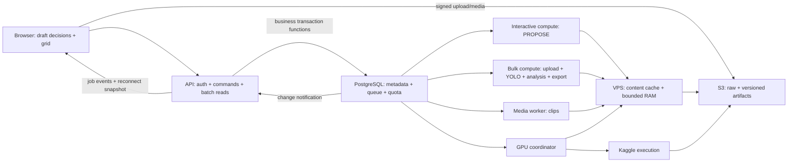

# Giải pháp kiến trúc theo từng vấn đề — đề xuất 2026-10-13

Theo yêu cầu người dùng: đánh giá lại không áp dụng giới hạn của các skill. Bản này đưa ra lựa chọn kiến trúc cụ thể,
không chỉ yêu cầu đo rồi tối ưu. Bằng chứng hiện trạng nằm ở [audit](../archived/2026-10-13/docs/backlog/ARCHITECTURE_DEPLOYMENT_REVIEW.md).
Trạng thái cập nhật #128: phần nền tảng CPU lanes/model owners trong mục 4 đã code/test tại #127, còn mixed-load/rollout.
Các phần khác vẫn là đề xuất, chưa tự sửa CONTRACTS/schema/hạ tầng hoặc deploy; trạng thái chi tiết theo [PLAN](../../PLAN.md).
Giữ mục tiêu pilot 2–3 người dùng, nhưng ranh giới dữ liệu/job/model đủ cho reference/report mở rộng.

## Kiến trúc đích đề xuất

Đây là nhóm trách nhiệm, không yêu cầu mỗi hộp một service/host. CPU lanes có thể là process trong một worker container,
nhưng cần budget/slot/accounting tường minh. PostgreSQL giữ state bền; notification/cache không thay authority.
Vị trí API/worker ưu tiên gần PostgreSQL và S3 sau xác nhận inventory/benchmark. Giữ DB/Auth managed là phương án đích ưu tiên;
tự host PostgreSQL vẫn là phương án hợp lệ khi có người vận hành/backup/restore và lợi ích được đo.

## 1. Nhiều round trips: transaction nghiệp vụ chạy trong PostgreSQL

**Lựa chọn đề xuất:** xây function SQL/PLpgSQL cho các command DB nóng: submit decisions+enqueue, claim,
publish/settle/close và receipt batch. Python xác thực input/ActorContext, tính toán ML và gọi transaction;
DB kiểm lock order, owner, CAS, idempotency, quota/receipt và ghi kết quả cùng transaction.

Worker gửi kết quả cùng usage/fence một lần vào function publish thay vì từng SELECT/UPDATE qua WAN.
Hàm DB vẫn có nhiều statement, nhưng chạy gần dữ liệu; số lần chờ client/server giảm. Mục tiêu 1 business call,
cộng protocol BEGIN/COMMIT/role setup cần thiết; không hứa toàn request chỉ một packet hoặc transaction không có lock wait.
Nhóm ghi độc lập vẫn dùng set-based SQL/UNNEST/jsonb_to_recordset/executemany/pipeline khi phù hợp.

Ưu tiên chuyển publish trước vì đã đo chậm cả PROPOSE/upload/clip/delete. Không chuyển scorer/decoder/model vào DB.
Có thể chia hook theo kind trong function hoặc DB apply phase có result type đã validate; không viết SQL dynamic từ payload.
Phiên bản function/migration và policy snapshot rõ; SECURITY INVOKER mặc định, role API/worker có quyền riêng,
REVOKE EXECUTE PUBLIC cho command private, scope owner kiểm từ actor đáng tin. Nếu cần DEFINER phải review search_path/owner/RLS kỹ.
[PostgreSQL function privileges](https://www.postgresql.org/docs/current/sql-createfunction.html).

**Đánh đổi:** nghiệp vụ persistence chuyển một phần từ Python sang SQL, migration/debug/test DB quan trọng hơn.
**Kiểm chứng:** parity kết quả/quota và transaction faults; duplicate publish/submit, CAS, lease/cancel/source đổi;
thời gian DB execution/lock wait/client wall trước-sau. Function dài giữ lock lâu vẫn phải sửa, không coi một call là đủ nhanh.

## 2. Read/write cạnh tranh: tách đường đọc và batch trả dữ liệu

**Lựa chọn đề xuất:** read queries kiểm active/owner/RLS nhưng không FOR UPDATE profile;
gom authz/session/source lookup cùng query/transaction cần thiết, tránh kiểm lại qua nhiều connection mỗi request.
Ghi khóa đúng row thay đổi (session/quota/source); audit những nơi khóa account làm mọi phiên cùng owner nối đuôi.
Không mặc định bỏ profile lock của mọi write: phải chứng minh disable/account/quota ordering còn đúng.

API media nhận lô unit IDs/variants có giới hạn, một lần kiểm quyền rồi trả READY/NOT_PREPARED/URL/expiry theo item.
Frontend dùng URL cache tới TTL và request in-flight dedup. Batch 16 không có 16 chuỗi authz/lookup riêng.
History/proposal list trả summary; detail/evidence/scores chỉ tải theo batch đang xem. Grid first render không đợi analysis/map.

**Đánh đổi:** thêm batch DTO/error semantics; client cũ cần tương thích. URL đã ký vẫn có hiệu lực tới TTL như hiện tại,
revocation tức thời cho bytes cần proxy/cơ chế storage khác, không giả DB read lock có thể thu hồi URL đã cấp.
**Kiểm chứng:** A/B/inactive/DELETE_PENDING, mixed valid-invalid IDs và giới hạn batch, lock contention test;
16/48 thumbnail cold/warm và HTTP count, không lộ S3 key/quyền khác qua cache.

## 3. Chọn mẫu và job status: command theo lô + event sau commit

Draft giữ trong bộ nhớ UI, reset khi rời/reload theo quyết định #124. Một POST submit draft + enqueue nguyên tử;
rollback giữ draft, response mất retry cùng key; worker fail/cancel sau enqueue không đảo ngược decisions đã commit.

**Lựa chọn đề xuất cho pilot:** polling đúng job là bước chuyển tiếp; đích có một stream SSE cho account/phiên,
phát phase/progress/terminal và job version. API dùng một listener PostgreSQL riêng mỗi instance,
không một DB connection cho mỗi browser; mỗi subscriber kiểm quyền, payload browser chỉ DTO sanitized.
Notify sau transaction commit, payload DB chỉ invalidation/job ID, không URL/token/evidence private.
NOTIFY không là durable queue; reconnect/event mất → GET job snapshot, worker vẫn claim queue DB và có periodic scan fallback.
Không emit per-frame DB event; coalesce progress theo thời gian/số unit. Chỉ dùng SSE khi API hosting hỗ trợ ổn định.
[PostgreSQL NOTIFY](https://www.postgresql.org/docs/current/sql-notify.html).

**Đánh đổi:** listener/reconnect/fanout cần quản lý và một dedicated session/direct connection;
SSE giảm polling/độ trễ cập nhật UI, không giảm handler/publish. Nếu load cần broker, Redis/NATS có thể làm wakeup/fanout;
business transaction vẫn DB, dispatch qua outbox khi có yêu cầu delivery bền để tránh enqueue DB thành công nhưng broker mất.
**Kiểm chứng:** một job/request/stream, duplicate/missed events, reconnect snapshot, account switch/revoke,
terminal dừng polling, listener chết không mất job và không rò connection.

## 4. Head-of-line CPU: lanes với resource budget

**Lựa chọn đề xuất:** reserve compute riêng cho PROPOSE, bulk cho upload/prepare/YOLO/analysis/export;
MEDIA riêng như đã có; GPU coordinator riêng. Host xác minh 4 vCPU/~8 GiB, live cap 3 CPU/4 GiB; cần benchmark với mỗi lane một thread trọng tâm
và tổng CPU budget tối đa host capacity, không để mỗi process dùng 3 OMP/MKL threads mặc định.
CPU-heavy GPU hydrate cũng phải lấy CPU budget, còn session GPU/provider wait không giữ CPU token không cần thiết.

Scheduler kết hợp round-robin account, priority interactive, age/weighted fairness cho bulk và pending cap.
Priority chỉ đổi job chưa chạy; tách lane mới giúp job interactive bắt đầu khi bulk đang chạy.
Bulk dài hỗ trợ checkpoint/chunk khi hợp lý, usage là tổng các chunk; không giả có thể preempt inference/decode tùy ý.
IO delete/recovery có thể chạy lane maintenance giới hạn, nhưng quota/resource ledger phải mô tả chính xác; không bypass admission.

**Đánh đổi:** thêm slot/resource schema và scheduling complexity, throughput bulk có thể giảm để giảm latency tương tác.
Nếu host không đủ RAM cho model/process đồng thời thì dùng CPU/RAM tokens chung hoặc thêm worker host gần DB,
không vượt memory cap để đạt UI SLA. Redis/Celery không tự giải quyết việc chỉ có một compute slot.
**Kiểm chứng:** 3 users, upload dài+proposal+clip+YOLO, không starvation/double claim;
process crash/lease/recovery, queue p50/p95 và peak RSS toàn cây, latency interactive và throughput bulk báo riêng.

## 5. Context/cache lặp: immutable data bundle + cache hai tầng

**Lựa chọn đề xuất:** sau prepare tạo bundle manifest theo raw SHA/spec/decoder/encoding version,
có ordered unit IDs, frame_idx/time, dimensions, sampling grid và feature/model artifact refs.
PROPOSE nhận manifest/feature hashes; hydrate metadata+embedding, không cần mở/probe/hash video lại cho tác vụ chỉ dùng vector.
Publish vẫn kiểm source resource_version và frozen context, không suy cache đúng tức source còn được phép dùng.

Tầng đĩa bền content-addressed dùng chung raw/feature/model; sau upload/GPU publish promote bytes đã validate vào cache,
tránh tải S3 ngay sau vừa tạo file. Tầng RAM per compute process giữ immutable arrays/model objects có LRU byte cap,
key gồm SHA/spec/producer/params/runtime; job state/proposals không nằm chung mutable Context cache.
Mmap/arrays format có thể hữu ích cho dataset lớn; đánh giá sau khi có manifest/parity, không đổi NPZ ngầm.
Cache manager có pin/lease local khi file đang dùng; cap có hard admission headroom + eviction, không chỉ grace khiến vượt trần vô hạn.

**Đánh đổi:** manifest contract và invalidation/version phải rõ; cache RAM/model giảm capacity có thể chạy đồng thời.
**Kiểm chứng:** same input→same picks/scores/anchor IDs, warm không tải raw/NPZ khi còn cache,
source/spec/model thay, corrupt cache recovery, oversize fallback, restart, cap/in-use eviction và owner checks.

## 6. Upload/ảnh/storage amplification: readiness theo capability và batch I/O

**Lựa chọn gần hạn:** giữ 4 fps/frame IDs nhưng encode/PUT/receipt publish batch và media batch;
thống kê exact bytes/object count và reserved/persisted. DeleteObjects theo inventory batch, đọc lỗi từng key,
check fence trước/sau I/O, xác nhận deletion theo contract; không HEAD/transaction khóa lần lượt khi có thể concurrency/batch an toàn.
S3 DeleteObjects nhận tối đa 1.000 object và trả thành công/lỗi từng object;
HTTP thành công không có nghĩa tất cả keys bị xóa. Bucket versioning cần inventory version IDs và accounting rõ,
delete marker không có nghĩa bytes cũ đã được giải phóng. [S3 API](https://docs.aws.amazon.com/AmazonS3/latest/API/API_DeleteObjects.html).

**Lựa chọn dài hạn đề xuất:** phân biệt raw validated, preview available, full frame set và features readiness.
Người dùng có thể thấy video đã nhận/validated trước khi hết prepare ảnh; nút recipe/inference dựa capability thật.
Preview có thể xuất dần; manifest completeness và pending UI rõ, không báo toàn bộ READY khi mới có một phần.
Full resolution lưu eager hoặc on-demand là policy của một version, không phải thay 4 fps theo tải ngầm.
Scene/quality/representative subset là sampling spec mới; evaluate trên tình huống mục tiêu trước chọn làm default.

JPEG preview quality 85 không dùng thay exact RGB cho model hiện tại. Nếu muốn inference luôn trên ảnh materialized,
chọn lossless canonical image hoặc công nhận JPEG preprocessing là pipeline version mới và chạy parity/quality evaluation.
**Đánh đổi:** lossless tốn storage; readiness tách giúp UX sớm hơn nhưng không làm tổng compute tự giảm;
eager full frame dễ phục vụ nhưng nhiều object, lazy tiết kiệm nhưng lần mở đầu chậm và cần durable task.
**Kiểm chứng:** availability đúng từng capability, missing frame/source đổi, data quality/ID parity,
partial PUT/delete/crash/retry không leak/double charge, video dài và IO overhead/temporary budget.

## 7. GPU bootstrap lặp: data reuse trước, workflow nhiều feature khi được chốt

GPU coordinator dùng bundle + raw cache trên VPS, không tải/probe raw lại chỉ để tạo manifest nếu metadata đã kiểm đủ.
Kaggle vẫn tải input được cấp quyền; use content hashes cho asset/result dedup và promote result vào VPS cache.
Tách startup/provider ready/download/model load/inference/transfer/stop verified trong estimate và trace.

**Hướng mở rộng:** nút explicit Chuẩn bị DINO+CLIP có thể là workflow dùng một session với bước/outputs riêng,
chia sẻ input download/decode hoặc decoded tensor batch khi RAM cho phép. Cần multi-output payload, partial success,
usage/session ownership/cancel/recovery contract, chỉ publish feature đã verify và kết thúc session theo lifecycle được chốt.
Warm session lâu dài là lựa chọn khác khi volume đủ: idle TTL/cap/budget/account ownership và stop proof rõ;
không coi session đang sống là compute free. Giữ session-per-job hiện tại là baseline an toàn để so.

**Đánh đổi:** GPU session pooling giảm cold overhead nhưng tăng idle budget và recovery complexity;
combined feature workflow hữu ích khi người dùng thực sự cần cả hai, không auto launch vì mở thư viện.
**Kiểm chứng:** DINO/CLIP thật cùng anchors/version, cold/warm, cancel lúc model load, session orphan,
partial result và budget receipt không tính startup/stop hai lần hoặc bỏ qua chi phí idle.

## 8. Observability gây tải: tách telemetry và critical accounting

**Lựa chọn đề xuất:** phase spans/progress có sampling/coalescing, batch insert/export ngoài transaction nghiệp vụ;
critical quota/storage receipts vẫn ghi bền cùng business transaction. Không dùng global advisory lock + N row insert cho mọi span.
Với pilot, JSON log rotated + bounded collector/batch summary đủ làm backend; có thể dùng OpenTelemetry SDK/exporter
và hệ thống log/trace ngoài DB nghiệp vụ khi muốn correlation/dashboard/alerts chuyên nghiệp, với cost/cap rõ.
Metadata heartbeat theo host/process/queue, không để các process ghi đè lẫn nhau thành healthy giả.

**Đánh đổi:** tách telemetry có thể mất span khi collector crash; đây phải là best-effort có dropped/error metrics,
không áp dụng cho usage/object audit bắt buộc. Bản metric/log không là authority quota.
**Kiểm chứng:** trace on/off performance A/B trong test, DB collector load/flush wait, retention,
secret filtering, event drops, một process chết còn lại sống và operator status đúng.

## 9. Placement, capacity và ETA: một deployment profile có số đo

**Đích ưu tiên:** API/CPU worker gần PostgreSQL, S3 region thuận cho worker/GPU; browser vẫn direct S3.
Giữ Supabase managed và chọn worker/API location phù hợp trước cân nhắc tự vận hành DB.
Compare placement ở candidate, vì SELECT 1 wall 261 ms đã đo nhưng chưa biết phần provider/network/server riêng.
DB function batching giảm số lượt; placement giảm giá mỗi lượt. Hai hướng bổ sung nhau.

Render always-on hoặc API riêng trên VPS đều là lựa chọn hợp lệ nếu cần tương tác ổn định.
Render Free có spin-down sau 15 phút không traffic, nên warm/cold phải là hai nhóm số đo và keepalive không là SLA.
[Render Free](https://render.com/docs/free). API cùng VPS cần CPU/RAM isolation và TLS/backup/uptime responsibility;
không vì gom host mà nạp model vào process API hoặc public worker endpoint.

Estimator gồm các phase: fixed bootstrap/admission/DB, unit/pixel/byte dependent work, queue predicted range,
cache state và concurrency. CPU/GPU quota dựa receipt thực, ETA wall riêng với confidence/range và estimator version.
Input envelope/quota policy giữ per-kind measurements + headroom; tổng connections tính cả workers/listener/rollout/operator,
không tăng pool riêng lẻ vượt DB capacity. Đo request/egress/object/storage trước tính tiền theo region/rate ngày xác minh.

**Kiểm chứng:** matrix 21–30 s/5 min, 720p/1080p, 1/3 account, cold/warm, queue mixtures;
pool wait/CPU/RSS/temp/disk/network, estimate versus actual. Mục tiêu tương tác đề xuất không SLA đã chốt:
warm API read p95 <1 s, cached proposal click→batch p50 <5 s/p95 <10 s trong pool chuẩn, publish nhẹ p50 <2 s.
Đây là mục tiêu cao hơn plan audit ban đầu để định hướng architecture; phải báo kết quả và bottleneck nếu không đạt.

## 10. Reference/model/report và release: versioned lineage + workflow

DatasetVersion = manifest sources/units/labels/class map/split/hashes/provenance/feature refs;
ModelVersion = checkpoint SHA/runtime/task/classes/training lineage/inference verification;
SessionBinding = pinned reference versions/model/recipe configs. Bronze/Silver/Gold là state/lineage, không ba bộ copy bytes.
Payload job freeze binding/hash, artifact result key theo input+algorithm version và ordered anchors.
Catalog/binding API tái dùng store hiện có nhưng cho phép schema mới khi data model yêu cầu, không ép vào bảng sai nghĩa để tránh migration.

Reference novelty: score candidate pool so reference + kept. Model-guided: shortlist theo embedding/text rồi bounded inference,
original/flip hoặc disagreement signal theo recipe/version. Không yêu cầu YOLO toàn video mỗi vòng nếu không có budget.
Inference/report là job phụ thuộc proposal/binding, manual mặc định hoặc auto opt-in; model/report lỗi không mất proposal.
Dependency trạng thái/partial retry/dedup dùng workflow metadata bền; không nối nhiều HTTP calls frontend để điều phối nghiệp vụ.

Report gồm curation evidence/predictions/quality/provenance; accuracy/mAP chỉ khi GT và evaluation split hợp lệ.
Export dùng frozen snapshot, PII derivatives + evidence/confirmation payload hash, preview/report images cũng qua gate.
Vòng learning: export→label ngoài→dataset version có nhãn→train ngoài→model version→held-out eval→binding phiên mới.

Release profile pin source, image, schema/functions, payload, policy, model/runtime. Compatibility matrix và contract tests
trước deploy, migration expand/contract, source/payload version support trong chuyển tiếp, drain/admission window khi cần.
Restore DB+artifact mapping drill và rollback trên data mới; backup tồn tại chưa là restore verified.
**Kiểm chứng:** owner/version/provenance, missing feature/model, bounded inference, deterministic IDs/scores,
invalidation/binding change, dependency retries, PII/GT gates, compatibility and restore on isolated environment.

## Thứ tự và quyết định cần chốt

1. Chốt business transaction functions + read path + draft/batch submit; ưu tiên giảm publish hiện có.
2. Resource-separated scheduling, data bundles và cache prepare→consume; benchmark toàn pipeline, không chỉ proposal.
3. Batch media/delete/telemetry và events; polling đúng job là fallback khi SSE chưa ready.
4. Placement/capacity/ETA và release profile, cùng phép đo 3 users/cold/warm/restore.
5. Reference/model lineage và dependency workflow cho inference/report/export, rồi sampling/learning loop.

Redis/broker, vector index/FAISS, image pack/shard, distributed cache, GPU warm pool hay tự host DB đều là lựa chọn có thể dùng;
chốt theo mục tiêu/volume/operations và benchmark. Không hạn chế bởi skill, cũng không coi nhiều thành phần tự tạo tốc độ.
Trước code phải đưa lựa chọn được duyệt vào CONTRACTS/architecture/UI. Chưa có deployment authorization cho topology mới.
